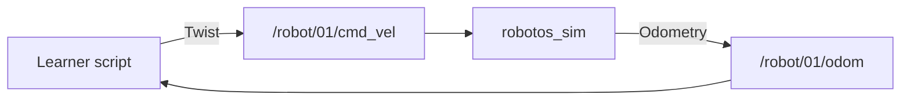
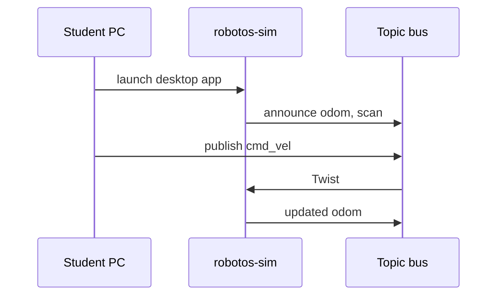

# Ebook & student-doc style guide

**Audience:** undergraduate robotics / middleware workshop readers who will
also receive a polished online ebook.  
**Languages:** English primary; Thai glosses optional in callouts.  
**Tone:** precise, encouraging, never condescending; explain jargon once.

## Repository map

| Location | Role |
|----------|------|
| `SETUP.md` | Fast path for class day (must stay accurate; link into ebook Ch.0) |
| `docs/theory/*` | Instructor short lecture cards — index [`docs/theory/README.md`](../theory/README.md); depth lives in ebook chapters |
| `docs/ebook/chapters/` | **Canonical student chapters** (ebook source) |
| `labs/{mw,wh,hw}/*/README.md` | Lab procedure (ebook “Lab sheets”); must meet quality bar |
| `docs/ebook/reviews/` | Persona review artifacts |

## Chapter template

Every file under `docs/ebook/chapters/` follows this outline:

```markdown
# Chapter N — Title

## Learning outcomes
## Prerequisites
## 1. Motivation / story
## 2. Theory (detailed)
## 3. Architecture (block diagram)
## 4. Interaction (sequence diagram)
## 5. Hands-on — Windows (PowerShell)
## 6. Hands-on — Linux / macOS (bash)
## 7. Code walkthrough (line-by-line for starters)
## 8. Expected results
## 9. Troubleshooting
## 10. Check yourself
## Glossary (this chapter)
## Further reading / next chapter
```

## Diagrams

Prefer **Mermaid** (renders on GitHub and most ebook pipelines):





Also keep a monospace ASCII fallback when helpful for print/PDF.

## OS forks

Never mix shells in one fence. Label fences:

- `powershell` for Windows
- `bash` for Linux and macOS (note Apple Silicon path folder names)

Call out OS-only steps in admonitions:

> **Windows only:** if activation fails with ExecutionPolicy…

> **macOS only:** System Settings → Privacy → allow `robotos-sim`…

> **Linux only:** `sudo usermod -aG dialout $USER` then re-login for serial.

## Code walkthrough rules

- Quote the real starter path (`labs/wh/wh-01-drive-twist/starter/drive_forward.py`).
- Explain **why** each block exists (rate loop, zero Twist on exit, schema import).
- Show a **minimal successful transcript** (5–15 lines of terminal output).

## Length targets (ebook)

| Piece | Target |
|-------|--------|
| Concept chapter | 1_500–3_500 words |
| Lab sheet | 800–2_000 words |
| SETUP / Ch.0 | as long as needed for zero-to-running |

Short instructor bullets alone are insufficient.

## Publishing later

Chapters are written so a static site or Pandoc ebook can concatenate
`docs/ebook/chapters/*.md` + lab sheets. Avoid absolute local paths in
prose; use pack-relative paths (`code/…`, `labs/…`).
