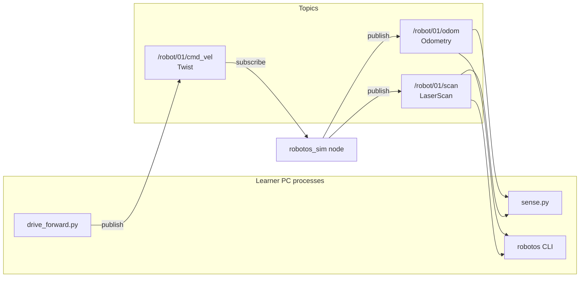
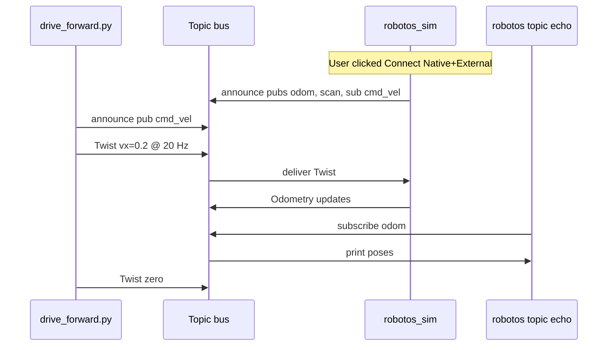

# Chapter 1 — Graph, nodes, and topics

## Learning outcomes

You can explain, in your own words:

- What a **node** is vs a **topic**  
- Why message **schemas** matter  
- How discovery (`topic list`) relates to “is anyone there?”  
- Why the warehouse teaching contract uses fixed names under `/robot/01/`  

## Prerequisites

- Chapter 0 complete (`robotos version` works)  
- Optional: warehouse sim running for the hands-on section  

---

## 1. Motivation / story

Imagine three classmates each writing a program:

- One **drives** the robot (publishes velocity commands)  
- One **logs** position (subscribes to odometry)  
- One **draws** a map (subscribes to laser scans)  

They should not hard-code each other’s IP ports or call each other’s functions. Instead they agree on **names** and **message shapes**. That agreement is the **graph**.

robotos (like ROS-style systems) implements that idea with:

- **Nodes** — running programs  
- **Topics** — named buses for streaming data  
- **Schemas** — protobuf types so bytes are meaningful  

---

## 2. Theory (detailed)

### 2.1 The graph is not one process

A common beginner mistake: “the simulator *is* the whole system.”  
In WH labs the desktop sim is **one node** (`robotos_sim`). Your Python script is **another**. The CLI (`robotos topic echo`) can be a **third**.

They meet on a shared transport (Zenoh under the hood). You rarely configure Zenoh by hand in this workshop: multicast peer mode on the lab LAN, or `ROBOTOS_CONNECT` when a bridge listens on TCP.

### 2.2 Topics are contracts

Example contract (warehouse P0):

| Topic | Who publishes | Who typically subscribes | Schema |
|-------|---------------|--------------------------|--------|
| `/robot/01/cmd_vel` | Your controller | Sim (or robot) | `robotos.geometry.v1.Twist` |
| `/robot/01/odom` | Sim / robot | Your controller / logger | `robotos.nav.v1.Odometry` |
| `/robot/01/scan` | Sim / robot | Avoidance / mapping | `robotos.sensor.v1.LaserScan` |

**Direction is convention:** commands *in* toward the robot, sensors *out* toward learners. The middleware will not stop you from publishing on `odom` — but you would break the teaching contract and confuse every other node.

### 2.3 Schemas (protobuf)

A topic carries **bytes**. Without a schema, subscribers cannot know whether those bytes are a Twist or a JPEG. In Python starters you see:

```python
from robotos.messages.robotos.geometry.v1.geometry_pb2 import Twist
pub = node.create_publisher("/robot/01/cmd_vel", Twist)
```

That second argument ties the topic to a type. CLI `topic list` shows the schema column so you can verify the contract at runtime.

### 2.4 Discovery vs data

- **Discovery:** “Who announced what?” → `robotos topic list`, `robotos node list`  
- **Data:** “What values are flowing?” → `robotos topic echo …`, your subscriber callbacks  

Empty `topic list` does **not** mean robotos is broken. It usually means **no node has joined** (sim not connected, wrong env, bridge down).

### 2.5 Native vs Mock (warehouse UI)

| Mode | Meaning for graded labs |
|------|-------------------------|
| **Native + External** | Real graph; your scripts may drive the robot |
| **Manual** | Operator owns motion; your `cmd_vel` is ignored for motion |
| **Mock** | UI fakes a learner — **not** for graded graph work |

Workshop rule: graded WH work uses the **real graph** (Native), not Mock.

---

## 3. Architecture (block diagram)



ASCII fallback:

```text
[drive_forward.py] --Twist--> /robot/01/cmd_vel --> [robotos_sim]
[robotos_sim] --Odometry--> /robot/01/odom ------> [sense.py / CLI]
[robotos_sim] --LaserScan--> /robot/01/scan -----> [sense.py / CLI]
```

---

## 4. Interaction (sequence diagram)



---

## 5. Hands-on — Windows (PowerShell)

Assumes Chapter 0 PATH + venv + sim connected (or `scripts\start-here.cmd` already done).

```powershell
cd YOUR_WORKSHOP_DIR
$env:PATH = "$PWD\code\robotos-v0.3.0-windows-x64\bin;$env:PATH"
.\.venv\Scripts\Activate.ps1

robotos topic list
robotos topic echo /robot/01/odom --count 3
scripts\run.cmd wh-01
# or: python .\labs\wh\wh-01-drive-twist\starter\drive_forward.py
```

Watch the sim: the robot should move, then stop.

---

## 6. Hands-on — macOS Apple Silicon (zsh or bash)

`YOUR_WORKSHOP_DIR` is the folder that contains `SETUP.md`. Paste the whole block.

```bash
cd YOUR_WORKSHOP_DIR
export PATH="$PWD/code/robotos-v0.3.0-macos-arm64/bin:$PATH"
source .venv/bin/activate
robotos topic list
robotos topic echo /robot/01/odom --count 3
./scripts/run wh-01
```

---

## 6b. Hands-on — Linux (bash)

Only if `code/robotos-v0.3.0-linux-x64` is in your drop.

```bash
cd YOUR_WORKSHOP_DIR
export PATH="$PWD/code/robotos-v0.3.0-linux-x64/bin:$PATH"
source .venv/bin/activate
robotos topic list
robotos topic echo /robot/01/odom --count 3
./scripts/run wh-01
```

---

## 7. Code walkthrough — publishing a Twist

File: `labs/wh/wh-01-drive-twist/starter/drive_forward.py`

```python
with robotos.Node("lab01_drive") as node:
    pub = node.create_publisher(TOPIC, Twist)
    settle()  # labs.common — discovery pause
    msg = make_twist(vx=args.vx, wz=args.wz)
    for _i in range(n):          # teaching loop stays in the starter
        pub.publish(msg)
        time.sleep(period)
    pub.publish(zero_twist())
```

| Line / idea | Explanation |
|-------------|-------------|
| `Node("lab01_drive")` | Creates a session on the mesh; name appears in `node list` |
| `create_publisher` | Declares intent + schema; other nodes can discover you |
| `settle()` | Brief wait so discovery can propagate (`labs.common`; do not edit that package) |
| `make_twist(...)` | Fill only the fields you need; others default |
| Timed loop | **Streaming** command — matches real teleop / control (stays in starter) |
| `zero_twist()` | Safety stop; do not leave a non-zero last command hanging |

Middleware MW-01 uses a different topic (`/machine/01/sensor/imu`) on purpose: you practice the **same pattern** without needing the warehouse sim.

---

## 8. Expected results

- `topic list` shows non-zero PUBS or SUBS on the three `/robot/01/*` topics when the sim is connected.  
- `topic echo /robot/01/odom --count 3` prints three odometry messages.  
- After `drive_forward.py`, the sim robot has translated roughly \(0.2\,\mathrm{m/s} \times 5\,\mathrm{s} \approx 1\,\mathrm{m}\) (open-loop; walls may intervene).  

---

## 9. Troubleshooting

| Symptom | Fix |
|---------|-----|
| Empty topic list | Connect sim; unset HW-only `ROBOTOS_LISTEN` if leftover |
| Echo hangs | No publisher yet — start sim or check topic name spelling |
| Drive runs but no motion | External+Native; not Manual; publish rate |
| ImportError on `geometry_pb2` | Reinstall the pack wheel matching your OS |

---

## 10. Check yourself

1. If the sim is Manual, should student publishes move the robot? Why?  
2. What does a PUBS count of `1` on `/robot/01/odom` tell you?  
3. Why is the schema column in `topic list` useful?  
4. Name one difference between MW-01’s IMU topic and WH `cmd_vel`.  

## Glossary

| Term | Meaning |
|------|---------|
| Graph | Set of nodes + topics (+ services/actions later) |
| Publish | Send messages on a topic |
| Subscribe | Receive messages on a topic |
| Schema / protobuf | Agreed binary layout for a message type |
| Discovery | Announcing and finding pubs/subs without hard-coded peers |
| Teaching contract | Fixed topic names/schemas for this workshop (P0) |

## Further reading

- Contract detail: [`docs/p0-contract.md`](../../p0-contract.md)  
- Instructor short notes (legacy): [`docs/theory/01-graph-topics.md`](../../theory/01-graph-topics.md)  
- Next labs: [`labs/wh/wh-00-hello-graph`](../../../labs/wh/wh-00-hello-graph/), [`labs/mw/mw-01-pub-sub`](../../../labs/mw/mw-01-pub-sub/)  
- Next chapter (planned): Twist & control ownership  
