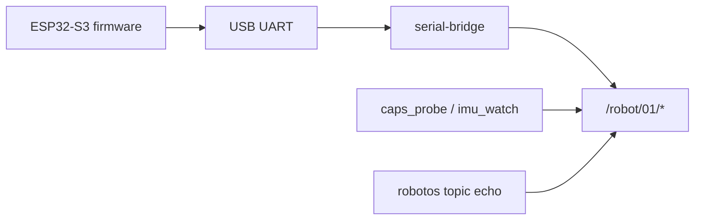
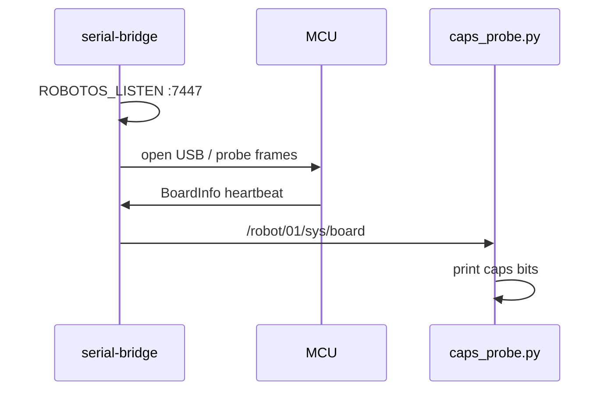

# Chapter 4 — ESP32-S3 board on the graph

## Learning outcomes

- Explain host ↔ `serial-bridge` ↔ MCU as three pieces on one mesh  
- Set `ROBOTOS_LISTEN` (bridge) vs `ROBOTOS_CONNECT` (labs) correctly  
- Run HW-00 / HW-01 and interpret `caps` bits before commanding actuators  

## Prerequisites

- Chapters 0–1 (graph vocabulary)  
- Pack with `serial-bridge` in `code/robotos-v*/bin/`  
- Preflashed workshop board + USB  

## 1. Motivation

Middleware ideas (pub/sub, params, bags) become tangible when the publisher is **silicon**. The board is not a special side channel — it is another **node** speaking the same topic contracts under `/robot/01/…`.

## 2. Theory

### 2.1 Roles

| Process | Role |
|---------|------|
| MCU firmware | Sense / actuate; UART framing to host |
| `serial-bridge` | USB serial ↔ robotos graph; often **listens** TCP `:7447` |
| Your CLI / Python | **Connect** to that listener; echo / subscribe / publish |

Do **not** set both `ROBOTOS_LISTEN` and `ROBOTOS_CONNECT` to the same endpoint in one process — you can create a self-connect mess. Bridge listens; student tools connect.

### 2.2 Two board SKUs + capabilities (`caps`)

This workshop supports **two** ESP32-S3 products. Firmware bins ship in-pack
under [`fw/`](../../../fw/) (students usually get a preflashed board; reflash
with **esptool** — see [`fw/README.md`](../../../fw/README.md)):

| `hw_model` | Prebuilt | Typical `caps` | Has |
|------------|----------|----------------|-----|
| **`es3c28p`** | `fw/es3c28p/` | `≈ 0x33` | LED + mic (+ keys/batt) |
| **`ws28p`** | `fw/ws28p/` | `≈ 0x3c` | IMU + RTC (+ keys/batt; **no** LED/mic) |

`BoardInfo.caps` is a bitfield — always probe with HW-01 before actuator labs:

| Bit | Name | Example lab |
|-----|------|-------------|
| `0x01` | LED | HW-03 `led_fx` (`es3c28p`) |
| `0x02` | MIC | stretch / `mic_dump` (`es3c28p`) |
| `0x04` | IMU | HW-02 `imu_watch` (`ws28p`) |
| `0x08` | RTC | time sync (`ws28p`) |
| `0x10` | BATT | HW-02 `board_watch` (both) |
| `0x20` | BTN | HW-05 touch/keys (both) |

Track index: [`labs/hw/README.md`](../../../labs/hw/README.md).

### 2.3 Read vs command

- **Read** — subscribe (`/robot/01/sensor/imu`, `/robot/01/sys/board`, …)  
- **Command** — publish actuator topics; bridge needs `--cmd-topic all` for LED/wave/params  

## 3. Architecture



## 4. Sequence



## 5–6. Hands-on

- [`labs/hw/hw-00-board-connect/README.md`](../../../labs/hw/hw-00-board-connect/README.md)  
- [`labs/hw/hw-01-caps-probe/README.md`](../../../labs/hw/hw-01-caps-probe/README.md)  
- Pack NOTES section B / B2  

## 7. Code walkthrough — `caps_probe.py`

| Piece | Role |
|-------|------|
| Subscribe `BoardInfo` on `/robot/01/sys/board` | Same schema the CLI echoes |
| `wait_for_message(sub, 15)` | Waits for the next sparse BoardInfo (`labs.common.wait`) |
| `CAPS_BITS` + `info.caps & bit` | Table in `labs.common.caps`; **yes/no print loop stays in starter** |
| Print `hw_model` / `fw_version` | Confirm you are talking to the expected firmware |

## 8. Expected results

```text
waiting for /robot/01/sys/board ...
hw_model=ws28p uuid=… fw=robotos-fw/0.3.0 caps=0x3c
  [no ] LED  -> led_fx
  [yes] IMU  -> imu_watch
  …
```

## 9. Troubleshooting

| Symptom | Fix |
|---------|-----|
| Empty `topic list` | Bridge not running; wrong `ROBOTOS_CONNECT`; USB unplugged |
| `Permission denied` (Linux) | `dialout` group + re-login |
| Auto port finds nothing | Close other serial apps; `--port COMx` / `/dev/ttyACM0` |
| Caps timeout | Firmware not workshop build; bridge baud 921600 |
| LED lab no-op | Caps has no LED — expected on some variants |

## 10. Check yourself

1. Why empty `topic list` with a powered board?  
2. Who should set `ROBOTOS_LISTEN` — bridge or lab script?  
3. What does `caps & 0x04` tell you?

## Glossary

| Term | Meaning |
|------|---------|
| serial-bridge | Host tool bridging USB UART ↔ robotos topics |
| BoardInfo | Status message including `caps` |
| caps | Bitmask of peripherals present |

## Next

- HW-02 read sensors; HW-03 actuators (if caps allow)  
- Future: board IMU → sim 3D (BACKLOG P3)  
