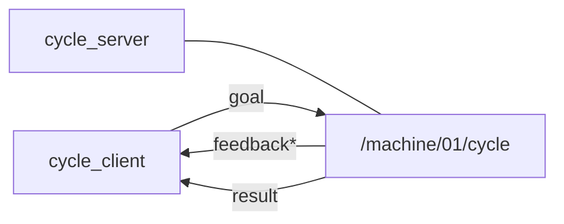
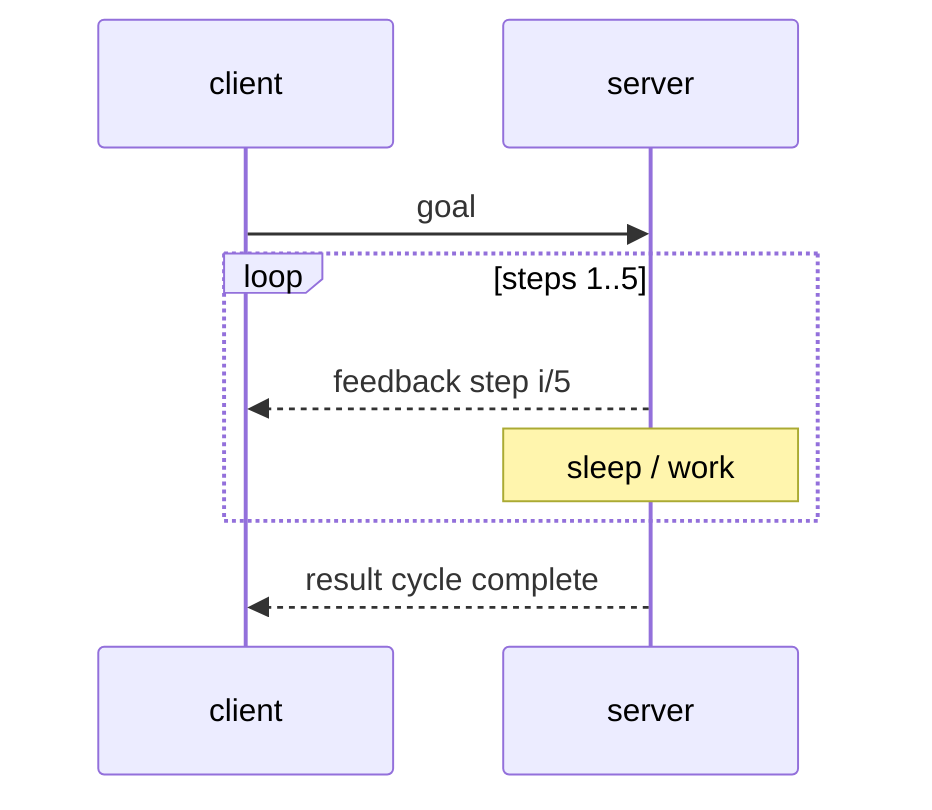

# Chapter 7 — Actions (long-running goals)

## Learning outcomes

- Contrast topic / service / action  
- Run a cycle action server and client; read feedback then result  
- Explain cancel and why warehouse drive stays on a **topic**  

## Prerequisites

- MW-02 / Chapter 6  

## 1. Motivation

A service blocks until one reply. A five-step machine cycle needs **progress** and maybe **cancel**. That shape is an **action**: goal → feedback* → result.

## 2. Theory

| Piece | Role |
|-------|------|
| Goal | What to do (`EchoRequest` in the toy lab) |
| Feedback | Intermediate updates (`step i/5`) |
| Result | Final outcome (`cycle complete` / `aborted`) |
| Cancel | Client asks server to stop early |

`send_goal` / create returns quickly; work continues asynchronously. Warehouse P0 **drive** remains `cmd_vel` (a stream). Actions appear for dock, map, batch jobs.

## 3. Architecture

## 4. Sequence

## 5–6. Hands-on

[`labs/mw/mw-03-actions/README.md`](../../../labs/mw/mw-03-actions/README.md)

## 7. Code walkthrough

Server handler: loop with `ctx.cancel_requested()`, `ctx.send_feedback(...)`, return final `EchoResponse`.  
Client: send goal, print feedback, wait for result (see starter).

## 8. Expected output

Multiple `step i/5` lines, then `cycle complete`.

## 9. Troubleshooting

| Symptom | Fix |
|---------|-----|
| No feedback | Server not running; wrong action name |
| Hangs forever | Check cancel path / server crash |
| Schema import error | Pack wheel |

## 10. Check yourself

Topic vs service vs action — one factory-floor example each.

## Glossary

| Term | Meaning |
|------|---------|
| Goal | Action start request |
| Feedback | Progress messages during execution |
| Cancel | Request to abort before result |

## Next

- MW-04 parameters  
- Theory: [`docs/theory/09-actions.md`](../../theory/09-actions.md)  
