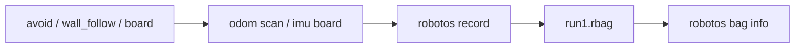
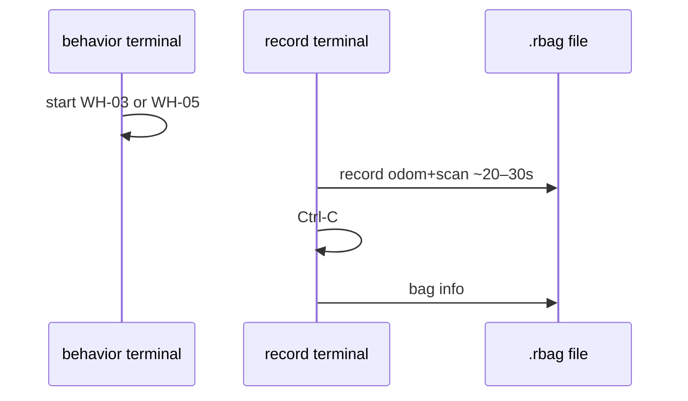

# Chapter 9 — Bags & evidence

## Learning outcomes

- Record selected topics to a `.rbag` while a behavior runs  
- Inspect with `robotos bag info`  
- Choose **minimum** topics that prove a claim  
- Apply the same idea on the **board** (HW-06)  

## Prerequisites

- WH-03 or WH-05 runnable; or HW-00 streaming  

## 1. Motivation

“It worked on my machine” is not evidence. A bag is a time-ordered recording of messages you can reopen later for grading and debugging.

## 2. Theory

| Idea | Detail |
|------|--------|
| Bag | Time-ordered messages on chosen topics |
| Why | Reproduce, grade, debug |
| What | Minimum topics that prove the claim — not everything |
| Replay | Not identical to live (clocks, Reset, Connect still matter) |

**Capstone culture:** pass = task + survival + artifact (`bag info` or transition log). A failed run with a clear log can teach more than a silent “lucky” success. Viewport screenshots alone are weak for wall-follow (no range proof).

## 3. Architecture



## 4. Sequence



## 5–6. Hands-on

- Warehouse: [`labs/wh/wh-07-record-bag/README.md`](../../../labs/wh/wh-07-record-bag/README.md)  
- Board: [`labs/hw/hw-06-record-board/README.md`](../../../labs/hw/hw-06-record-board/README.md)  

## 7. Commands (shape)

```text
robotos record -o run1.rbag /robot/01/odom /robot/01/scan
robotos bag info run1.rbag
```

Exact flags: `robotos --help` / pack `NOTES.txt`.

## 8. Expected results

`bag info` shows topics, duration, non-zero message counts.

## 9. Troubleshooting

| Symptom | Fix |
|---------|-----|
| Empty bag | Nothing publishing; wrong topic names |
| Only odom, no scan | You omitted scan — weak for wall-follow grading |
| HW bag empty | Bridge down; pick topics your caps actually publish |

## 10. Check yourself

1. Bag has odom but no scan — can you grade wall-follow well?  
2. When is a viewport screenshot *not* enough?

## Glossary

| Term | Meaning |
|------|---------|
| Bag / rbag | Recorded topic stream file |
| Evidence | Artifact that supports a lab claim |

## Next

- WH-08 capstone rubric  
- Theory: [`docs/theory/06-bags-evidence.md`](../../theory/06-bags-evidence.md)  
