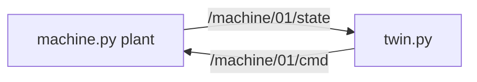
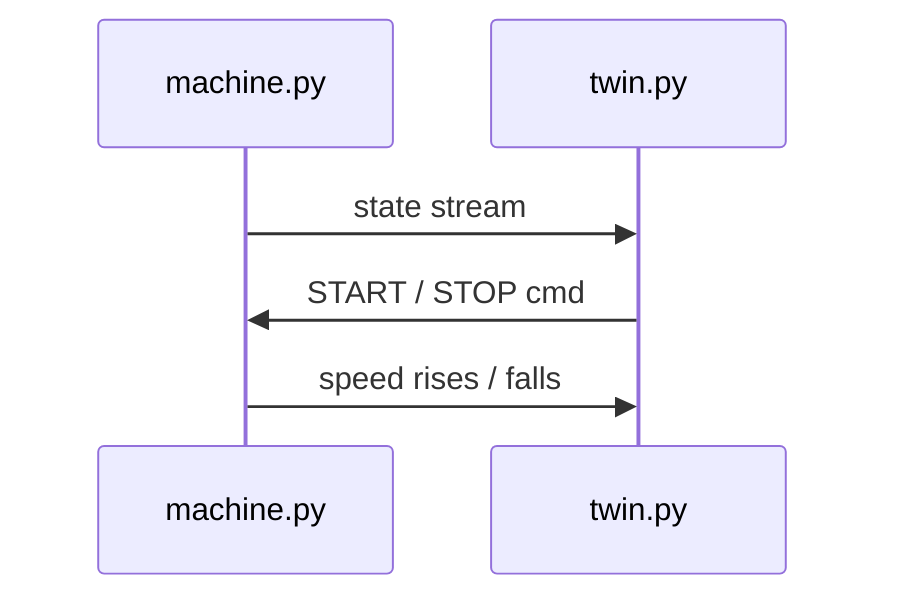

# Chapter 11 — Digital twin on the middleware

## Learning outcomes

- Define a twin as a consumer/commander on the **same** topics as the plant  
- Run the mini twin (machine + twin processes)  
- Connect the idea to warehouse `robotos-sim` and future board↔sim fusion  

## Prerequisites

- MW-01 pub/sub; Chapter 9 bags helpful  

## 1. Motivation

Before risking hardware (or a graded WH run), exercise logic against a **stand-in plant** that speaks the same contracts.

## 2. Theory

| Idea | Detail |
|------|--------|
| Twin | Uses the **same** topic/service names as the plant |
| Safe test | Replay bags into the twin before silicon |
| Scales | MW-06 = laptop mini-twin; WH sim = 3D twin; P3 = board+sim fusion |

If the twin invents different topic names, you built a **second system**, not a twin.

## 3. Architecture

## 4. Sequence

## 5–6. Hands-on

[`labs/mw/mw-06-mini-twin/README.md`](../../../labs/mw/mw-06-mini-twin/README.md)

## 7. Notes

Starters may use Imu as a simple stand-in payload for cmd/state — the lesson is the **pattern**, not IMU physics.

## 8. Expected results

Twin prints rising/falling “speed” after START/STOP.

## 9. Troubleshooting

| Symptom | Fix |
|---------|-----|
| Twin silent | Machine not running; topic names |
| No effect on START | Cmd topic mismatch |

## 10. Check yourself

If the twin uses different topic names than the robot, what did you build?

## Glossary

| Term | Meaning |
|------|---------|
| Plant | Real or simulated process being mirrored |
| Twin | Graph citizen sharing the plant’s contracts |

## Next

- Warehouse WH track as 3D twin  
- Future P3: board IMU → sim scene  
- Theory: [`docs/theory/13-digital-twin.md`](../../theory/13-digital-twin.md)  
