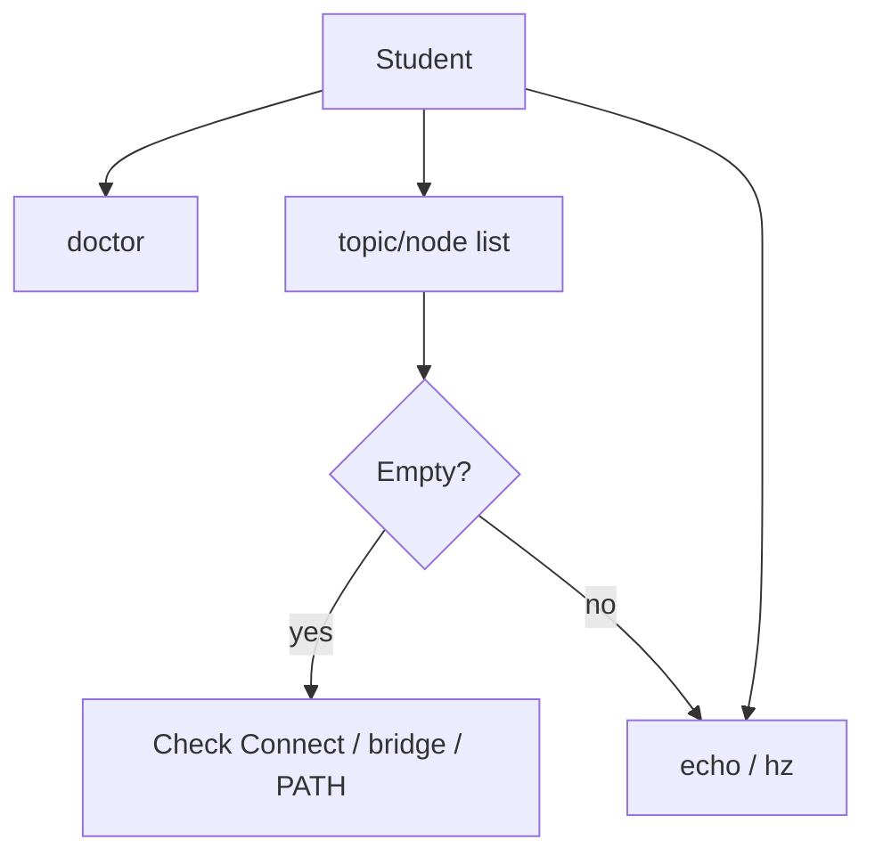
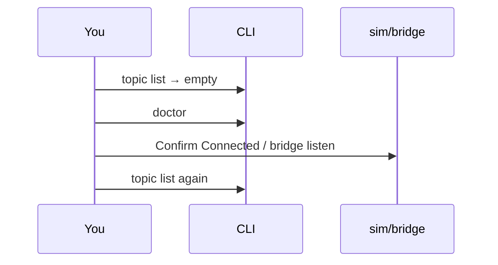

# Chapter 12 — Observe, debug & QoS

## Learning outcomes

- Use `node list` / `topic list` / `echo` / `hz` / `doctor` before blaming the network  
- Interpret empty lists as “nobody Connected,” not “middleware dead”  
- Explain why sensors and commands may want different reliability/depth  
- Relate cmd_vel **timeout** to control-loop determinism  

## Prerequisites

- Chapters 0–1; MW-00 practiced  

## 1. Motivation

Most “Zenoh is broken” tickets are actually: wrong PATH, sim not Connected, leftover `ROBOTOS_LISTEN`, or schema mismatch. **Observe first.**

## 2. Theory

### 2.1 Observe toolkit

| Tool | Question it answers |
|------|---------------------|
| `robotos doctor` | Transport / env sanity |
| `robotos node list` | Who joined? |
| `robotos topic list` | What is announced (pubs/subs/schema)? |
| `robotos topic echo` | What values flow? |
| `robotos topic hz` | How fast? |

Schema mismatch ⇒ messages may be **skipped** — watch echo counters when available.

### 2.2 QoS (concept)

Quality of Service trades **reliability**, **history depth**, and **latency**.

| Kind of data | Typical wish |
|--------------|--------------|
| Sensors | Prefer fresh samples; dropping old OK |
| Commands | Prefer delivery; loss hurts control |
| Logs | Can buffer; less urgent |

Packs may expose presets (`sensor|control|state|logging`) on some CLI paths — see `--help`. Exact knobs vary by version; the **idea** matters more than memorizing enums on day one.

**Cousin of QoS:** warehouse **500 ms cmd_vel timeout** — if commands are not steady, the plant fails safe to stop.

## 3. Architecture



## 4. Sequence (debug empty graph)



## 5–6. Hands-on

MW-00 + SETUP smoke. Optional: `robotos topic hz /robot/01/odom` with sim running.

### Windows (PowerShell)

```powershell
robotos doctor
robotos topic list
robotos topic echo /robot/01/odom --count 3
```

### Linux / macOS (bash)

```bash
robotos doctor
robotos topic list
robotos topic echo /robot/01/odom --count 3
```

## 7–8. Expected / walkthrough

`doctor` prints peer mode / listen/connect. With sim up, `topic list` shows `/robot/01/*`.

## 9. Troubleshooting

| Symptom | Fix |
|---------|-----|
| Empty list | Connect sim/bridge; clear conflicting env |
| Echo skips | Schema mismatch / wrong type expectation |
| Jerky robot | Rate vs timeout (Ch.2 / Ch.5) |

## 10. Check yourself

Name two tools you’d use before blaming Zenoh.

## Glossary

| Term | Meaning |
|------|---------|
| QoS | Reliability/history/latency policy for a link |
| Discovery | Announcing nodes/topics on the mesh |

## Next

- Chapter 13 — frames / TF  
- Theory: [`docs/theory/11-observe-qos.md`](../../theory/11-observe-qos.md)  
