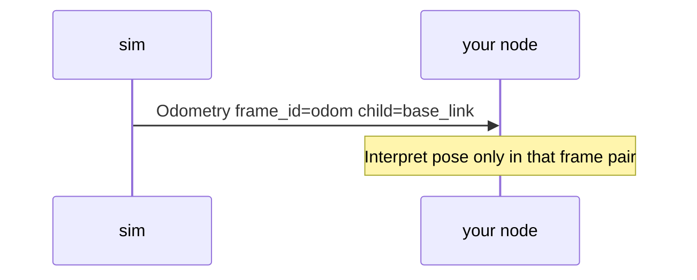

# Chapter 13 — Frames & TF (concept)

## Learning outcomes

- State why a pose needs a **frame_id**  
- Sketch `map → odom → base_link → sensor`  
- Read `frame_id` / `child_frame_id` on warehouse odom  
- Avoid mixing frames silently  

## Prerequisites

- Chapter 3 (odometry)  

## 1. Motivation

“x = 3.0” is useless for docking unless everyone agrees **which origin and axes** that `x` lives in.

## 2. Theory

| Term | Meaning |
|------|---------|
| Frame | Named coordinate system (`odom`, `base_link`, `map`) |
| `frame_id` | Frame a quantity is expressed in |
| TF | Tree of transforms between frames over time |

Warehouse **P0** does not require you to run a full TF publisher lab. Odometry messages already carry frame fields — treat them as a contract hint. A full TF tree is a later course topic.

Classic chain:

```text
map → odom → base_link → sensor_link
```

Mixing frames (e.g. treating `odom` meters as `map` meters without a transform) produces silent geometry bugs.

## 3. Architecture


## 4. Sequence (mental model)



## 5–6. Hands-on (discussion + WH-02)

While running WH-02, print or echo odom and note any `frame_id` fields your tooling shows. No separate TF binary lab in this pack.

## 7–8. Expected insight

You can answer: “This pose is in the `odom` frame relative to `base_link` (or as the message states), not GPS.”

## 9. Troubleshooting

| Symptom | Fix |
|---------|-----|
| Path looks rotated vs viewport | Wrong yaw/frame assumption |
| “Dock at x=3” fails in class | Instructor meant a **map** mark — ask which frame |

## 10. Check yourself

Is “x=3.0” enough to dock? Why?

## Glossary

| Term | Meaning |
|------|---------|
| `odom` frame | Local integrated pose frame |
| `map` frame | World/map frame (later) |
| TF | Transform tree between frames |

## Next

- Capstone WH-08 with honest frame talk in your note  
- Theory: [`docs/theory/12-tf-frames.md`](../../theory/12-tf-frames.md)  
- Future: dedicated TF publisher lab (lab-outline “out of pack”)  
