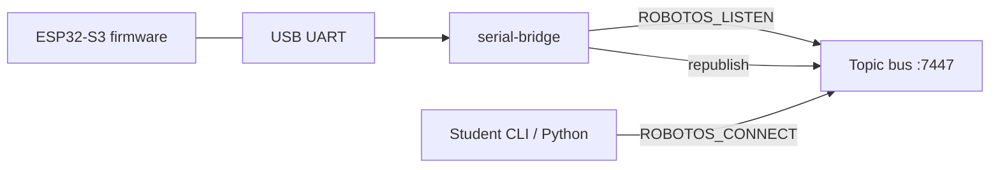

# Persona review — Aisha (`linux-advanced`) — 2026-11-02

**Persona:** Ubuntu 24.04 daily CLI user; reads man pages; expects precise package names, `dialout`/`udev`, executable bits, exact wheel filename.  
**Scope:** `SETUP.md` (Linux), `code/NOTES.txt` §B, `labs/hw/hw-00`…`hw-02`, theory `14` / `10` / `06`, `packs/LAYOUT.md`, `README.md`, PowerShell/COM assumptions.  
**Verdict:** **Fail for unsupervised Linux HW + ebook depth.** I can invent the bash myself, but the shipped student path is Windows-first; silent serial failures and missing `chmod`/`dialout` are my panic triggers. Do not ship a Linux class drop with the current NOTES/HW sheets as-is.

---

## 1. Stuck points

Ranked **Blocker / Confusing / Nice-to-have**. Quotes are exact where useful.

### Blocker

| # | Quote / locus | File | Why Aisha stuck |
|---|---------------|------|-----------------|
| B1 | Entire §B is `$env:…`, `COM7`, `serial-bridge.exe`, `Get-CimInstance Win32_SerialPort` | `code/NOTES.txt` | Shipped NOTES is **windows-x64 only**. Coverage matrix says Aisha must run HW-00/01; I have no copy-paste for `/dev/ttyACM*`, `export`, or `serial-bridge` without `.exe`. Template (`packs/NOTES.template.txt`) already has macOS/Linux — the drop did not use it. |
| B2 | Fence labeled `powershell` only; `# or: serial-bridge --port COM7` | `labs/hw/hw-00-board-connect/README.md` | Lab sheet never shows bash. `COM7` is not a Linux device node. No `ROBOTOS_LISTEN`/`PATH` in bash. |
| B3 | `python starter\caps_probe.py` / `starter\imu_watch.py` | `hw-01` / `hw-02` READMEs | Backslash paths; on Ubuntu I need `python3 starter/caps_probe.py` (or activated venv). Easy to mistype; looks like the author never ran this on Linux. |
| B4 | No `dialout` / udev / “Permission denied” | `SETUP.md` Troubleshooting; `NOTES.txt`; HW-00 | Style guide already documents `sudo usermod -aG dialout $USER` then re-login — **student docs omit it**. Bridge “auto finds nothing” or open failures look like firmware bugs. |
| B5 | No `chmod +x` for `bin/robotos`, `bin/serial-bridge`, sim binary | `SETUP.md` §2–4; `LAYOUT.md` | Unzip from Windows/zip tools often strips execute bits. Symptom: `Permission denied` or “command not found” after PATH is set — docs blame PATH only. |
| B6 | §5 Smoke: `cd d:\CODE\2027\cronos\robotos-workshop` + PowerShell only | `SETUP.md` | Absolute maintainer Windows path in student SETUP. Linux reader has zero smoke transcript for WH. |
| B7 | §4 “Launch desktop sim from `code/robotos-sim-v*/`” — no Linux artifact name, deps, or AppImage/`.desktop` notes | `SETUP.md`; `LAYOUT.md` lists `robotos-sim-v*-linux-x64/` but no install steps | WH track on Ubuntu: I don’t know whether to run `./robotos-sim`, an AppImage, or install `.deb`. No `ldd`/WebKit/GTK hints. SMOKE.md only logs **windows-x64**. |
| B8 | `pip install code\robotos-0.3.0-*.whl` inside a `powershell` fence; comment-only Linux activate | `SETUP.md` §3 | Wrong separators; glob may not expand under bash the way students expect; **exact wheel name never stated** for Linux (`py3-none-any` vs platform tag — `LAYOUT.md` says `py3-none-any.whl`, SETUP says `*.whl`). |

### Confusing

| # | Quote / locus | File | Why |
|---|---------------|------|-----|
| C1 | “Pack must ship `serial-bridge.exe` next to `robotos.exe`” | `SETUP.md` §7 | Linux binary has no `.exe`. Students may search for a missing Windows name on a Linux tree. |
| C2 | Override with `--port COM7` | `SETUP.md` §7; HW-00 | After “Linux / macOS” PATH earlier, HW snaps back to COM-only. |
| C3 | `python -m venv` / `python -c` | `SETUP.md` §3 | Ubuntu 24.04 default is often `python3` + `python3-venv`; bare `python` may be absent. Advanced users cope; class images may not. |
| C4 | Troubleshooting: “Use **PowerShell** on Windows (Bash rewrites `/robot/...`)” | `SETUP.md`; NOTES | Correct for Git Bash; on Linux, bash is the right shell — no affirmative “on Ubuntu use bash and these paths.” |
| C5 | Theory “students use `ROBOTOS_CONNECT` as in pack NOTES” | `docs/theory/14-board-on-graph.md` | NOTES are Windows; circular fail for Linux. |
| C6 | `assemble.ps1` only; “Edit `code/NOTES.txt` COM port” | `packs/LAYOUT.md`; `README.md` | Maintainer story is Windows-only. No `assemble.sh`, no note to set execute bits when copying `serial-bridge`. |
| C7 | HW-01/02 omit “bridge still running / `ROBOTOS_CONNECT`” bash reminder | lab READMEs | PowerShell one-liners assume session state from HW-00 Windows instructions. |

### Nice-to-have

| # | Item | Why |
|---|------|-----|
| N1 | Optional udev rule snippet (`ATTRS{idVendor}`, `MODE="0666"` or dialout GROUP) | Lab machines that forbid group changes. |
| N2 | `ls -l /dev/ttyACM*`; `groups`; `id` | Fast serial permission self-check. |
| N3 | Explicit: do not run bridge as root “to fix” permissions | Anti-pattern I would otherwise use once. |
| N4 | `python3` shebang is good on starters — call that out in README | Starters already use `#!/usr/bin/env python3`. |
| N5 | Linux smoke row in `packs/SMOKE.md` | Prove WH + HW on linux-x64 before class. |

---

## 2. Missing for ebook

Against `STYLE.md` / skill quality bar. Instructor `docs/theory/*` bullets are **not** ebook-ready.

| Doc | Outcomes | Prereqs | Theory depth | Arch diagram | Sequence | Win + bash forks | Code walkthrough | Expected output | Troubleshooting ≥3 | Check yourself | Glossary |
|-----|----------|---------|--------------|--------------|----------|------------------|------------------|-----------------|--------------------|---------------|----------|
| `SETUP.md` | partial | thin | n/a (proc) | no | no | **PATH yes; Python/smoke/HW mostly Win** | n/a | WH expect yes; Linux no | table OK but no dialout/chmod | no | no |
| `NOTES.txt` §B | n/a | thin | n/a | no | no | **Win only (template has both)** | n/a | no sample echo | Win-centric | no | no |
| HW-00 README | no | short | link only | no | no (bridge↔graph needs one) | **PowerShell only** | no | vague | none in README | checklist only | no |
| HW-01 README | no | none | one line | no | no | **PS only** | no walkthrough of `caps_probe.py` | “caps=0x..” only | none | checklist | no |
| HW-02 README | goal only | none | none | no | no | **PS only** | no | weak | none | checklist | no |
| `14-board-on-graph.md` | no | no | **talking points** (~½ page) | no | no | no | no | no | one check Q | check Q | no |
| `10-params-lifecycle.md` | no | day label | bullets | no | no | no | no | no | one Q | one Q | no |
| `06-bags-evidence.md` | no | day label | short bullets | no | no | no | no | no | 2 Qs | Qs | no |
| `LAYOUT.md` / `README.md` | maintainer | — | — | tree only | — | assemble PS-only | — | — | — | — | — |

**HW track ebook depth gaps (emphasis):**

- No Mermaid: host ↔ `serial-bridge` ↔ USB UART ↔ ESP32 ↔ topic bus.
- No sequence: listen `:7447` → probe `/dev/ttyACM0` → republish `/robot/01/sys/board` → student `echo` / `caps_probe`.
- No line-by-line for `caps_probe.py` (`on_message` vs `recv`, 15s wait, caps bits table).
- No sample successful transcripts (bridge log + `topic echo` + caps printout).
- Theory 14/10/06 need expansion into `docs/ebook/chapters/` (1.5k–3.5k words), not lab-sheet links to bullet lists.
- Bags theory (`06`) still warehouse/odom-centric; HW-06 board bag not woven in.

**Wrong OS assumptions (summary):** Student-facing HW path and shipped `NOTES.txt` **do** wrongly assume PowerShell + `COMx`. Linux PATH in SETUP §2 is a fig leaf; §3–7 and labs undo it. `NOTES.template.txt` is the better source of truth and should replace class NOTES for linux-x64 drops.

---

## 3. Rewrite snippets

Short replacements only — not a full curriculum rewrite.

### 3.1 `SETUP.md` — Linux PATH + execute bits

```bash
cd /path/to/robotos-workshop
OS=robotos-v0.3.0-linux-x64
chmod +x "code/$OS/bin/"*          # zip may drop +x
export PATH="$PWD/code/$OS/bin:$PATH"
command -v robotos && robotos version
command -v serial-bridge && serial-bridge --help | head
```

### 3.2 `SETUP.md` — Python on Ubuntu 24.04 + wheel name

```bash
sudo apt install -y python3 python3-venv python3-pip
python3 -m venv .venv
source .venv/bin/activate
pip install -U pip
# Ship documents ONE name; example from LAYOUT:
pip install code/robotos-0.3.0-py3-none-any.whl
python -c "import robotos; print(robotos.Node.version())"
```

### 3.3 `SETUP.md` / NOTES — serial permissions (Linux only admonition)

> **Linux only:** USB serial needs group `dialout` (or a udev rule).  
> `groups | grep dialout` — if missing:  
> `sudo usermod -aG dialout "$USER"` then **log out and back in** (or reboot).  
> Device nodes are usually `/dev/ttyACM0` or `/dev/ttyUSB0`, not `COM7`.  
> Symptom without this: `Permission denied` or `--port auto` finds nothing.

### 3.4 `code/NOTES.txt` §B — bash bridge (mirror template)

```bash
# Terminal A
export PATH="$PWD/code/robotos-v0.3.0-linux-x64/bin:$PATH"
export ROBOTOS_LISTEN=tcp/0.0.0.0:7447
serial-bridge --port auto --baud 921600 --robot-id 01 --cmd-topic all
# pin if needed: serial-bridge --port /dev/ttyACM0 ...
# list: ls -l /dev/ttyACM* /dev/ttyUSB*

# Terminal B
export PATH="$PWD/code/robotos-v0.3.0-linux-x64/bin:$PATH"
export ROBOTOS_CONNECT=tcp/127.0.0.1:7447
source .venv/bin/activate
robotos topic echo /robot/01/sys/board --count 3
python labs/hw/hw-01-caps-probe/starter/caps_probe.py
```

### 3.5 HW-00 README — dual fences (excerpt)

```bash
# Linux / macOS — Terminal A
export ROBOTOS_LISTEN=tcp/0.0.0.0:7447
serial-bridge --port auto --baud 921600 --robot-id 01 --cmd-topic all

# Terminal B
export ROBOTOS_CONNECT=tcp/127.0.0.1:7447
robotos node list
robotos topic list
robotos topic echo /robot/01/sys/board --count 3
```

Keep the existing `powershell` fence; do not mix shells in one fence (`STYLE.md`).

### 3.6 HW-01 / HW-02 — path separators

```bash
export ROBOTOS_CONNECT=tcp/127.0.0.1:7447   # if pack requires
python starter/caps_probe.py
python starter/imu_watch.py 10
python starter/board_watch.py 15
```

### 3.7 Theory 14 — minimal architecture (ebook seed)



### 3.8 `LAYOUT.md` assemble note

When copying Linux `serial-bridge` into `robotos-v*/bin/`, preserve mode `755` (or `chmod +x`). Prefer generating `NOTES.txt` from `NOTES.template.txt` with `OS/arch: linux-x64` and `/dev/ttyACM*` examples — not a Windows NOTES in a Linux zip. Document the **exact** wheel filename per OS zip.

### 3.9 Sim (WH) — Linux placeholder instructors must fill

> **Linux:** run the binary inside `code/robotos-sim-v<ver>-linux-x64/` (name TBD per build: `./robotos-sim` or AppImage). If “Permission denied”, `chmod +x` that file. If the UI fails to start, install WebKitGTK / required `.so` per shipping doc — link `robotos-sim/docs/workshop-bundle-shipping.md`. Until a linux-x64 sim is in the drop, say so explicitly in SETUP (“WH labs: Windows/macOS sim only this term”).

---

## 4. Pass criteria — unsupervised Aisha success

I succeed on Ubuntu 24.04 **without asking the instructor** when:

1. **Linux zip** contains `robotos-v0.3.0-linux-x64/bin/{robotos,serial-bridge}` with execute bits, plus the **named** Linux/mac wheel (`py3-none-any` or whatever CI actually ships — one string in SETUP).
2. **`code/NOTES.txt`** for that zip is the template’s Linux/macOS commands (not PowerShell/`COM7`/`*.exe`).
3. **SETUP** has full bash for PATH, `chmod +x`, `python3-venv`, wheel install, and HW bridge; Troubleshooting includes **dialout** and serial `Permission denied`.
4. **HW-00…02** READMEs each have labeled `bash` blocks with `/` paths, `/dev/ttyACM*`, and `export ROBOTOS_*`; COM only under Windows fences.
5. **HW-00** states expected `topic list` / echo lines; **HW-01** walks `caps_probe.py` enough that a 15s timeout is diagnosable (bridge / connect / dialout).
6. **Ebook path:** theory 14 (and later 10/06 for params/bags) expanded beyond talking points — outcomes, Mermaid arch + sequence, glossary — or labs stop pretending a one-page bullet list is “theory.”
7. **Sim honesty:** either a tested `robotos-sim-*-linux-x64` with launch steps, or SETUP explicitly scopes WH sim to OSes that ship a binary (`packs/SMOKE.md` gains a linux-x64 row when real).

Until then: MW CLI-only may limp; **HW board labs and WH sim on Linux are not class-ready.**

---

## Files reviewed

- `docs/ebook/personas.md`, `docs/ebook/STYLE.md`, `.cursor/skills/student-doc-review/SKILL.md`
- `SETUP.md`, `code/NOTES.txt`, `packs/NOTES.template.txt`, `packs/LAYOUT.md`, `packs/SMOKE.md`, `README.md`
- `labs/hw/hw-00-board-connect/` (README + CHECKLIST)
- `labs/hw/hw-01-caps-probe/` (README + CHECKLIST + `starter/caps_probe.py`)
- `labs/hw/hw-02-read-sensors/` (README + CHECKLIST + `imu_watch.py`, `board_watch.py`)
- `docs/theory/14-board-on-graph.md`, `10-params-lifecycle.md`, `06-bags-evidence.md`
