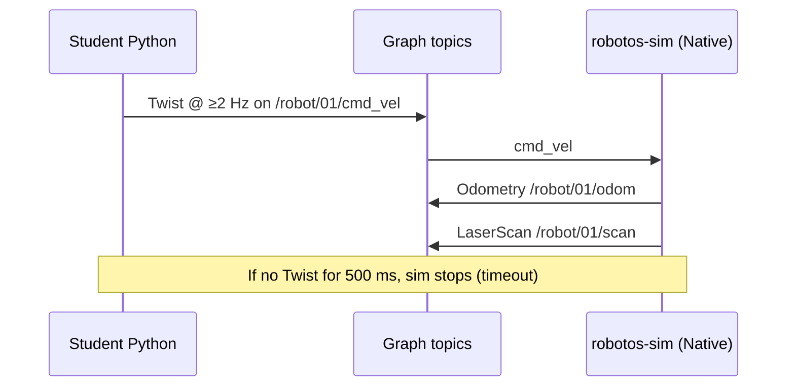
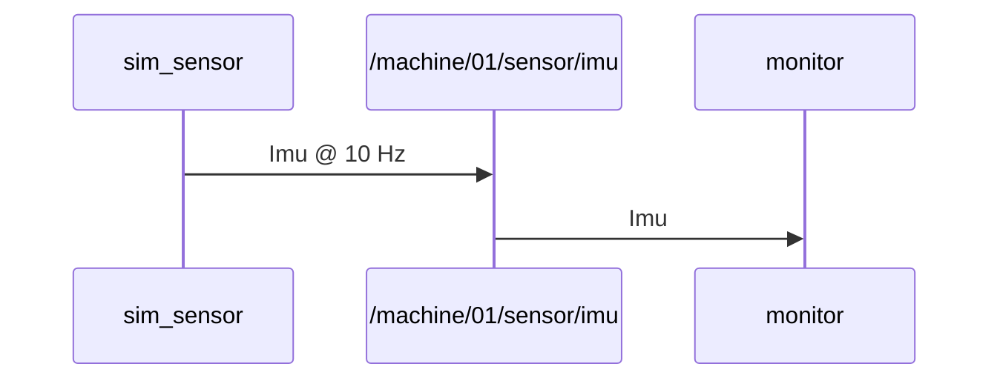

# Persona review — Kenji (`mac-intermediate`)

**Date:** 2026-11-02  
**OS lens:** macOS Apple Silicon (`macos-arm64`), Terminal / zsh, `python3`, Gatekeeper  
**Skill lens:** CS undergrad — fine with bash/git; little robotics; needs contracts, Native≠Mock, schema names  
**Scope:** SETUP.md, NOTES, lab-outline, p0-contract, theory 02/03/07, WH-01/02, MW-01/02  
**Verdict:** **Not ebook-ready as-is.** I can probably survive SETUP with instructor help, but smoke + NOTES are Windows-pack copies, WH/MW lab sheets are instructor stubs, and theory notes are talking-point lists — no sequences, no code walkthroughs, no macOS fork where it matters.

---

## 1. Stuck points

Ranked for me on day 1 with a `macos-arm64` unzip and no TA standing over my shoulder.

### Blocker

| Quote / cue | File | Why I stop |
|-------------|------|------------|
| `export PATH="$PWD/code/robotos-v0.3.0-linux-x64/bin:$PATH"` with only a comment `# linux-x64 or macos-arm64` | `SETUP.md` §2 | I will literally paste **linux-x64** on Apple Silicon. Pack mismatch is my #1 panic. Need an explicit `macos-arm64` fence (or two labeled examples). |
| Smoke block is PowerShell-only: `cd d:\CODE\2027\cronos\robotos-workshop`, `.\.venv\Scripts\Activate.ps1`, `labs\wh\...` | `SETUP.md` §5 | Zero bash smoke. I don’t know if my PATH/venv/wheel worked until I invent the macOS equivalent. Absolute Windows instructor path also teaches the wrong unpack root. |
| Python block: `python -m venv` + `pip install code\robotos-0.3.0-*.whl` inside a PowerShell fence; bash activate is a *comment* | `SETUP.md` §3 | On my Mac, `python` often means nothing / wrong install; I use `python3`. Backslash wheel path is Windows. One mixed fence = I half-follow Windows, half-guess bash. |
| `OS/arch: windows-x64` + `pip install code\robotos-0.3.0-py3-none-win_amd64.whl` + only PowerShell | `code/NOTES.txt` | Shipped NOTES is a **Windows drop**, not a template. If my macOS zip still has this file, every command is wrong (wheel tag, PATH folder, `serial-bridge.exe`, `COM7`). |
| No Gatekeeper / “cannot be opened” / quarantine steps for `robotos-sim` | `SETUP.md` §4 | First launch of unsigned/Tauri app on Apple Silicon commonly dies in System Settings. Doc assumes double-click Just Works. |
| Lab READMEs say `python drive_forward.py` / `python sense.py` | `labs/wh/wh-01-…/README.md`, `wh-02-…/README.md` | After `source .venv/bin/activate` either works, but pre-activate or system PATH → `command not found: python`. Prefer `python3` in macOS fences. |
| MW-01 / MW-02 practice blocks are PowerShell only (`python starter\sim_sensor.py`) | `labs/mw/mw-01-pub-sub/README.md`, `mw-02-services/README.md` | Backslash paths; no bash twin. I will try to run from wrong cwd or copy Windows paths into zsh. |

### Confusing

| Quote / cue | File | Why I hesitate |
|-------------|------|----------------|
| “Desktop builds **auto-select External + Native and Connect**” vs table “Mock / Bridge — not real graph” | `SETUP.md` §4, `docs/p0-contract.md` | I understand *what to click*, not **why Native ≠ Mock**. If UI already shows connected, am I done? What does Mock publish? When would `topic list` lie? |
| Mode row: “Mock / Bridge \| Instructor web demo” | `docs/p0-contract.md` | “Bridge” also means `serial-bridge` for HW. Same word, two meanings → I might think WH graded path involves serial-bridge. |
| Acceptance: “Start graph (pack `robotos` tooling…)” | `docs/p0-contract.md` | Ambiguous “connect the sim” / “start graph.” Is multicast enough? Do I need `ROBOTOS_CONNECT`? Who announces `/robot/01/*`? |
| Twist theory: ownership + timeout as bullets only | `docs/theory/02-twist-control.md` | Fine for a TA script; as a student chapter I still don’t see **who publishes / who consumes** or the 500 ms timeline. |
| Odom theory: “perfect integration” + yaw formula “show once” | `docs/theory/03-odometry-scan.md` | No formula, no field map (`pose.pose` vs starter’s `pose.position`). Starter uses `latest_odom.pose` — schema story missing. |
| Schema theory: “bytes + schema id” in four bullets | `docs/theory/07-messages-schema.md` | Doesn’t name `robotos.geometry.v1.Twist` / Imu / Echo or show Python `from robotos.messages…_pb2 import`. MW-01 will feel like magic imports. |
| WH-01 starter README CLI uses PowerShell `` ` `` line continuations; note “(Linux/macOS: one line, no backticks.)” | `labs/wh/wh-01-drive-twist/starter/README.md` | Better than nothing, but no ready-to-paste bash one-liner. Hex Twist without explaining schema/`--allow-commands` is opaque. |
| WH-02: “Sketch: cmd → motion → odom/scan” | `labs/wh/wh-02-sense-odom-scan/README.md` | Asks *me* for the sequence diagram the ebook should already show. |
| MW-02: “Optional CLI: `robotos service list` / `service call` (pack docs)” | `labs/mw/mw-02-services/README.md` | Vague pointer; no example call, no request/response schema names in the README body. |
| `lab-outline.md` maps theory↔labs well | `docs/lab-outline.md` | Useful index, not a student procedure. Easy to treat as “I read the outline so I’m ready” — I’m not. |

### Nice-to-have

| Quote / cue | File | Note |
|-------------|------|------|
| Template already has macOS `/dev/cu.usbmodem*` and bash env | `packs/NOTES.template.txt` | Good — but shipped `code/NOTES.txt` didn’t inherit it. Pack build should stamp OS. |
| HW section in SETUP is PowerShell + `COM7` | `SETUP.md` §7 | Out of WH/MW scope today; still, coverage matrix later needs `/dev/cu.*` + `chmod +x serial-bridge`. |
| `drive_forward.py` shebang `python3` but docs say `python` | starters vs READMEs | Align docs with shebang. |
| Explicit zero Twist on exit in starter | `drive_forward.py` | Good habit; theory demo mentions it — lab README doesn’t highlight the line. |

---

## 2. Missing for ebook (quality bar)

Per `.cursor/skills/student-doc-review` — **fail** until expanded into `docs/ebook/chapters/` + lab sheets. Instructor `docs/theory/*` talking points ≠ chapters.

| Artifact | Outcomes | Prereqs | Theory depth | Architecture | Sequence | Win + mac/Linux steps | Code walkthrough | Expected output | Troubleshooting ≥3 | Check yourself | Glossary |
|----------|----------|---------|--------------|--------------|----------|----------------------|------------------|-----------------|--------------------|----------------|----------|
| SETUP.md | partial | partial | n/a | no | no | **fail** (smoke Win-only; PATH example linux-x64) | n/a | partial | yes (table) | no | no |
| code/NOTES.txt | n/a | n/a | n/a | n/a | n/a | **fail** (windows-x64 only) | n/a | no | partial | n/a | n/a |
| packs/NOTES.template.txt | n/a | n/a | n/a | n/a | n/a | better (has macOS) | n/a | no | partial | n/a | n/a |
| docs/lab-outline.md | n/a (map) | n/a | n/a | no | no | n/a | n/a | n/a | n/a | n/a | n/a |
| docs/p0-contract.md | no | no | thin one-pager | no diagram | **no sequence** | no OS steps | no | smoke list only | no | no | Native/Mock need glossary |
| theory/02-twist-control.md | yes (short) | no | bullets only | **missing** | **missing** (timeout!) | no | no | no | no | yes (2 Qs) | no |
| theory/03-odometry-scan.md | yes (short) | no | bullets only | **missing** | **missing** | no | no | no | pitfalls only | yes | no |
| theory/07-messages-schema.md | no | no | **too thin** | **missing** | **missing** | no | no | no | no | 1 Q | no |
| WH-01 README + starter | goal only | thin | no | no | no | bash-ish but `python` | no walkthrough | no sample transcript | no | checklist only | no |
| WH-02 README + starter | goal only | none | schema table only | asks student to sketch | **missing** | `python` only | no | no | no | checklist only | no |
| MW-01 README + starters | no | no | link to thin theory | no | **missing** pub→sub | **PowerShell only** | no | no | no | checklist only | no |
| MW-02 README + starters | no | no | link only | no | **missing** req/rep | **PowerShell only** | no | no | no | checklist only | no |

### Focus gaps (Kenji)

1. **Contract clarity** — `/robot/01/cmd_vel|odom|scan` + schema FQNs are in p0-contract; WH labs don’t restate Twist FQN in the main README; no Mermaid of learner ↔ topics ↔ sim.  
2. **Native vs Mock** — stated as a table row, never explained as “your Python node is / isn’t on the Zenoh/graph.” No failure picture for Mock (empty `topic list` / robot moves in UI only).  
3. **Schema explanations** — theory/07 doesn’t walk `Twist` / `Imu` / `EchoRequest` fields or import paths used in starters.  
4. **Sequence diagrams** — STYLE.md examples exist; none of the scoped theory/labs include `sequenceDiagram` for drive timeout, sense loop, pub/sub, or service call.  
5. **macOS ≠ Windows examples** — SETUP smoke, NOTES.txt, MW READMEs, HW COM ports are Windows-first; Apple Silicon folder name under-emphasized; Gatekeeper absent; `python3` inconsistent.

---

## 3. Rewrite snippets

Short replacements only — not whole chapters.

### SETUP.md §2 — explicit Apple Silicon PATH

```bash
# macOS Apple Silicon (this workshop pack)
cd /path/to/robotos-workshop
export PATH="$PWD/code/robotos-v0.3.0-macos-arm64/bin:$PATH"
chmod +x code/robotos-v0.3.0-macos-arm64/bin/*   # if needed after unzip
robotos version
```

> **Do not** use `…-linux-x64` or `…-windows-x64` folder names on a Mac. Wrong pack → `Bad CPU type` / wheel “not supported.”

### SETUP.md §3 — separate bash / python3 fence

```bash
python3 -m venv .venv
source .venv/bin/activate
python -m pip install -U pip
python -m pip install code/robotos-0.3.0-*-macosx_*.whl   # or the exact arm64 wheel in code/
python -c "import robotos; print(robotos.Node.version())"
```

### SETUP.md §4 — Gatekeeper + Native≠Mock

> **macOS only:** if `robotos-sim` won’t open (“developer cannot be verified”), use System Settings → Privacy & Security → Allow, or right-click → Open once. Then confirm the UI shows **External** control, **Native** transport, **Connected**.  
> **Native** = your Terminal `robotos` / Python nodes share the real graph with the sim. **Mock** = UI demo traffic that does **not** count for graded WH labs — `robotos topic list` may stay empty while the viewport still animates.

### SETUP.md §5 — bash smoke twin

```bash
cd /path/to/robotos-workshop
export PATH="$PWD/code/robotos-v0.3.0-macos-arm64/bin:$PATH"
source .venv/bin/activate
# sim already External + Native + Connected
robotos topic list
python labs/wh/wh-01-drive-twist/starter/drive_forward.py
```

**Expect:** topics include `/robot/01/cmd_vel`, `/robot/01/odom`, `/robot/01/scan`; robot moves ~1 m.

### docs/p0-contract.md — add sequence (timeout + ownership)



Also rename table cell **Mock / Bridge** → **Mock (sim UI)** and point HW serial-bridge elsewhere to avoid the word clash.

### theory/07 — one concrete schema paragraph

> Topic `/machine/01/sensor/imu` carries protobuf type `robotos.sensor.v1.Imu`. In Python the starter does `from robotos.messages.robotos.sensor.v1.imu_pb2 import Imu`. Publisher and subscriber must agree on that full name; JSON-shaped dicts in constructors (`acceleration={"z": 9.81}`) still serialize as that schema. Warehouse drive uses a different schema: `robotos.geometry.v1.Twist` on `/robot/01/cmd_vel`.

### WH-01 README — outcomes + macOS run + walkthrough hook

```markdown
## Learning outcomes
- Publish `robotos.geometry.v1.Twist` to `/robot/01/cmd_vel` at a loop rate that beats the 500 ms timeout.
- Explain why External+Native is required (your node owns motion; Manual keyboard does not).

## Run (macOS / Linux)
cd labs/wh/wh-01-drive-twist/starter
python3 drive_forward.py
```

Add 5–10 lines explaining: `create_publisher(TOPIC, Twist)`, 20 Hz loop, final `Twist()` zero — and a sample transcript (`robotos 0.3.0 — pub Twist vx=0.2…` / `done — N cmds + zero`).

### WH-02 — don’t outsource the diagram

Replace “Sketch: cmd → …” with a Mermaid flowchart (learner cmd_vel → sim → odom/scan → `sense.py`) plus expected print line: `x=… y=… yaw=…  R=… F=… L=…`.

### MW-01 / MW-02 — bash fences + sequence

```bash
# Terminal A
cd labs/mw/mw-01-pub-sub
python3 starter/sim_sensor.py
# Terminal B
python3 starter/monitor.py 5
robotos topic echo /machine/01/sensor/imu --count 5
```



For MW-02, show `EchoRequest` → `/test/echo` → `EchoResponse` and note client retries on status 10 (UNAVAILABLE).

### code/NOTES.txt (macOS pack stamp)

When building `macos-arm64` drops, generate NOTES from `packs/NOTES.template.txt` with:

```text
OS/arch:    macos-arm64
robotos-sim: code/robotos-sim-v0.1.0-macos-arm64/robotos-sim
pip install code/robotos-0.3.0-*-macosx_*.whl
source .venv/bin/activate
```

Do not ship `win_amd64` / `serial-bridge.exe` lines in a Mac zip.

---

## 4. Pass criteria (Kenji unsupervised)

I succeed on WH-01 / MW-01 without a TA when:

1. **Pack identity** — SETUP shows a copy-paste `macos-arm64` PATH and matching wheel filename; NOTES.txt in my zip matches that OS (not `windows-x64`).  
2. **Sim launch** — Gatekeeper allow steps exist; I can verify **External + Native + Connected** and know Mock is graded-fail even if the robot wiggles.  
3. **Smoke on bash** — `robotos version`, `topic list` shows `/robot/01/*`, `python3 …/drive_forward.py` moves ~1 m; expected output is written down.  
4. **Contract** — one page (or chapter) lists topic → schema → who pubs/subs, with a sequence for cmd timeout and a Native vs Mock glossary entry.  
5. **Schemas** — theory/ebook names Twist, Odometry, LaserScan, Imu, Echo* and points at the real `_pb2` imports in starters.  
6. **Lab sheets** — WH-01/02 and MW-01/02 have learning outcomes, separate bash blocks (`python3`, `/` paths), Mermaid sequence/flowchart, short code walkthrough, sample transcript, ≥3 troubleshooting rows, check-yourself.  
7. **No Windows-only dead ends** — smoke, MW practice, and NOTES do not require PowerShell, `COM7`, or `d:\CODE\…` paths.

Until then: **ebook quality bar = fail** for this persona on the scoped set; p0-contract is a usable cheat sheet but not a chapter; theory 02/03/07 and WH/MW READMEs need expansion into STYLE.md chapter/lab shape.

---

## Appendix — files reviewed

- `SETUP.md`
- `code/NOTES.txt`, `packs/NOTES.template.txt`
- `docs/lab-outline.md`, `docs/p0-contract.md`
- `docs/theory/02-twist-control.md`, `03-odometry-scan.md`, `07-messages-schema.md`
- `labs/wh/wh-01-drive-twist/` (README, CHECKLIST, `starter/drive_forward.py`, `starter/README.md`)
- `labs/wh/wh-02-sense-odom-scan/` (README, CHECKLIST, `starter/sense.py`)
- `labs/mw/mw-01-pub-sub/` (README, CHECKLIST, `starter/sim_sensor.py`, `monitor.py`)
- `labs/mw/mw-02-services/` (README, CHECKLIST, `starter/echo_server.py`, `client.py`)
