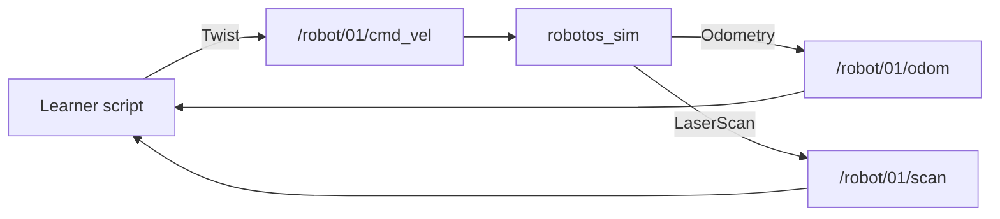

# Theory — Graph, nodes, topics

**Who / when:** Day 1 opening talk → before / with **MW-00**, **MW-01**, **WH-00**  
**Time:** ~40 min talk + board (not a full chapter)

> **Student ebook (canonical depth):**  
> [`ch01-graph-nodes-topics.md`](../ebook/chapters/ch01-graph-nodes-topics.md)  
> These notes stay short for live lecture; send students to the ebook after class.

> **Practice labs:**  
> [`mw-00-getting-started`](../../labs/mw/mw-00-getting-started/) ·  
> [`mw-01-pub-sub`](../../labs/mw/mw-01-pub-sub/) ·  
> [`wh-00-hello-graph`](../../labs/wh/wh-00-hello-graph/)

## Learning outcomes

After this card + lab peek, a student can say:

- Who **publishes** vs who **subscribes** on a named topic  
- Why a **schema** (message type) must match on both ends  
- Why `/robot/01/…` names are a teaching **contract**, not decoration  
- What empty `topic list` usually means (nobody joined yet)

## Talking points

1. **Graph** = many programs talking by **name**, not one mega-app.  
   *Gloss:* a **node** is one running program (sim, your script, CLI).  
2. **Topic** = named bus (`/robot/01/cmd_vel`). Direction is convention: cmds *in*, sensors *out*.  
3. **Schema** = agreed shape of the bytes (`robotos.geometry.v1.Twist`). Without it, data is opaque.  
4. **Discovery** — `robotos topic list` / `node list` show announcements; empty ⇒ nobody Connected (or wrong env), not “robotos broken.”  
5. **Workshop rule** — graded work uses the **real graph** (**Native**), not Mock “fake learner” UI.

## Board sketch

```text
[learner] --Twist--> /robot/01/cmd_vel --> [robotos_sim]
[robotos_sim] --Odometry--> /robot/01/odom --> [learner]
[robotos_sim] --LaserScan--> /robot/01/scan --> [learner]
```



## Check questions

- If sim is **Manual**, should a student publish move the robot? (**No** — keyboard owns motion; use **External** for scripts.)  
- Why does `topic list` show PUBS/SUBS counts? (**Discovery:** how many nodes announced publish vs subscribe on that name.)  
- Empty `topic list` after you “started something” — first check? (**Sim Connected / Native; no leftover wrong `ROBOTOS_*`; wait a second for discovery.**)

## Mini-glossary

| Term | One-line gloss |
|------|----------------|
| Node | One running program on the graph |
| Topic | Named stream where messages flow |
| Publish / subscribe | Send / receive on a topic |
| Schema | Typed layout of a message (protobuf name) |
| Native vs Mock | Real graph vs in-UI fake learner |
| Teaching contract | Fixed topic names + schemas for this pack |
