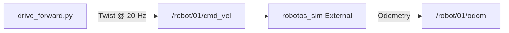

# Theory — Twist & control ownership

**Who / when:** Day 1 → before **WH-01** (after graph vocabulary)  
**Time:** ~25 min + 2 min demo

> **Student ebook (canonical depth):**  
> [`ch02-twist-control.md`](../ebook/chapters/ch02-twist-control.md)

> **Practice lab:**  
> [`wh-01-drive-twist`](../../labs/wh/wh-01-drive-twist/)

## Learning outcomes

- Map `Twist` fields to warehouse motion (`linear.x`, `angular.z`)  
- Explain **External** vs **Manual** ownership in one sentence  
- Explain the **~500 ms command timeout** and why labs use a publish loop  
- Say why reconnect should not auto-drive after a network blip

## Talking points

1. **Twist** = velocity command message. P0 shortcut: `linear.x` = forward m/s, `angular.z` = yaw rad/s (other components ignored).  
2. **Clamps** in the sim — huge numbers will not make a race car (`|v|` / `|ω|` capped by contract).  
3. **Ownership:** **Manual** = keyboard/UI drives; **External** = graph `/robot/01/cmd_vel` drives. Only one at a time.  
4. **Command timeout (~500 ms):** stop publishing ⇒ motion stops. Safety + forces a control-loop rate (≥ ~2 Hz; WH-01 uses 20 Hz).  
5. **Reconnect does not auto-move** — avoids surprise after Wi‑Fi blips. Still publish an explicit zero `Twist()` on exit (good habit).

## Demo (2 min)

Pub forward ~5 s, then silence — robot stops from timeout without an explicit zero. Then show explicit zero anyway.

## Board sketch

```text
drive_forward.py  --Twist @ 20 Hz-->  /robot/01/cmd_vel  -->  robotos_sim (External)
silence > 500 ms  ----------------------->  motion stops (fail-safe)
```



## Check questions

- Rate 1 Hz with 500 ms timeout — what happens? (**Starvation / stuttering:** gaps longer than timeout ⇒ stop–go.)  
- Why do graded labs insist **External**, not **Manual**? (**Your script must own `cmd_vel`; Manual ignores student pubs.**)  
- One publish then exit — enough? (**No** — need a loop while moving; timeout clears stale cmds.)

## Mini-glossary

| Term | One-line gloss |
|------|----------------|
| Twist | Velocity setpoint (`linear` + `angular`) |
| External | UI mode: graph commands drive the robot |
| Manual | UI mode: keyboard/UI teleop owns motion |
| Command timeout | No fresh Twist ≈ 500 ms ⇒ stop |
| Clamp | Sim limits max speed / yaw rate |
