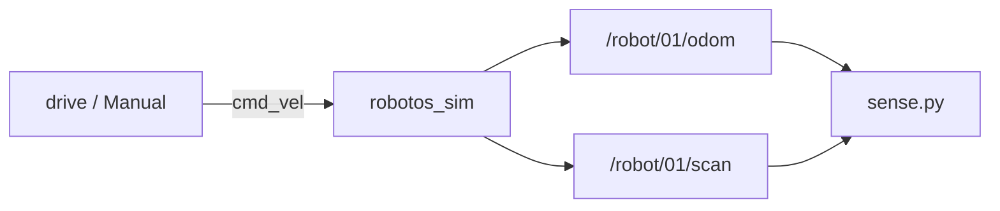

# Theory — Odometry & scan

**Who / when:** Day 1 → before **WH-02** (after Twist / ownership)  
**Time:** ~25 min

> **Student ebook (canonical depth):**  
> [`ch03-odometry-scan.md`](../ebook/chapters/ch03-odometry-scan.md)

> **Practice lab:**  
> [`wh-02-sense-odom-scan`](../../labs/wh/wh-02-sense-odom-scan/)

## Learning outcomes

- Read pose (`x`, `y`, yaw) from `/robot/01/odom`  
- Interpret three ranges as **right / front / left**  
- Explain why P0 odom is a teaching model, not GPS  
- Know to check `range_max` before calling a large range “no wall”

## Talking points

1. **Odometry** — “where am I / how am I moving?” Pose in the `odom` frame + twist.  
   *P0 gloss:* roughly perfect integration of applied cmds (no wheel slip) — still useful for learning fields and loops.  
2. **Yaw** from quaternion (z-up) — show the planar formula once; don’t drown in 3D. Starter has `yaw_from_quat`.  
3. **LaserScan P0** — not a full spinning lidar: three beams **right / front / left** at −90°, 0°, +90°.  
4. **Indices:** `ranges[0]=R`, `[1]=F`, `[2]=L`. Memorize this for avoid / wall-follow.  
5. **Rates** — sensing ~20 Hz on the graph; UI may look smoother than `topic echo`.

## Pitfalls (say once)

- Treating odom as GPS / map coordinates on Earth.  
- Assuming “huge range” = “no wall” without checking `range_max` / invalids.

## Board sketch

```text
                    /robot/01/odom  --> sense.py  (pose + yaw)
robotos_sim  ----->
                    /robot/01/scan  --> sense.py  (R, F, L)
driver / Manual --> /robot/01/cmd_vel --> sim   (something must move)
```



## Check questions

- Which range drops first when driving straight into a shelf? (**Front — `ranges[1]`.**)  
- If odom updates but scan doesn’t, what do you check? (**Topic name `/robot/01/scan`, schema, sim Connected, subscriber callback vs wrong index.**)  
- Is odom origin fixed to the warehouse map forever? (**No** — episode start / reset; not GPS.)

## Mini-glossary

| Term | One-line gloss |
|------|----------------|
| Odometry | Pose + twist estimate in the `odom` frame |
| Quaternion | 4-number orientation; we only need planar yaw |
| LaserScan | Range array message (here: 3 beams) |
| `range_max` | Contract max useful range — don’t invent infinity |
| Frame | Named coordinate system (`odom`, not “Earth”) |
