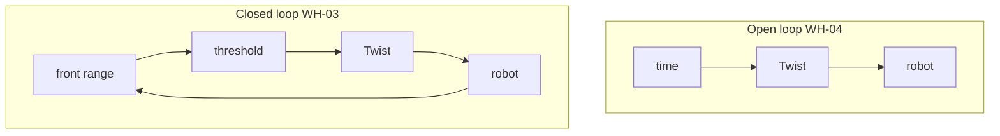

# Theory — Feedback vs open loop

**Who / when:** Day 1 → before **WH-03**, then contrast with **WH-04**  
**Time:** ~30 min talk (+ ~20 min open-loop lab feel)

> **Student ebook (canonical depth):**  
> [`ch05-feedback-control.md`](../ebook/chapters/ch05-feedback-control.md)

> **Practice labs:**  
> [`wh-03-avoid-front`](../../labs/wh/wh-03-avoid-front/) (closed loop) ·  
> [`wh-04-square-path`](../../labs/wh/wh-04-square-path/) (open loop on purpose)

## Learning outcomes

- Contrast **open-loop** (`cmd = f(time)`) with **closed-loop** (`cmd = f(sensors)`)  
- Describe **bang-bang** control and one failure mode (**chatter**)  
- Predict why timed squares **drift** even when “math looks right”  
- Remember the 500 ms timeout still applies — keep publishing in the loop

## Talking points

1. **Open loop:** cmd = f(time). Blind to walls. Easy to write; fragile.  
2. **Closed loop:** cmd = f(sensors). WH-03 thresholds on **front** range.  
3. **Bang-bang** — discrete “too close / OK”; first robotics control, not PID yet.  
4. **Why WH-04 after WH-03:** students *feel* drift after they’ve seen feedback win.  
5. **Integration math:** distance ≈ v·Δt, angle ≈ ω·Δt — clocks, clamps, and discrete steps break perfection.

## Board sketch

```text
open:   time ──► Twist ──► robot ──► (hope)

closed: scan ──► logic ──► Twist ──► robot ─┐
          ▲_________________________________|
```



## Check questions

- Will a “perfect” square close in odom under P0 if timing is exact and no collisions? (**Closer than reality; still discuss discrete steps / clamps / loop jitter.**)  
- Name one failure mode of bang-bang. (**Chatter** at the threshold; or ignoring timeout and starving cmds.)  
- Why must WH-03 keep publishing at ~20 Hz? (**500 ms command timeout** — silence stops the robot.)

## Mini-glossary

| Term | One-line gloss |
|------|----------------|
| Open loop | Commands from time only — no sensor correction |
| Closed loop / feedback | Commands from sensor measurements |
| Bang-bang | On/off or two-mode threshold control |
| Chatter | Rapid flip-flop around a threshold |
| Drift | Path error that grows over a timed sequence |
