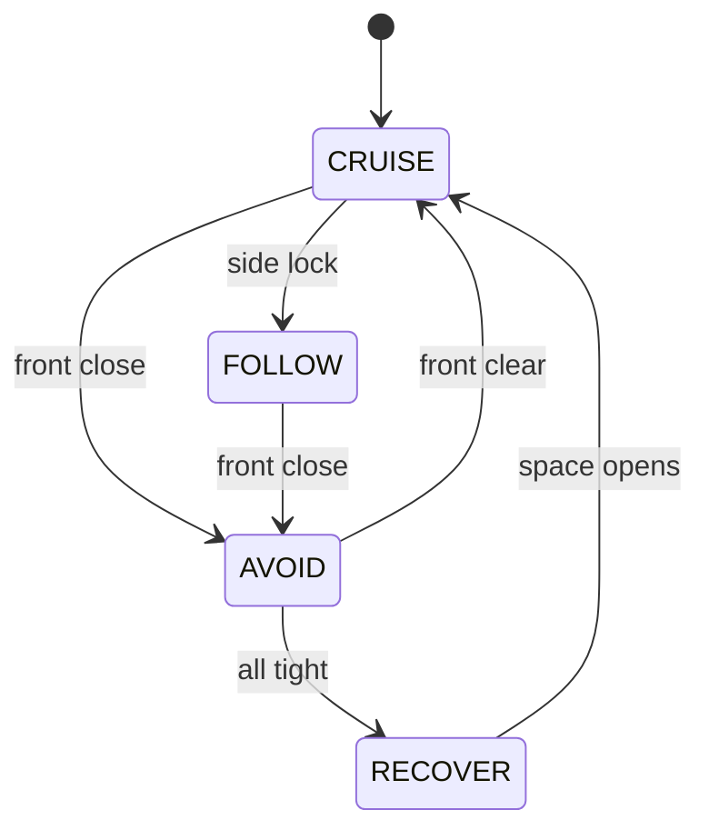

# Theory — Wall follow & state machines

**Who / when:** Day 2 → before **WH-05**, then **WH-06**  
**Time:** ~25 min wall-follow + ~30 min FSM

> **Student ebook (canonical depth):**  
> [`ch08-wall-follow-fsm.md`](../ebook/chapters/ch08-wall-follow-fsm.md)

> **Practice labs:**  
> [`wh-05-wall-follow`](../../labs/wh/wh-05-wall-follow/) ·  
> [`wh-06-state-machine`](../../labs/wh/wh-06-state-machine/)

## Learning outcomes

- Form a side-range **error** and steer with a proportional gain `k`  
- Treat **front** range as an interrupt (don’t hug into a corner)  
- Name FSM **states** and **transitions**; log every change  
- Detect **stuck** (all ranges tight) and recover instead of chatter

## Talking points — wall follow

1. **Error:** `e = target − side_range` (too far / too near).  
2. **Steer:** `angular.z ∝ −e` (sign depends on left vs right wall — say it once, then tune).  
3. **Front is an interrupt** — don’t hug the wall into a corner; switch behavior.  
4. **Gains** are empiric in the warehouse — theory gives *structure*; practice tunes `k`.

## Talking points — state machines

1. **State** = named mode with clear entry/exit (e.g. CRUISE / FOLLOW / AVOID / RECOVER).  
2. **Transition** = boolean on sensors (and maybe timers).  
3. **Log transitions** — debugging autonomy without a log is guessing.  
4. **Stuck detection** — all ranges tight ⇒ RECOVER, not infinite AVOID chatter.

## Board sketch

```text
  e = target - side_range
  wz ≈ -k * e     (sign by wall side)
  if front close → leave FOLLOW / CRUISE → AVOID (interrupt)
```



## Check questions

- Why not one giant `if` without named states? (**Hard to grade, hard to debug, easy to miss transitions.**)  
- What happens if FOLLOW never yields to AVOID? (**Hugging into a corner / collision; front interrupt missing.**)  
- What should the log show on a good WH-06 run? (**Timestamped `STATE → STATE` lines when sensors cross thresholds.**)

## Mini-glossary

| Term | One-line gloss |
|------|----------------|
| Error `e` | Target side distance minus measured side range |
| Gain `k` | How strongly you steer for a given error |
| FSM | Finite state machine — named modes + transitions |
| Interrupt | Higher-priority condition that forces a state change |
| Stuck / RECOVER | All beams tight → escape behavior, not chatter |
