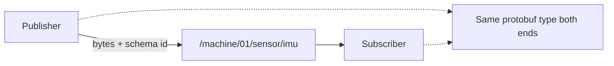

# Theory — Messages & schema

**Who / when:** Day 1 → with **MW-01** (pairs with graph vocabulary in theory 01)  
**Time:** ~15–20 min (keep short; deep dive lives in the ebook)

> **Student ebook (canonical depth):**  
> Schemas & typed payloads — [`ch01-graph-nodes-topics.md`](../ebook/chapters/ch01-graph-nodes-topics.md) (§ schemas / protobuf)  
> *(No separate “Ch.07 messages” file; Ch.1 is the student home for this idea.)*

> **Practice lab:**  
> [`mw-01-pub-sub`](../../labs/mw/mw-01-pub-sub/)  
> *(Also reinforces the same idea on WH topics in [`wh-00-hello-graph`](../../labs/wh/wh-00-hello-graph/).)*

## Learning outcomes

- Say that a topic carries **bytes + a schema id**, not free-form JSON  
- Explain why the same schema lets Python / Rust / C++ interoperate  
- Treat schema + topic name as a **contract** (version carefully)  
- Spot schema mismatch as a reason messages “don’t show up” / decode wrong

## Talking points

1. A topic carries **bytes + schema id** (protobuf full name). *Gloss:* **schema** = agreed binary layout so both sides know the fields.  
2. Same schema ⇒ languages interoperate (Python/Rust/C++ use generated stubs).  
3. Changing a field without versioning breaks subscribers — **contracts** matter.  
4. Workshop **Imu / Echo / Twist** are examples of *typed* payloads, not a JSON free-for-all.  
5. CLI `topic list` shows the schema column — use it to verify the contract at runtime.

## Board sketch

```text
Publisher                  Topic bus                 Subscriber
---------                  ---------                 ----------
fill Twist fields  -->  bytes + schema id  -->  decode as Twist
                         (name + type)

Mismatch schema id  -->  drop / mis-decode  -->  "it doesn't work"
```



## Check questions

- Can two nodes disagree on schema and still “work”? (**They’ll mis-decode or drop — looks like silence or garbage.**)  
- Why not put config forever on a JSON string topic? (**No shared type check; harder to discover; workshop wants typed contracts.**)  
- Where do students see the schema name in class? (**`robotos topic list` schema column; Python `create_publisher(..., Twist)`.**)

## Mini-glossary

| Term | One-line gloss |
|------|----------------|
| Message | One typed payload instance on a topic |
| Schema / protobuf | Agreed binary layout + type name |
| Schema id | Full type name announced with the topic |
| Contract | Topic name + schema the class agrees to use |
| Interop | Different languages sharing the same schema |
