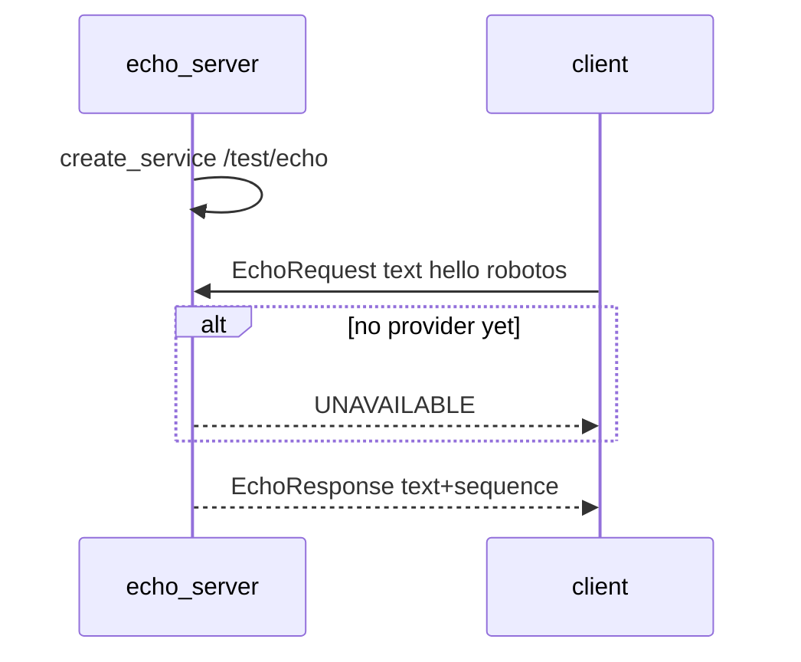

# Theory — Services (request / reply)

**For:** Day 1 → MW-02 (after MW-01 pub/sub)  
**Time:** ~20 min talk + live call demo  
**Who:** instructor short notes — students read ebook Ch.6 for depth

> **Student ebook:** [`docs/ebook/chapters/ch06-services.md`](../ebook/chapters/ch06-services.md)  
> **Practice lab:** [`labs/mw/mw-02-services/`](../../labs/mw/mw-02-services/README.md)

## Outcomes

Students can:

1. Contrast **topic** (stream) vs **service** (one request → one response).  
2. Name the workshop service `/test/echo` and schemas `EchoRequest` / `EchoResponse`.  
3. Say the client addresses the **service name**, not a PID.  
4. Reject “5-minute homing as a blocking service” → point to actions (MW-03).

## Talking points

1. **Shape:** client → named service → one reply. Not a continuous bus like `/machine/01/sensor/imu` or `/robot/01/odom`.  
2. **Workshop contract:**  
   - Name: `/test/echo`  
   - Schemas: `robotos.test.v1.EchoRequest` / `EchoResponse` (`echo_pb2`)  
   - Server node: `echo_server` (`create_service`) · Client: `node.call(..., timeout_ms=2000)`  
3. **Discovery:** `robotos service list` — empty ⇒ nobody advertised that name (same mesh / env as MW-01).  
4. **UNAVAILABLE / no responder:** normal while server starts; starter client **retries** — not “Zenoh broken.”  
5. **Anti-pattern:** long / cancellable work as a service → **action** `/machine/01/cycle` next lab.  
6. **Not warehouse drive:** P0 motion stays on topic `/robot/01/cmd_vel` (`Twist`); services are for discrete RPCs (echo, reset, get-config).

## Board / sequence

```text
[client.py] --EchoRequest--> /test/echo --EchoResponse--> [client.py]
                                 ^
                          [echo_server.py]
```



## Common confusions

| Confusion | Clarify |
|-----------|---------|
| “Service = background daemon” | Here = **named RPC on the graph**, not systemd. |
| Client must know server PID / host | No — address `/test/echo`; discovery finds a provider. |
| Same as publishing a topic once | Topic has no request/reply pairing or caller-visible status. |
| UI “Bridge” / `serial-bridge` | Irrelevant to MW-02 — laptop-only echo; no sim Native/Mock, no USB bridge. |
| Long job as service | Blocks caller, no feedback/cancel → use **actions**. |

## Check questions

1. Why not implement “5-minute homing” as a service?  
   **A:** Caller blocks; no progress stream; cancel is awkward → action (`goal → feedback* → result`).  
2. What does the client identify — process or service name?  
   **A:** Service name `/test/echo`.  
3. Client prints no reply and `service list` is empty — first three checks?  
   **A:** Server running? Same workshop root / env mesh? `.venv` + pack wheel (`echo_pb2`)?
