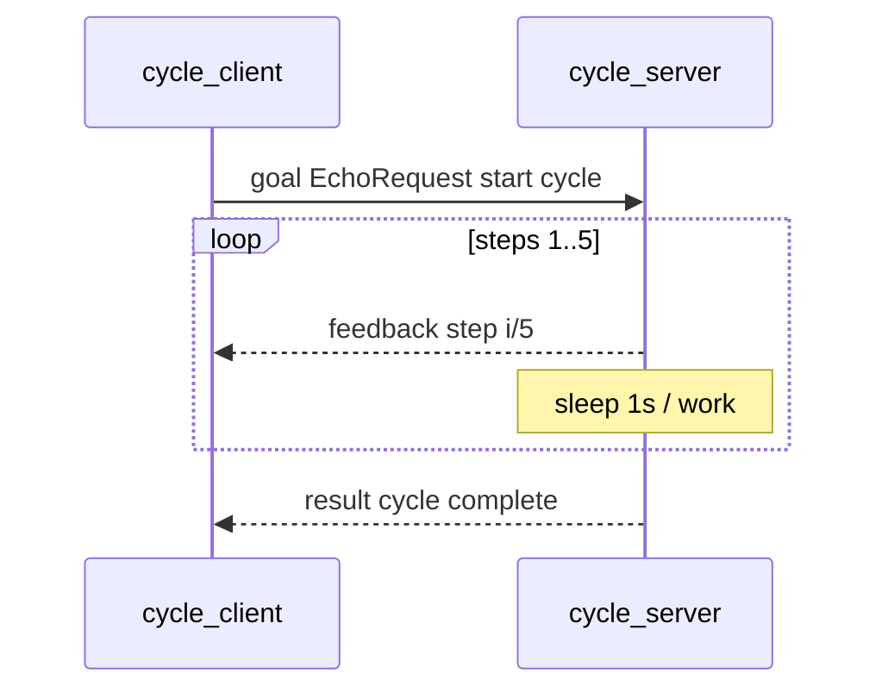

# Theory — Actions (long-running goals)

**For:** Day 2 → MW-03 (after MW-02 services)  
**Time:** ~25 min talk + live 5-step cycle  
**Who:** instructor short notes — students read ebook Ch.7 for depth

> **Student ebook:** [`docs/ebook/chapters/ch07-actions.md`](../ebook/chapters/ch07-actions.md)  
> **Practice lab:** [`labs/mw/mw-03-actions/`](../../labs/mw/mw-03-actions/README.md)

## Outcomes

Students can:

1. State the shape **goal → feedback* → result** (+ **cancel**).  
2. Name workshop action `/machine/01/cycle` and the toy schemas (`EchoRequest` goal/feedback, `EchoResponse` result).  
3. Contrast topic / service / action with one factory-floor example each.  
4. Explain why warehouse P0 **drive** stays on topic `cmd_vel`, not an action.

## Talking points

1. **Why actions exist:** service = one shot; cycle needs progress + optional abort.  
2. **Workshop contract:**  
   - Action name: `/machine/01/cycle`  
   - Server: `cycle_server` · `create_action(ACT, EchoRequest, EchoRequest, EchoResponse, handler)`  
   - Client: `action_client` → send goal → print feedback → wait result  
   - Feedback text: `step i/5` · Result: `cycle complete` or `aborted`  
3. **`send_goal` returns quickly** — work is async; UI/supervisor watches feedback.  
4. **Cancel:** `ctx.cancel_requested()` in server; stretch = second client / CLI mid-cycle.  
5. **Warehouse P0:** drive = stream `/robot/01/cmd_vel` (`Twist`) + 500 ms timeout. Actions appear later for dock / map / batch — not for continuous teleop.  
6. **Schemas are toy:** lab reuses `echo_pb2` types for goal/feedback/result — lesson is the **pattern**, not a production CycleGoal message.

## Board / sequence

```text
[cycle_client] --goal--> /machine/01/cycle --feedback*--> [cycle_client]
                              |                --result--->
                         [cycle_server]
```



## Common confusions

| Confusion | Clarify |
|-----------|---------|
| Action ≈ service with a longer timeout | No — feedback stream + cancel; service has neither. |
| Drive the WH robot with `/machine/01/cycle` | Wrong namespace. WH uses `/robot/01/*`; cycle is a **laptop machine** demo. |
| Feedback = result | Feedback = intermediate; result = terminal outcome. |
| “Just use a topic for progress” | Possible, but action binds goal id, feedback, result, cancel into one contract. |
| Native vs Mock | MW-03 is peer Python nodes — no sim. Don’t demo Mock here. |

## Check questions

1. Topic vs service vs action — one factory-floor example each?  
   **A:** Topic: conveyor belt speed stream. Service: “query lot ID once.” Action: “run 5-step pack cycle with progress + abort.”  
2. Does `send_goal` wait until step 5 finishes?  
   **A:** No — returns promptly; client awaits feedback/result separately.  
3. Why isn’t WH drive an action in P0?  
   **A:** Continuous rate loop + fail-safe timeout fits a **command topic**, not a finite goal.
