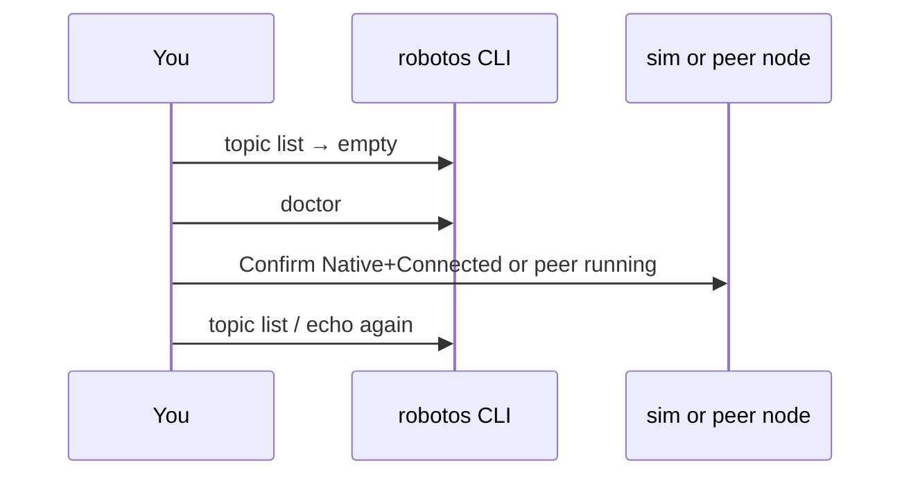

# Theory — Observe, debug & QoS

**For:** Day 1 studio habit + Day 2 deepen; before blaming the network  
**Time:** ~15–20 min (toolkit drill) + short QoS concept  
**Who:** instructor short notes — students read ebook Ch.12 for depth

> **Student ebook:** [`docs/ebook/chapters/ch12-observe-qos.md`](../ebook/chapters/ch12-observe-qos.md)  
> **Practice:** MW-00 smoke + any live lab; warehouse: `topic list` / `echo` / `hz` on `/robot/01/*` · laptop MW: `/machine/01/*` or `/test/echo`

## Outcomes

Students can:

1. Name the observe toolkit: `doctor`, `node list`, `topic list`, `echo`, `hz` (and `service list` when relevant).  
2. Interpret **empty list** as “nobody Connected / nobody joined,” not “middleware dead.”  
3. Say schema mismatch ⇒ messages may be **skipped**.  
4. Relate QoS presets (`sensor|control|state|logging`) and the **500 ms cmd_vel timeout** cousin.

## Talking points

### Observe first

1. **Order of blame:** PATH / `.venv` → process up → **Native + Connected** (sim) or bridge listen → then Zenoh.  
2. **Toolkit → question:**  
   | Tool | Answers |  
   |------|---------|  
   | `robotos doctor` | Transport / env sanity |  
   | `robotos node list` | Who joined? |  
   | `robotos topic list` | What pubs/subs/schema announced? |  
   | `robotos topic echo …` | What values? |  
   | `robotos topic hz …` | How fast? |  
   | `robotos service list` | Is `/test/echo` advertised? (MW-02) |  
3. **Contracts to echo in class:**  
   - Warehouse: `/robot/01/odom`, `/robot/01/scan`, `/robot/01/cmd_vel`  
   - MW-01: `/machine/01/sensor/imu`  
4. **Empty ≠ broken:** sim still Manual/Mock, not Connected, leftover `ROBOTOS_LISTEN`, or wrong mesh env.

### QoS (keep conceptual)

1. Trade **reliability / history depth / latency**. Sensors often prefer fresh; commands prefer delivery.  
2. Pack may expose presets `sensor|control|state|logging` on some CLI paths — `--help`, don’t memorize enums day one.  
3. **Cousin:** warehouse **500 ms `cmd_vel` timeout** — unsteady pubs ⇒ fail-safe stop (determinism / safety).

## Board / sequence

```text
You → doctor → node/topic list → empty?
         │                         │ yes → Connect / bridge / PATH / clear env
         │                         │ no  → echo / hz → schema OK?
```



## Common confusions

| Confusion | Clarify |
|-----------|---------|
| Empty `topic list` ⇒ Zenoh broken | Usually nobody on the graph / not Connected. |
| UI **Bridge** (web demo) vs **`serial-bridge`** | Different things. Graded WH = **Native**. HW host tool = `serial-bridge`. |
| **Native ≠ Mock** | Mock can move the viewport without your node joining; `topic list` won’t prove your script. |
| Echo “silent” with pub alive | Schema / type mismatch → skipped messages. |
| QoS = “make it faster” | Policy tradeoffs, not a speed cheat code. |
| PowerShell-only debug | Same verbs on macOS/Linux bash: `robotos doctor`, `topic list`, … |

## Check questions

1. Name two tools you’d use before blaming Zenoh.  
   **A:** e.g. `robotos doctor` + `topic list` (or `node list` / `echo`).  
2. Sim viewport moves but `topic list` is empty — what mode trap?  
   **A:** Likely **Mock** (or not Native/Connected) — UI fake, not your graded graph path.  
3. Why is cmd_vel timeout a cousin of QoS / determinism?  
   **A:** Control needs steady command flow; gaps ⇒ safe stop, same family as reliability/rate expectations.
