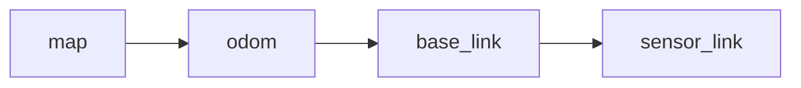
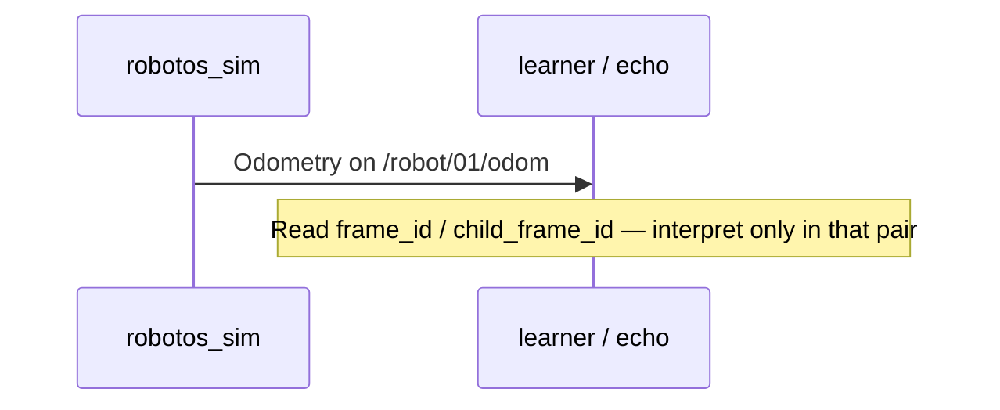

# Theory — TF / frames (concept)

**For:** Day 2 concept talk; reinforce during WH-02 odom echo  
**Time:** ~15 min (no separate TF publisher lab in pack)  
**Who:** instructor short notes — students read ebook Ch.13 for depth

> **Student ebook:** [`docs/ebook/chapters/ch13-tf-frames.md`](../ebook/chapters/ch13-tf-frames.md)  
> **Practice:** discussion + [`labs/wh/wh-02-sense-odom-scan/`](../../labs/wh/wh-02-sense-odom-scan/README.md) — echo `/robot/01/odom` and note `frame_id` / `child_frame_id` fields your tooling shows

## Outcomes

Students can:

1. State why a pose needs a **frame_id** (origin + axes named).  
2. Sketch the classic chain `map → odom → base_link → sensor_link`.  
3. Treat warehouse odom frame fields as a **contract hint** (full TF tree = later).  
4. Refuse silent frame mixing (“odom meters as map meters”).

## Talking points

1. **“x = 3.0” is incomplete** — in which frame? Docking without agreement = geometry bug.  
2. **Vocabulary:**  
   - Frame = named coordinate system (`odom`, `base_link`, `map`, `sensor_link`)  
   - `frame_id` / `child_frame_id` on odometry = which frames the pose relates  
   - **TF** = tree of transforms between frames over time  
3. **Warehouse P0 contract:** topics `/robot/01/odom` (and scan) — message carries frame fields; you are **not** required to run a TF publisher lab in this pack.  
4. **Classic chain (board it):**

```text
map → odom → base_link → sensor_link
```

5. Mixing frames (treat `odom` as `map` without a transform) → silent path/dock failures.  
6. Viewport vs odom: if the path looks rotated, ask yaw/frame assumptions before “sim is wrong.”

## Board / sequence





## Common confusions

| Confusion | Clarify |
|-----------|---------|
| TF lab missing ⇒ frames don’t matter | Frames still on messages; full tree is later course work. |
| `odom` frame = GPS / map | `odom` is local integrated pose; `map` is world (later). |
| Scan ranges are in `map` | Sensor frame relative to `base_link` / as message states — don’t invent. |
| Twin / sim “same place” | Visual pose and odom frame must still agree on names; renaming topics ≠ fixing frames. |
| UI Bridge / serial-bridge | Unrelated to frame math — don’t derail the talk. |

## Check questions

1. Is “x = 3.0” enough to dock?  
   **A:** No — need the **frame** (and units/axes). Instructor “x=3” often means a **map** mark.  
2. What does P0 require you to run for TF?  
   **A:** Nothing extra — read frame fields on odom; full TF publisher is out of pack.  
3. You command dock using odom `x` against a map sticker — failure mode?  
   **A:** Frame mix: odom drift/origin ≠ map; need a transform (later) or operate only in one agreed frame.
