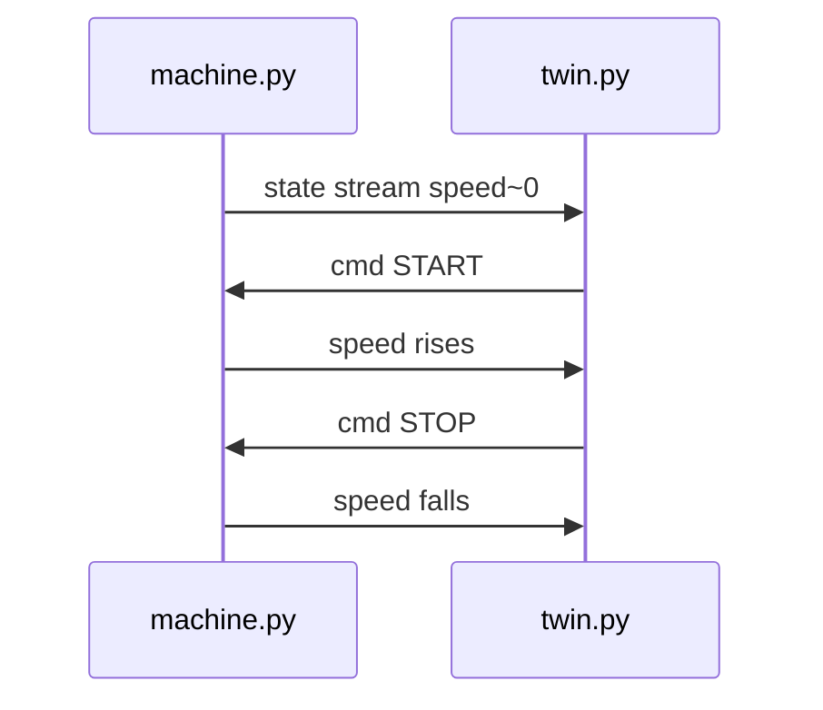

# Theory — Digital twin on the middleware

**For:** Day 2 → MW-06; bridge talk into WH warehouse sim  
**Time:** ~20 min talk + two-terminal mini-twin  
**Who:** instructor short notes — students read ebook Ch.11 for depth

> **Student ebook:** [`docs/ebook/chapters/ch11-digital-twin.md`](../ebook/chapters/ch11-digital-twin.md)  
> **Practice lab:** [`labs/mw/mw-06-mini-twin/`](../../labs/mw/mw-06-mini-twin/README.md)  
> **Related:** bags ([`mw-05`](../../labs/mw/mw-05-record-replay/README.md) / Ch.9) for replay-into-twin story; WH track = 3D plant on `/robot/01/*`

## Outcomes

Students can:

1. Define a twin as a consumer/commander on the **same** topic/service names as the plant.  
2. Name MW-06 contracts: `/machine/01/state`, `/machine/01/cmd` (nodes `machine`, `twin`).  
3. Scale the idea: mini-twin (laptop) → `robotos-sim` warehouse (3D) → future board↔sim fusion.  
4. Reject “different topic names” as a twin — that is a **second system**.

## Talking points

1. **Contract (MW-06):**  
   - Plant: `machine.py` publishes `/machine/01/state`  
   - Twin: `twin.py` subscribes state, publishes `/machine/01/cmd`  
   - Payload stand-in: `robotos.sensor.v1.Imu` — `frame_id` carries `START`/`STOP`; “speed” mirrored from `acceleration.x`  
   - Lesson = **shared names**, not IMU physics  
2. **Twin ≠ simulator product name:** a twin is a **graph citizen** sharing plant contracts. `robotos-sim` is one visual plant/twin at warehouse scale (`/robot/01/cmd_vel|odom|scan`).  
3. **Safe testing:** replay bags (MW-05 / WH-07) into logic that speaks the same names before silicon or graded WH.  
4. **Native path for WH:** External + **Native** + Connect — Mock is not “a twin of your code.”  
5. **Future P3:** board IMU via `serial-bridge` → same contracts → sim scene (fusion) — still same-name discipline.

## Board / sequence

```text
[machine.py] --Imu state--> /machine/01/state --> [twin.py]
[twin.py]    --Imu cmd----> /machine/01/cmd   --> [machine.py]
```



## Common confusions

| Confusion | Clarify |
|-----------|---------|
| Twin = any second process | Only if it uses the **same** topic/service names as the plant. |
| Twin = `robotos-sim` only | Sim is the 3D scale; MW-06 is the laptop pattern; both are “twin-shaped.” |
| Twin = Mock mode | Mock fakes a learner in UI; twin is a real node on the mesh. |
| UI **Bridge** vs **`serial-bridge`** | UI Bridge = instructor web path. `serial-bridge` = HW USB tool. Neither renames `/machine/01/*`. |
| Rename topics “to avoid clashes” | You broke the twin contract — now it’s a second system + adapter debt. |
| Imu on cmd/state means we’re doing AHRS | Stand-in schema for the pattern only. |

## Check questions

1. If the twin uses different topic names than the robot, what did you build?  
   **A:** A **second system** (plus a future translator), not a twin.  
2. What are the two MW-06 topic names?  
   **A:** `/machine/01/state` and `/machine/01/cmd`.  
3. How does warehouse sim relate?  
   **A:** Same idea at 3D scale: plant on `/robot/01/*`; your learner is the twin/commander — use **Native**, not Mock.
