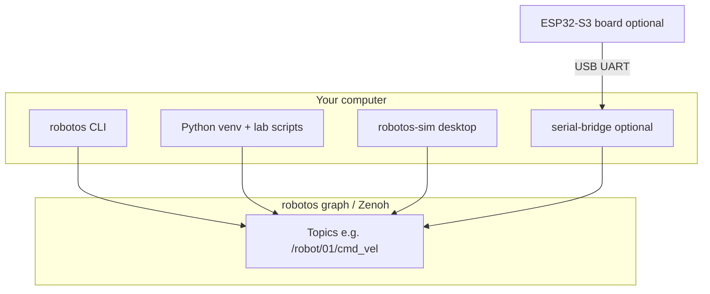
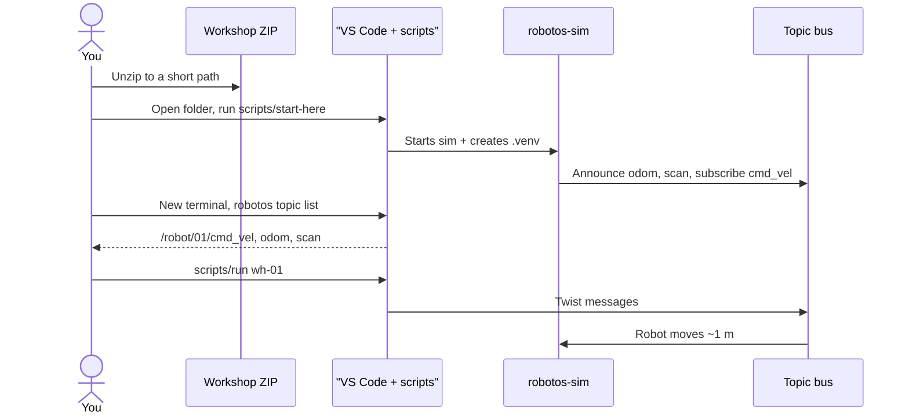

# Chapter 0 — Setup your machine

## Learning outcomes

After this chapter you can:

- Unpack the workshop drop and recognize each folder’s job  
- Open a terminal on **your** OS and run `robotos version`  
- Create a Python virtual environment and import the `robotos` SDK  
- Launch the warehouse simulator (when your pack includes it)  
- Run a first smoke test that moves the simulated robot  

## Prerequisites

- The course ZIP / drop for **your** OS (class focus: **Windows x64** or **macOS arm64**)  
- **VS Code** (class machines)  
- About 2 GB free disk space  
- Administrator rights only if your school PC blocks installing Python or running unsigned apps — ask a TA if unsure  

You do **not** need to clone private GitHub source repos for the student labs.
Clone/unzip **robotos-workshop** only — it already includes `code/` packs.

---

## 1. Motivation

Robot middleware is a **graph of programs** talking over named topics. Your laptop will run:

1. **CLI tools** (`robotos`) — list topics, echo messages, record bags  
2. **Python scripts** — your labs publish and subscribe  
3. **Warehouse sim** (WH labs) — a desktop app that *is* the robot on the graph  
4. Optionally a **serial-bridge** (HW labs) — connects a real ESP32-S3 board  

If PATH, the Python wheel, or the sim connection is wrong, every later lab looks “broken.” This chapter removes that fog.

---

## 2. Theory — what you are installing

| Artifact | What it is | You use it when… |
|----------|------------|------------------|
| `code/robotos-v0.3.0-<os>/` | Prebuilt CLI + native libraries | Every lab (`robotos topic list`, …) |
| `code/robotos-0.3.0-*.whl` | Python package (`import robotos`) | Every Python starter |
| `code/robotos-sim-v*/` | Desktop warehouse simulator | Warehouse (WH) labs |
| `code/NOTES.txt` | Class-specific ports / COM hints | Especially HW labs |
| `scripts/` | `start-here`, `start-bridge`, `run` | Day-1 helpers (prefer these) |
| `labs/` | Step sheets + starter code | Graded work |
| `docs/` + `docs/ebook/` | Theory & this ebook source | Reading / revision |

**Virtual environment (venv):** an isolated Python folder (`.venv/`) so course packages do not fight other class installs. Always **activate** it before `pip` or `python` lab commands.

**PATH:** the list of folders your terminal searches for programs. Putting `code/robotos-v*/bin` on PATH makes `robotos` and `serial-bridge` runnable by name.

---

## 3. Architecture — pieces on your PC



---

## 4. Sequence — first successful hour



---

## 5. Hands-on — Windows (VS Code + helpers)

### 5.0 Preferred class path (do this first)

1. Unzip to a short path **without spaces**, e.g. `C:\robotos-workshop`.  
2. Confirm you see `SETUP.md`, `labs\`, `code\`, and `scripts\`.  
3. Open that folder in **VS Code** (`File → Open Folder…`).  
4. Double-click `scripts\start-here.cmd` once — creates `.venv`, installs the wheel, starts the sim.  
5. Open PowerShell or a VS Code terminal. It does not remember `robotos`. Paste the whole block. `YOUR_WORKSHOP_DIR` is the folder that contains `SETUP.md`.

```powershell
cd YOUR_WORKSHOP_DIR
$env:PATH = "$PWD\code\robotos-v0.3.0-windows-x64\bin;$env:PATH"
.\.venv\Scripts\Activate.ps1
robotos topic list
scripts\run.cmd wh-01
```

**Expect:** topics `/robot/01/cmd_vel`, `odom`, `scan`, and the sim robot moves ~1 m.

Board labs later: double-click `scripts\start-bridge.cmd` and leave it open, then `scripts\run.cmd hw-01`.

> The rest of §5 is the **manual** PowerShell walkthrough if a TA asks you to type every step.

### 5.1 Open PowerShell (manual)

1. Press `Win`, type `PowerShell`, open **Windows PowerShell**.  
2. This is a text window where you type commands and press Enter. Red text usually means an error — read it; it is rarely “your PC is broken.”

### 5.2 Unpack (manual)

1. Unzip the course drop.  
2. Prefer a short path **without spaces**, e.g. `C:\robotos-workshop` or `D:\CODE\robotos-workshop`.  
3. Confirm you see `SETUP.md`, `labs\`, `code\`, and `scripts\`.

### 5.3 PATH and `robotos`

```powershell
cd YOUR_WORKSHOP_DIR
$env:PATH = "$PWD\code\robotos-v0.3.0-windows-x64\bin;$env:PATH"
Get-Command robotos
robotos version
```

**Expect:** a line containing `robotos 0.3.0` (version may match your pack).

If `Get-Command` fails: you typed the wrong `cd`, or the `code\robotos-v0.3.0-windows-x64\bin` folder is missing.

> **Note:** `$env:PATH = ...` lasts only for **this** PowerShell window. Open a new window → run the PATH lines again (or keep the window open for the session).

### 5.4 Python venv + wheel

Need Python 3.10+ from [python.org](https://www.python.org/downloads/) (check “Add python.exe to PATH” on install).

```powershell
cd YOUR_WORKSHOP_DIR
python -m venv .venv
.\.venv\Scripts\Activate.ps1
```

If activation errors with **ExecutionPolicy**, run **once** as the same user:

```powershell
Set-ExecutionPolicy -Scope CurrentUser RemoteSigned
```

Then retry `Activate.ps1`. Your prompt usually gains `(.venv)`.

```powershell
cd YOUR_WORKSHOP_DIR
.\.venv\Scripts\Activate.ps1
python -m pip install -U pip
python -m pip install .\code\robotos-0.3.0-py3-none-win_amd64.whl
python -c "import robotos; print(robotos.Node.version())"
```

### 5.5 Start the sim

```powershell
cd YOUR_WORKSHOP_DIR
Start-Process .\code\robotos-sim-v0.1.0-windows-x64\robotos-sim.exe
```

Or double-click `robotos-sim.exe` in Explorer. Wait until the UI shows **connected / NATIVE** (desktop builds auto-connect). If you changed modes: **Warehouse → Native → External → Connect**.

### 5.6 Smoke test (manual)

Paste the whole block again. A new window does not keep PATH or `.venv`.

```powershell
cd YOUR_WORKSHOP_DIR
$env:PATH = "$PWD\code\robotos-v0.3.0-windows-x64\bin;$env:PATH"
.\.venv\Scripts\Activate.ps1
robotos topic list
scripts\run.cmd wh-01
```

**Expect:** topic list includes `/robot/01/cmd_vel`, `/robot/01/odom`, `/robot/01/scan`, and the sim robot moves forward briefly.

---

## 6. Hands-on — Linux / macOS (bash)

### 6.1 Open a terminal

- **Ubuntu:** Apps → Terminal  
- **macOS:** Spotlight (`Cmd+Space`) → `Terminal`

### 6.2 Unpack

```bash
cd YOUR_WORKSHOP_DIR
ls SETUP.md labs code
```

Use a path without spaces if possible.

### 6.3 PATH

**Linux x64**

```bash
cd YOUR_WORKSHOP_DIR
export PATH="$PWD/code/robotos-v0.3.0-linux-x64/bin:$PATH"
chmod +x code/robotos-v0.3.0-linux-x64/bin/robotos 2>/dev/null || true
robotos version
```

**macOS Apple Silicon**

```bash
cd YOUR_WORKSHOP_DIR
export PATH="$PWD/code/robotos-v0.3.0-macos-arm64/bin:$PATH"
chmod +x code/robotos-v0.3.0-macos-arm64/bin/robotos 2>/dev/null || true
robotos version
```

### 6.4 Python venv + wheel

**Linux x64** — prefer the exact name in your pack’s `NOTES.txt`; tag-safe:

```bash
cd YOUR_WORKSHOP_DIR
python3 -m venv .venv
source .venv/bin/activate
python -m pip install -U pip
python -m pip install code/robotos-0.3.0-py3-none-any.whl
python -c "import robotos; print(robotos.Node.version())"
```

**macOS Apple Silicon**

```bash
cd YOUR_WORKSHOP_DIR
python3 -m venv .venv
source .venv/bin/activate
python -m pip install -U pip
python -m pip install code/robotos-0.3.0-py3-none-any.whl
python -c "import robotos; print(robotos.Node.version())"
```

### 6.0 Preferred class path (macOS)

1. Unzip / clone so you see `SETUP.md`, `labs/`, `code/`, and `scripts/`.  
2. Open that folder in **VS Code**.  
3. Once: double-click `scripts/start-here.command` (or run `./scripts/start-here.sh`).  
4. Open Terminal, Cursor, or VS Code. Paste the whole block. Do not type only the last line.

```bash
cd YOUR_WORKSHOP_DIR
export PATH="$PWD/code/robotos-v0.3.0-macos-arm64/bin:$PATH"
source .venv/bin/activate
robotos topic list
./scripts/run wh-01
```

HW later: `./scripts/start-bridge.sh` in a second window, then `./scripts/run hw-01`.

> §§6.1–6.6 below are the **manual** Terminal.app walkthrough.

### 6.5 Start the sim (manual)

Windows and macOS class packs **include** the sim. If your zip is Linux-only or
`code/robotos-sim-v*/` is missing, skip this section and WH labs — continue with
MW/HW (see `SETUP.md` §4).

**Linux x64** (sim often not shipped)

```bash
cd YOUR_WORKSHOP_DIR
chmod +x code/robotos-sim-v0.1.0-linux-x64/robotos-sim
./code/robotos-sim-v0.1.0-linux-x64/robotos-sim &
```

**macOS Apple Silicon**

```bash
cd YOUR_WORKSHOP_DIR
open code/robotos-sim-v0.1.0-macos-arm64/robotos-sim.app
# First launch: Finder → right-click → Open if Gatekeeper blocks
```

> **macOS Gatekeeper (do this at first launch):** if macOS says the app “cannot be opened,” use **right-click → Open**, or System Settings → Privacy & Security → Allow. Do not skip this — the binary will not stay running until you approve it.

Confirm **Native / External / Connect** in the UI as on Windows.

### 6.6 Smoke test (manual)

**macOS Apple Silicon**

```bash
cd YOUR_WORKSHOP_DIR
export PATH="$PWD/code/robotos-v0.3.0-macos-arm64/bin:$PATH"
source .venv/bin/activate
robotos topic list
./scripts/run wh-01
```

**Linux** — only if `code/robotos-v0.3.0-linux-x64` is in your drop:

```bash
cd YOUR_WORKSHOP_DIR
export PATH="$PWD/code/robotos-v0.3.0-linux-x64/bin:$PATH"
source .venv/bin/activate
robotos topic list
./scripts/run wh-01
```

---

## 7. Code walkthrough — `drive_forward.py` (preview)

Full path: `labs/wh/wh-01-drive-twist/starter/drive_forward.py`.

| Part | Why it matters |
|------|----------------|
| `SETUP.md` path walk | Puts workshop root on `sys.path` so `labs.common` imports work |
| `from ... geometry_pb2 import Twist` | Messages are typed (protobuf schemas), not free-form JSON |
| `TOPIC = "/robot/01/cmd_vel"` | **Contract name** — must match the sim |
| `Node("lab01_drive")` | Joins the graph as one more node |
| `create_publisher` + `settle()` / `make_twist` | Graph API stays visible; settle/twist helpers are workshop plumbing |
| Loop at 20 Hz | Controllers must **keep publishing**; one message is not enough |
| Final `zero_twist()` | Commands zero velocity so the robot stops |

Detailed walkthrough continues in Chapter 2 / lab WH-01.

---

## 8. Expected results

**`robotos version`**

```text
robotos 0.3.0
```

**`robotos topic list`** (sim connected; columns may vary)

```text
TOPIC                 PUBS  SUBS  ...
/robot/01/cmd_vel     ...   1
/robot/01/odom        1     ...
/robot/01/scan        1     ...
```

**`drive_forward.py`**

```text
robotos 0.3.0 — pub Twist vx=0.2 wz=0.0 for ~5.0s @ 20.0 Hz
done — 100 cmds + zero
```

---

## 9. Troubleshooting

| Symptom | Likely cause | Fix |
|---------|--------------|-----|
| `robotos: command not found` | PATH not set in **this** terminal | Re-run PATH export / `$env:PATH` |
| `Activate.ps1` cannot run | ExecutionPolicy | `Set-ExecutionPolicy -Scope CurrentUser RemoteSigned` |
| Wheel “not supported” | Wrong OS wheel | Install `win_amd64` / `macosx` / `manylinux` matching your PC |
| `ModuleNotFoundError: labs` | Not inside workshop tree | Terminal cwd under folder with `SETUP.md` + `labs/` (see `labs/common/README.md`) |
| `no topics announced` | Sim not connected or wrong mesh env | Connect Native+External; clear leftover `ROBOTOS_LISTEN` from HW labs |
| Robot ignores Twist | Control ownership still Manual | UI: External + Native; keep publishing ≥ ~2 Hz |
| Git Bash mangles `/robot/...` | Bash on Windows rewrites paths | Use **PowerShell** for `robotos topic …` on Windows |
| Linux serial later fails | User not in `dialout` | `sudo usermod -aG dialout $USER` then log out/in |

---

## 10. Check yourself

1. What three processes might share the graph in a WH lab?  
2. Why does PATH need to be set again in a new terminal?  
3. What UI mode must the warehouse use for your script to drive the robot?  
4. Name the three P0 topics under `/robot/01/`.  

## Glossary

| Term | Meaning |
|------|---------|
| Topic | Named channel for typed messages |
| Node | One program participating on the graph |
| Wheel (`.whl`) | Python install package |
| venv | Isolated Python environment folder |
| PATH | Where the shell looks for executables |
| Native / External | Sim modes: real graph + accept external cmd_vel |

## Next

- Fast checklist twin of this chapter: [`SETUP.md`](../../../SETUP.md)  
- Chapter 1 — Graph, nodes, topics  
- Lab [`wh-00-hello-graph`](../generated/wh/wh-00-hello-graph/index.md)  
