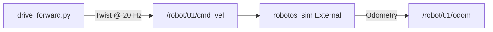
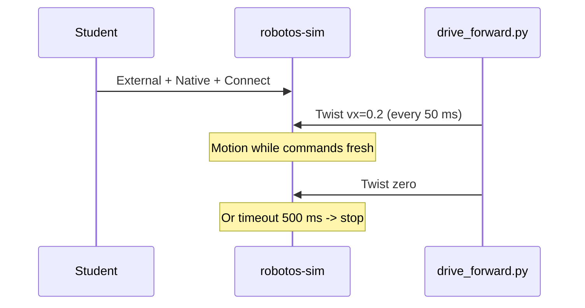

# Chapter 2 — Twist commands & control ownership

## Learning outcomes

- Map `Twist.linear.x` / `Twist.angular.z` to warehouse motion  
- Explain why **External + Native** is required for graded drive labs  
- Explain the **500 ms command timeout** and why labs publish in a loop  
- Run WH-01 from the workshop root on Windows or Unix  

## Prerequisites

- Chapter 0–1; sim connected  
- Lab WH-00 done  

## 1. Motivation

Your script is not “calling the simulator API.” It is **publishing velocity setpoints** on a topic. If nobody is listening under External ownership, or if you publish too slowly, the robot will not do what you expect.

## 2. Theory

### 2.1 Twist fields that matter (P0 warehouse)

| Field | Unit | Effect |
|-------|------|--------|
| `linear.x` | m/s | Forward (+) / reverse (−) |
| `angular.z` | rad/s | Yaw left/right |

Other components are ignored in the P0 warehouse model. The sim **clamps** speeds (`|v| ≤ 0.5`, `|ω| ≤ 1.5` by contract) — huge numbers do not make a race car.

### 2.2 Control ownership

| UI mode | Who moves the robot? |
|---------|----------------------|
| **Manual** | Keyboard / on-screen teleop |
| **External** | Messages on `/robot/01/cmd_vel` |
| **Mock** | Fake learner inside the UI — **not** your Python node on the real graph |

Graded path: **External + Native + Connect**.  
“Bridge” in some UI tables means an instructor web demo path — **not** the HW `serial-bridge` tool.

### 2.3 Command timeout (500 ms)

If External is selected but **no fresh Twist** arrives within ~500 ms, the sim stops applying motion. Consequences:

- A single publish is not enough — use a **rate loop** (≥ ~2 Hz; WH-01 uses 20 Hz).  
- Stopping your script (or network blip) fails safe toward “stop.”  
- Still publish an explicit zero `Twist()` on exit — good habit even with timeout.

## 3. Architecture



## 4. Sequence



## 5–6. Hands-on

Follow the section for your computer in [`labs/wh/wh-01-drive-twist/README.md`](../generated/wh/wh-01-drive-twist/index.md).

## 7. Code walkthrough

See `labs/wh/wh-01-drive-twist/starter/drive_forward.py`.

**Ignore the short top block** that finds `SETUP.md`. Do **not** open or edit
`labs/common/` — shared helpers live there for every lab; your lesson is the
publish loop.

| Piece | Role |
|-------|------|
| Top block (finds `SETUP.md`) | **Ignore / do not edit** |
| `--vx` / `--wz` / `--seconds` | Experiment without editing source |
| `RATE_HZ = 20` | Stay well above timeout |
| `settle` / `make_twist` | Short wait + build Twist — leave helpers alone |
| Timed `for` publish loop | Stays in starter — the lesson |
| Final `zero_twist()` | Explicit stop |

## 8. Expected results

```text
robotos 0.3.0 — pub Twist vx=0.2 wz=0.0 for ~5.0s @ 20.0 Hz
done — 100 cmds + zero
```

Open-loop distance ≈ \(0.2 \times 5 = 1\,\mathrm{m}\) if unobstructed.

## 9. Troubleshooting

| Symptom | Fix |
|---------|-----|
| Script OK, no motion | External (not Manual); Connected; keep publishing |
| Jerky motion | Rate too low vs 500 ms timeout |
| Moves then never stops | Check you did not leave another publisher running |
| `geometry_pb2` ImportError | Reinstall pack wheel |
| `ModuleNotFoundError: labs` | Terminal cwd must be workshop root (`SETUP.md` beside `labs/`) |

## 10. Check yourself

1. Rate 1 Hz with 500 ms timeout — what happens?  
2. Why insist on External, not Manual, for graded labs?  
3. What does Mock *not* prove about your script?

## Glossary

| Term | Meaning |
|------|---------|
| Twist | Velocity command message (`linear` + `angular`) |
| External | Sim accepts graph `cmd_vel` |
| Command timeout | Max age of last Twist before forced stop |
| Open-loop | Command without using odom feedback |

## Next

- Lab WH-02 — sense odom/scan  
- Chapter (planned): odometry & laser  
- Contract: [`docs/p0-contract.md`](../../p0-contract.md)  
