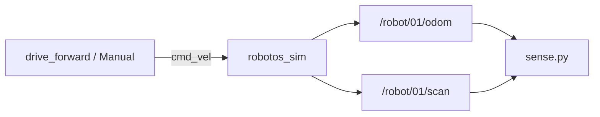
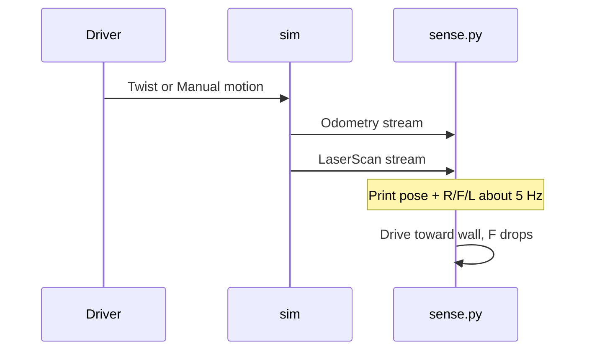

# Chapter 3 — Odometry & three-beam scan

## Learning outcomes

- Read pose (`x`, `y`, yaw) from `/robot/01/odom`  
- Interpret `ranges[0/1/2]` as right / front / left  
- Explain why P0 odom is a teaching model, not GPS  
- Run WH-02 while something moves the robot  

## Prerequisites

- Chapters 0–2; WH-00 / WH-01  
- Sim Connected (Native); External if you drive from a script  

## 1. Motivation

Driving blind (WH-01) proves the command path. Sensing proves the **feedback** path you need for avoid / wall-follow labs: “where am I?” and “how close is that shelf?”

## 2. Theory

### 2.1 Odometry

`robotos.nav.v1.Odometry` on `/robot/01/odom` carries:

- **Pose** in the `odom` frame — position + orientation (quaternion)  
- **Twist** — estimated velocity (useful later; WH-02 focuses on pose)

P0 warehouse odom is roughly **perfect integration** of applied commands (no wheel slip). That is still valuable: you learn message fields and closed-loop structure without fighting a noisy EKF on day one.

**Not GPS:** the origin is wherever the sim episode started (or last reset), not a map frame on Earth.

### 2.2 Yaw from quaternion (z-up)

Orientation is a quaternion `(x, y, z, w)`. For planar yaw:

\[
\psi = \operatorname{atan2}\bigl(2(wz + xy),\; 1 - 2(y^2 + z^2)\bigr)
\]

The starter implements this in `yaw_from_quat` — you do not need full 3D attitude theory yet.

### 2.3 LaserScan P0 — three beams

Not a spinning lidar. Contract beams:

| Index | Name | Angle |
|-------|------|-------|
| `ranges[0]` | right | −90° |
| `ranges[1]` | front | 0° |
| `ranges[2]` | left | +90° |

Check `range_max` (and invalid/sentinel values if present) before treating a large number as “no wall forever.”

Publish rate is on the order of ~20 Hz; the UI may look smoother than the graph.

## 3. Architecture



## 4. Sequence



## 5–6. Hands-on

See lab sheet [`labs/wh/wh-02-sense-odom-scan/README.md`](../generated/wh/wh-02-sense-odom-scan/index.md).

## 7. Code walkthrough — `sense.py`

| Piece | Role |
|-------|------|
| Two subscribers | Odom and scan are independent topics |
| `on_message` → `latest_*` | Callbacks store newest sample |
| Print loop `sleep(0.2)` | ~5 Hz display without flooding the terminal |
| `yaw_from_quat` | Convert orientation to a single planar angle |
| `ranges[0], [1], [2]` | Right, front, left per contract |

## 8. Expected output

```text
listening odom+scan — Ctrl-C to stop
x=0.00 y=0.00 yaw=0.00  R=2.50 F=2.50 L=2.50
x=0.41 y=0.00 yaw=0.00  R=2.50 F=1.80 L=2.50
```

(Exact numbers depend on map and motion.)

## 9. Troubleshooting

| Symptom | Fix |
|---------|-----|
| `odom=?` forever | Sim not Connected; wrong mesh env |
| `scan=?` | Topic name / sim not publishing scan |
| Numbers frozen | Nothing is moving the robot — run WH-01 or Manual |
| Front never drops | You are not facing a wall; check viewport |

## 10. Check yourself

1. Which range drops first when driving straight into a shelf?  
2. If odom updates but scan does not, what do you check?  
3. Why is odom not the same as “GPS coordinates”?

## Glossary

| Term | Meaning |
|------|---------|
| `odom` frame | Local pose frame integrated from motion |
| LaserScan | Range array message (here: 3 beams) |
| Quaternion | 4-number orientation; we extract yaw only |

## Next

- WH-03 avoid-front (use `ranges[1]`)  
- Chapter (planned): feedback control  
- Contract: [`docs/p0-contract.md`](../../p0-contract.md)  
