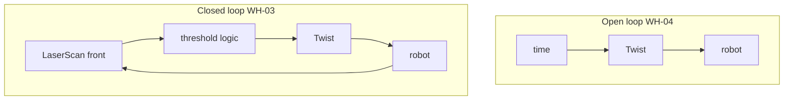
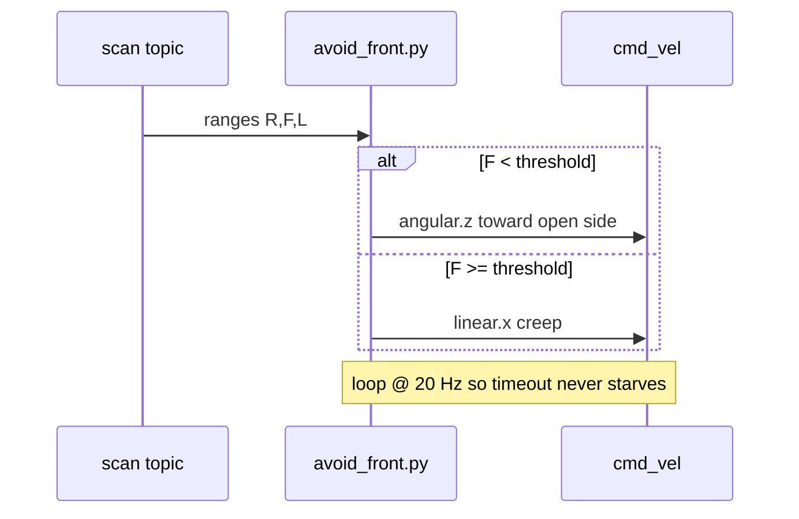

# Chapter 5 — Feedback vs open loop

## Learning outcomes

- Contrast open-loop timed commands with closed-loop sensor-based commands  
- Describe bang-bang control and its chatter failure mode  
- Explain why WH-03 must keep publishing against the 500 ms timeout  
- Predict why WH-04 squares drift  

## Prerequisites

- Chapters 2–3; labs WH-01 / WH-02  

## 1. Motivation

WH-01 proved you can move. WH-02 proved you can see. Feedback ties them: **command = f(sensors)** so the robot reacts to the world instead of hoping a timer is enough.

## 2. Theory

### 2.1 Open loop

`cmd = f(time)` — e.g. “drive 2 s, turn 1 s, repeat.” Easy to write; blind to walls and slip. WH-04 uses this on purpose so you *feel* the failure after seeing feedback win in WH-03.

### 2.2 Closed loop

`cmd = f(sensors)` — WH-03 reads front range and chooses creep vs turn.

### 2.3 Bang-bang

Discrete thresholds (“too close / OK”), not continuous PID yet. Good first controller; classic failure: **chatter** if the measurement oscillates around the threshold.

### 2.4 Timing math (still approximate)

Distance ≈ \(v \cdot \Delta t\), angle ≈ \(\omega \cdot \Delta t\). Clamps, discrete steps, and collisions break perfection even when odom is “perfect integration.”

## 3. Architecture

## 4. Sequence (avoid-front)

## 5–6. Hands-on

- [`labs/wh/wh-03-avoid-front/README.md`](../generated/wh/wh-03-avoid-front/index.md)  
- Then WH-04 square (open loop) for contrast  

## 7. Code walkthrough — `avoid_front.py`

| Piece | Role |
|-------|------|
| Subscribe scan / publish Twist | Classic sense→actuate node |
| `ranges[1]` vs `--threshold` | Bang-bang front gate |
| Turn sign from `L` vs `R` | Prefer the more open side |
| 20 Hz loop + zero on Ctrl-C | Timeout safety + clean stop |

## 8. Expected results

Robot creeps in open space; near a wall it spins instead of tunneling into shelves for ≥30 s.

## 9. Troubleshooting

| Symptom | Fix |
|---------|-----|
| Hits wall anyway | Threshold too small; External mode; publish rate |
| Spins forever in open space | Stale `inf` ranges — wait for first scan |
| Jerky / stops randomly | Rate too low vs 500 ms timeout |

## 10. Check yourself

1. Name one bang-bang failure mode.  
2. Will a “perfect” timed square always close in odom?  
3. Why run WH-04 *after* WH-03 pedagogically?

## Glossary

| Term | Meaning |
|------|---------|
| Open loop | Commands without using live sensors |
| Closed loop | Commands from sensor feedback |
| Bang-bang | Two-state (or few-state) threshold control |
| Chatter | Rapid flipping around a threshold |

## Next

- WH-05 / WH-06 wall-follow + FSM  
- Chapter (planned): state machines  
