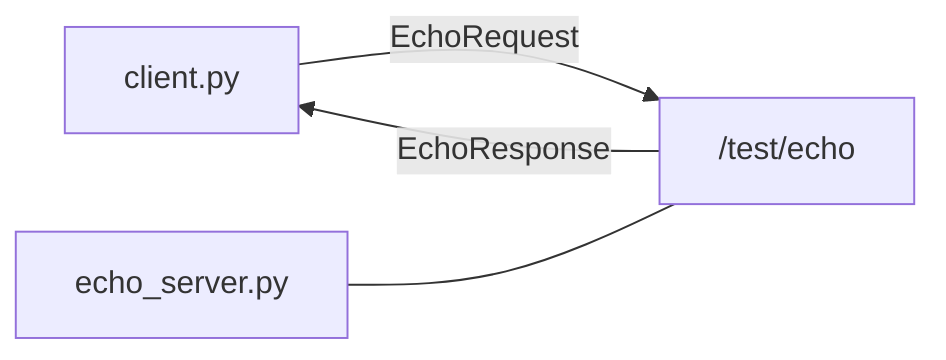
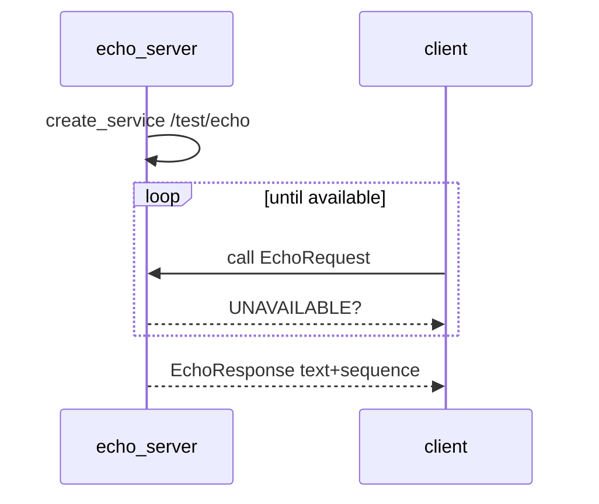

# Chapter 6 — Services (request / reply)

## Learning outcomes

- Contrast **topics** (streams) with **services** (one request → one response)  
- Run echo server + client on `/test/echo`  
- Explain why long jobs belong in **actions**, not services  

## Prerequisites

- MW-00 / MW-01; Chapter 1 vocabulary  

## 1. Motivation

Sometimes you do not want a firehose of messages — you want “please do X and tell me the result once.” That is a **service**.

## 2. Theory

| Pattern | Shape | Good for |
|---------|-------|----------|
| Topic | continuous pub/sub | sensors, cmd_vel |
| Service | request → response | echo, get config, reset |
| Action | goal → feedback → result | long motions (MW-03) |

The client addresses the **service name** (e.g. `/test/echo`), not the server process PID. Discovery finds a provider.

**Anti-pattern:** a 5-minute homing routine as a blocking service call — use an **action** so you can get feedback and cancel.

## 3. Architecture



## 4. Sequence



## 5–6. Hands-on

[`labs/mw/mw-02-services/README.md`](../generated/mw/mw-02-services/index.md)

## 7. Code walkthrough

**Server** — `create_service(SVC, EchoRequest, EchoResponse, handler)` then sleep loop.

**Client** — `node.call(..., timeout_ms=2000)` with retries on status `UNAVAILABLE` (server not up yet).

## 8. Expected output

```text
# server
serving /test/echo — Ctrl-C to stop
request: 'hello robotos' (seq 1)

# client
reply: 'hello robotos' (seq 1)
```

## 9. Troubleshooting

| Symptom | Fix |
|---------|-----|
| `no responder` | Start server first; same mesh env |
| Import / schema errors | Pack wheel includes `echo_pb2` |
| Wrong shell PATH | Activate `.venv` in both terminals |

## 10. Check yourself

1. Why not implement “5-minute homing” as a service?  
2. What does the client identify — process or service name?  

## Glossary

| Term | Meaning |
|------|---------|
| Service | Named RPC-style request/response on the graph |
| UNAVAILABLE | No provider (yet) for that service name |

## Next

- MW-03 actions  
- Theory notes: [`docs/theory/08-services.md`](../../theory/08-services.md)  
