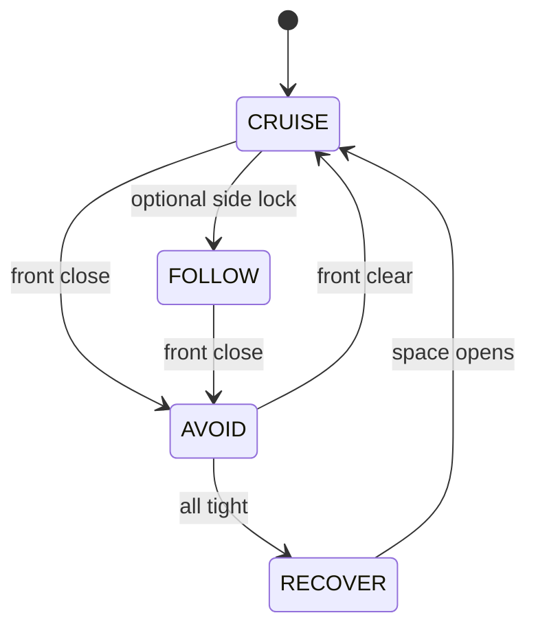
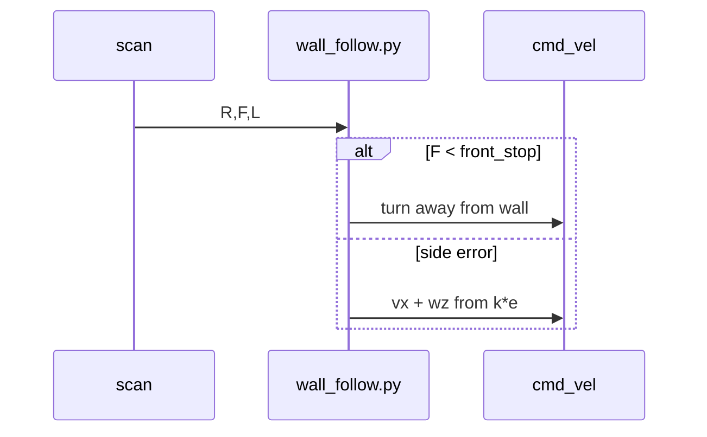

# Chapter 8 — Wall follow & state machines

## Learning outcomes

- Form a side-range error and steer with a proportional gain  
- Treat front range as an **interrupt** to wall hugging  
- Name FSM states, log transitions, and detect stuck  

## Prerequisites

- Chapters 3 & 5; WH-03  

## 1. Motivation

Bang-bang avoid keeps you alive. Wall follow keeps you **useful** in aisles. An FSM keeps the logic **gradable and debuggable** when behaviors multiply.

## 2. Theory

### 2.1 Wall follow

Error: \(e = d_{\mathrm{target}} - d_{\mathrm{side}}\) (too far / too near).  
Steer: `angular.z ∝ −e` (sign depends on left vs right wall).  
Front close → do **not** hug into a corner; switch to turn/avoid.  
Gains \(k\) are empiric in the warehouse — theory gives structure; practice tunes.

### 2.2 State machines

| Idea | Meaning |
|------|---------|
| State | Named mode (CRUISE / AVOID / FOLLOW / RECOVER) |
| Transition | Boolean on sensors (and timers) |
| Log | Print `t=… CRUISE → AVOID` every change |
| Stuck | All ranges tight → RECOVER, not infinite AVOID chatter |

One giant anonymous `if` is hard to grade and harder to debug.

## 3. Architecture

## 4. Sequence (wall follow loop)

## 5–6. Hands-on

- [`labs/wh/wh-05-wall-follow/README.md`](../generated/wh/wh-05-wall-follow/index.md)  
- [`labs/wh/wh-06-state-machine/README.md`](../generated/wh/wh-06-state-machine/index.md)  

## 7. Code notes

`wall_follow.py`: `--side`, `--target`, `--k`, `--front-stop`; 20 Hz publish.  
`fsm_drive.py`: explicit states + transition prints (read starter).

## 8. Expected results

WH-05: lap an aisle ≥60 s. WH-06: 90 s run with readable transition log.

## 9. Troubleshooting

| Symptom | Fix |
|---------|-----|
| Oscillates on side | Lower `k` / raise rate |
| Spins forever | Front interrupt missing; RECOVER never entered |
| Timeout stops | Publish loop too slow |

## 10. Check yourself

1. Why name states instead of one giant `if`?  
2. What if FOLLOW never yields to AVOID?  

## Glossary

| Term | Meaning |
|------|---------|
| Side error | Target distance minus measured side range |
| FSM | Finite state machine |
| RECOVER | Escape when sensors say “boxed in” |

## Next

- WH-07 bags / evidence  
- Capstone WH-08  
