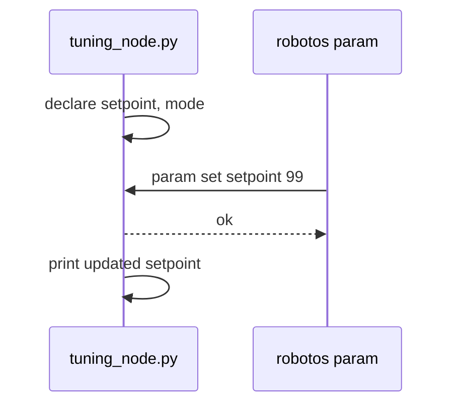

# Chapter 10 — Parameters & lifecycle

## Learning outcomes

- Treat params as typed named config on a node (not a config topic)  
- `list` / `get` / `set` a live setpoint from the CLI  
- Explain why remote sets are gated and why lifecycle exists  
- Relate laptop params (MW-04) to board NVM params (HW-04)  

## Prerequisites

- MW-00…02; optional HW-00 for board params  

## 1. Motivation

Hard-coding `setpoint = 42` in source forces a rebuild for every tune. **Parameters** let you change config while the node runs. **Lifecycle** is orderly bring-up/shutdown — not `kill -9` pedagogy.

## 2. Theory

### 2.1 Parameters

| Idea | Detail |
|------|--------|
| Declare | Node advertises name + type + default |
| Get / set / watch | Read, write, observe changes |
| Persist | Optional save/load (board NVM for HW-04) |
| Trust | Remote writes need explicit allow |

**Param vs topic:** a topic streams values forever; a param is addressed config on a **node**. You usually do not spam “config messages” on a topic when the platform has params.

### 2.2 Lifecycle

Typical path: unconfigured → inactive → active → …  
CLI can query/transition where the pack exposes it. Goal: safe online / offline.

## 3. Architecture

## 4. Sequence

## 5–6. Hands-on

- Laptop: [`labs/mw/mw-04-parameters/README.md`](../generated/mw/mw-04-parameters/index.md)  
- Board: [`labs/hw/hw-04-board-params/README.md`](../generated/hw/hw-04-board-params/index.md)  

## 7. Code / CLI notes

Exact `robotos param` / `lifecycle` subcommands: pack `--help` and NOTES.  
HW-04 `--persist` survives reboot only for supported board params.

## 8. Expected results

MW-04: printout changes after `param set`.  
HW-04: `get` after `set` matches; stretch = persist across unplug.

## 9. Troubleshooting

| Symptom | Fix |
|---------|-----|
| Node not listed | `tuning_node` not running; name mismatch |
| Set rejected | Remote set not allowed / wrong type |
| Board persist no-op | Param not NVM-backed; caps/firmware |

## 10. Check yourself

Difference between a param and a topic of “config messages”?

## Glossary

| Term | Meaning |
|------|---------|
| Param | Typed config field on a node |
| NVM | Non-volatile memory on the board |
| Lifecycle | Explicit node state machine for bring-up |

## Next

- MW-06 twin · Chapter 11  
- Theory: [`docs/theory/10-params-lifecycle.md`](../../theory/10-params-lifecycle.md)  
