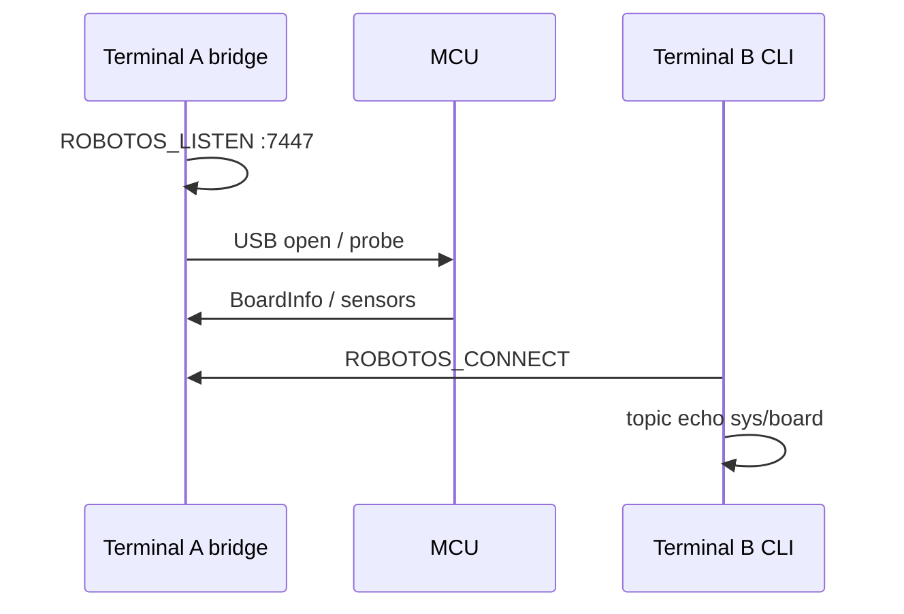

# HW-00 — Board on the graph

<div class="ebook-run">

**Track:** `hw` (Hardware) · **Lab:** `hw-00` · **Folder:** `hw-00-board-connect`

Paste the **whole** block for your computer. A new window does not keep PATH or `.venv`. `YOUR_WORKSHOP_DIR` is the folder that contains `SETUP.md`.

**Windows (PowerShell)**

```powershell
cd YOUR_WORKSHOP_DIR
$env:PATH = "$PWD\code\robotos-v0.3.0-windows-x64\bin;$env:PATH"
.\.venv\Scripts\Activate.ps1
scripts\run.cmd hw-00
```

---

**macOS Apple Silicon (zsh or bash)**

```bash
cd YOUR_WORKSHOP_DIR
export PATH="$PWD/code/robotos-v0.3.0-macos-arm64/bin:$PATH"
source .venv/bin/activate
./scripts/run hw-00
```

---

**Linux (bash)** — only if `code/robotos-v0.3.0-linux-x64` is in your drop:

```bash
cd YOUR_WORKSHOP_DIR
export PATH="$PWD/code/robotos-v0.3.0-linux-x64/bin:$PATH"
source .venv/bin/activate
./scripts/run hw-00
```

---

Prerequisite: serial bridge running, warehouse sim closed.

<p class="ebook-source"><strong>Source:</strong> <code>labs/hw/hw-00-board-connect/README.md</code></p>

</div>


## Goal

Bring the ESP32-S3 onto the robotos graph via `serial-bridge` and see `/robot/01/sys/board`.

## This window forgets

`robotos` is not installed on the computer. The program is a file in `code/…/bin` inside the workshop folder. Lab `python` is the `.venv` in that same folder. A new Terminal, PowerShell, Cursor, or VS Code window starts blank and does not remember them.

Every command block on this page begins with the lines for your computer. Paste the **whole** block. If you open another window, paste the whole block again.

`YOUR_WORKSHOP_DIR` is the folder that contains `SETUP.md`, `code/`, and `labs/`. If `dir` or `ls` does not show those names, you are in the wrong folder. If activate says `.venv` does not exist, do the Python SDK check in [MW-00](../../mw/mw-00-getting-started/index.md) first, then come back and paste the block again.

## Learning outcomes

- Run bridge (listen) and lab terminal (connect) without env conflicts  
- Confirm board topics with `topic list` / `topic echo`  

## Theory

- Ebook: [`ch04-board-on-graph.md`](../../../chapters/ch04-board-on-graph.md)  
- Notes: [`docs/theory/14-board-on-graph.md`](../../../docs/theory/14-board-on-graph.md)

## Prerequisites

- ESP32-S3 workshop board + USB; firmware preflashed  
- [`code/NOTES.txt`](../../../code/NOTES.txt) section B / B2  
- [`SETUP.md`](../../../../SETUP.md) §7  

## Architecture

```mermaid
flowchart LR
  mcu[ESP32-S3] -->|USB UART| bridge[serial-bridge]
  bridge --> graph[Topics /robot/01/*]
  student[CLI / Python] --> graph
```



## Windows

Use **PowerShell**. Follow this section from the first block to the last.

If `Activate.ps1` is blocked, run this once, then paste the lab block again:

```powershell
Set-ExecutionPolicy -Scope CurrentUser RemoteSigned
```

### Bridge (terminal A)

Leave this terminal open.

> **Preferred:** double-click `scripts\start-bridge.cmd`. Manual commands below if a TA asks.

```powershell
cd YOUR_WORKSHOP_DIR
$env:PATH = "$PWD\code\robotos-v0.3.0-windows-x64\bin;$env:PATH"
$env:ROBOTOS_LISTEN = "tcp/0.0.0.0:7447"
serial-bridge --port auto --baud 921600 --robot-id 01 --cmd-topic all
# or: serial-bridge --port COM7 --baud 921600 --robot-id 01 --cmd-topic all
```

### Practice (terminal B)

```powershell
cd YOUR_WORKSHOP_DIR
$env:PATH = "$PWD\code\robotos-v0.3.0-windows-x64\bin;$env:PATH"
Remove-Item Env:ROBOTOS_LISTEN -ErrorAction SilentlyContinue
$env:ROBOTOS_CONNECT = "tcp/127.0.0.1:7447"
robotos node list
robotos topic list
robotos topic echo /robot/01/sys/board --count 3
```

---

## macOS

Use **Terminal** on Apple Silicon (zsh or bash). Follow this section from the first block to the last.

### Bridge (terminal A)

Leave this terminal open.

> **Preferred:** run `./scripts/start-bridge.sh` from this folder. Manual commands below if a TA asks.

```bash
cd YOUR_WORKSHOP_DIR
export PATH="$PWD/code/robotos-v0.3.0-macos-arm64/bin:$PATH"
export ROBOTOS_LISTEN=tcp/0.0.0.0:7447
chmod +x code/robotos-v*/bin/serial-bridge 2>/dev/null || true
serial-bridge --port auto --baud 921600 --robot-id 01 --cmd-topic all
# If auto skips /dev/cu.usbmodem* , pin the "[auto] selected" path.
# This Mac selected /dev/tty.usbmodem101.
```

### Practice (terminal B)

```bash
cd YOUR_WORKSHOP_DIR
export PATH="$PWD/code/robotos-v0.3.0-macos-arm64/bin:$PATH"
unset ROBOTOS_LISTEN
export ROBOTOS_CONNECT=tcp/127.0.0.1:7447
robotos node list
robotos topic list
robotos topic echo /robot/01/sys/board --count 3
```

---

## Linux

Use **bash**. Follow this section from the first block to the last. Skip it when `code/robotos-v0.3.0-linux-x64` is not in your drop.

### Bridge (terminal A)

Leave this terminal open.

> **Preferred:** run `./scripts/start-bridge.sh` from this folder. Manual commands below if a TA asks.

```bash
cd YOUR_WORKSHOP_DIR
export PATH="$PWD/code/robotos-v0.3.0-linux-x64/bin:$PATH"
export ROBOTOS_LISTEN=tcp/0.0.0.0:7447
chmod +x code/robotos-v*/bin/serial-bridge 2>/dev/null || true
serial-bridge --port auto --baud 921600 --robot-id 01 --cmd-topic all
# or: --port /dev/ttyACM0
```

Linux permission denied → `sudo usermod -aG dialout $USER` then log out/in.

### Practice (terminal B)

```bash
cd YOUR_WORKSHOP_DIR
export PATH="$PWD/code/robotos-v0.3.0-linux-x64/bin:$PATH"
unset ROBOTOS_LISTEN
export ROBOTOS_CONNECT=tcp/127.0.0.1:7447
robotos node list
robotos topic list
robotos topic echo /robot/01/sys/board --count 3
```

---

## Expected output

`topic list` shows `/robot/01/sys/board` (and often IMU/battery). Echo prints `BoardInfo { … }`.

## Troubleshooting

| Symptom | Fix |
|---------|-----|
| No topics | Bridge down; `ROBOTOS_CONNECT` missing; USB |
| Port busy | Close serial monitors / other bridges |
| Linux access denied | `dialout` + re-login |
| Self-connect errors | Do not set LISTEN+CONNECT in the same process |

## Done when

You see board-related topics (at least `/robot/01/sys/board` or sensor streams).

See [CHECKLIST.md](CHECKLIST.md).

---

## Checklist

<p class="ebook-source"><strong>Source:</strong> <code>labs/hw/hw-00-board-connect/CHECKLIST.md</code></p>

### HW-00 checklist

- [ ] Bridge / connect env set
- [ ] `node list` or `topic list` shows board traffic
- [ ] Echoed at least one board/sys message
