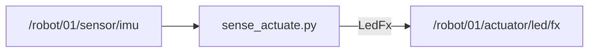

# HW-07 — Sense → actuate (closed loop on silicon)

<div class="ebook-run">

**Track:** `hw` (Hardware) · **Lab:** `hw-07` · **Folder:** `hw-07-sense-actuate`

```text
# from workshop root
scripts\run.cmd hw-07
# Unix: ./scripts/run hw-07
# prerequisite: scripts/start-bridge running; sim closed
```

<p class="ebook-source"><strong>Source:</strong> <code>labs/hw/hw-07-sense-actuate/README.md</code></p>

</div>


## Goal

One host node: **read a sensor**, **command an actuator** (WH-03 pattern on hardware).

## Learning outcomes

- Branch on HW-01 caps (IMU+LED vs IMU-only vs LED-only)  
- Close a loop: tilt → LED / console state  
- Zero/off on exit when commanding LEDs  

## Prerequisites

- HW-01/02/03 as needed for your caps  
- Ebook: [`ch05-feedback-control.md`](../../../chapters/ch05-feedback-control.md) + [`ch04-board-on-graph.md`](../../../chapters/ch04-board-on-graph.md)

## Spec (minimum)

- If board has **IMU + LED**: tilt threshold → LED solid; level → off.  
- If **IMU only**: print `TILT` / `LEVEL` (no LED).  
- If **LED only**: map battery % or a param into color (instructor pick).

## Architecture



## Run

> **Preferred runner** (workshop root): `scripts\run.cmd <lab-id>` (Windows) or `./scripts/run <lab-id>` (macOS/Linux). List: `scripts\run.cmd list`. The `python labs/...` lines below still work.


### Windows (PowerShell)

```powershell
python labs\hw\hw-07-sense-actuate\starter\sense_actuate.py
```

### Linux / macOS (bash)

```bash
python labs/hw/hw-07-sense-actuate/starter/sense_actuate.py
```

Needs caps matching your branch (probe with HW-01 first). On `ws28p`, expect IMU path + LED publish may be a no-op (no LED cap) — console `TILT`/`LEVEL` still counts.

## Expected output

```text
tilt>25.0° → LED; level → off — Ctrl-C
TILT 138°
LEVEL 12°
```

## Troubleshooting

| Symptom | Fix |
|---------|-----|
| No prints | Bridge / IMU cap / `ROBOTOS_CONNECT` |
| LED dark with TILT | No LED cap — OK; use console branch |
| Forgot `--cmd-topic all` | Restart bridge with flag |

## Done when

Physical motion (or chosen input) changes an actuator or clear console state without Manual board UI.

See [CHECKLIST.md](CHECKLIST.md).

---

## Checklist

<p class="ebook-source"><strong>Source:</strong> <code>labs/hw/hw-07-sense-actuate/CHECKLIST.md</code></p>

### HW-07 checklist

- [ ] Caps checked (HW-01)
- [ ] Sensor subscription live
- [ ] Actuator or state output responds to sensor
