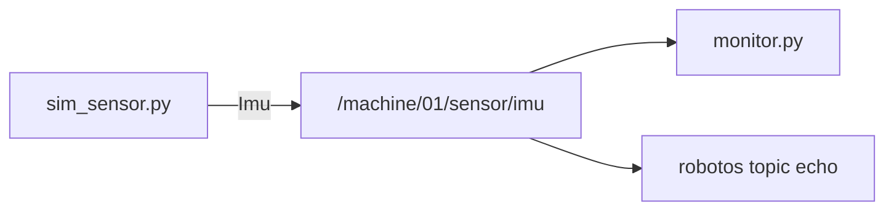
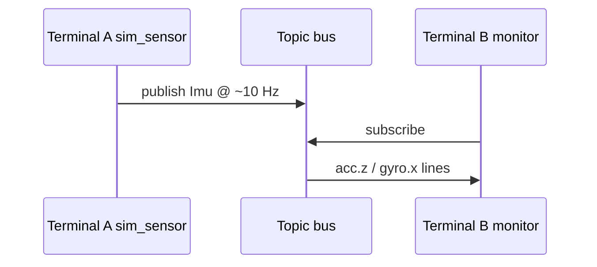

# MW-01 — Publish & subscribe

<div class="ebook-run">

**Track:** `mw` (Middleware) · **Lab:** `mw-01` · **Folder:** `mw-01-pub-sub`

Paste the **whole** block for your computer. A new window does not keep PATH or `.venv`. `YOUR_WORKSHOP_DIR` is the folder that contains `SETUP.md`.

**Windows (PowerShell)**

```powershell
cd YOUR_WORKSHOP_DIR
$env:PATH = "$PWD\code\robotos-v0.3.0-windows-x64\bin;$env:PATH"
.\.venv\Scripts\Activate.ps1
scripts\run.cmd mw-01
```

---

**macOS Apple Silicon (zsh or bash)**

```bash
cd YOUR_WORKSHOP_DIR
export PATH="$PWD/code/robotos-v0.3.0-macos-arm64/bin:$PATH"
source .venv/bin/activate
./scripts/run mw-01
```

---

**Linux (bash)** — only if `code/robotos-v0.3.0-linux-x64` is in your drop:

```bash
cd YOUR_WORKSHOP_DIR
export PATH="$PWD/code/robotos-v0.3.0-linux-x64/bin:$PATH"
source .venv/bin/activate
./scripts/run mw-01
```

---

<p class="ebook-source"><strong>Source:</strong> <code>labs/mw/mw-01-pub-sub/README.md</code></p>

</div>


## Goal

Run a publisher and a subscriber on `/machine/01/sensor/imu` (`robotos.sensor.v1.Imu`) without the warehouse sim.

## This window forgets

`robotos` is not installed on the computer. The program is a file in `code/…/bin` inside the workshop folder. Lab `python` is the `.venv` in that same folder. A new Terminal, PowerShell, Cursor, or VS Code window starts blank and does not remember them.

Every command block on this page begins with the lines for your computer. Paste the **whole** block. If you open another window, paste the whole block again.

`YOUR_WORKSHOP_DIR` is the folder that contains `SETUP.md`, `code/`, and `labs/`. If `dir` or `ls` does not show those names, you are in the wrong folder. If activate says `.venv` does not exist, do the Python SDK check in [MW-00](../../mw/mw-00-getting-started/index.md) first, then come back and paste the block again.

## Learning outcomes

- Start two processes that share one topic  
- Read live values with `monitor.py` and `robotos topic echo`  
- Confirm discovery with `topic list` (PUBS/SUBS counts)  

## Prerequisites

- MW-00 done  
- Ebook: [`ch01-graph-nodes-topics.md`](../../../chapters/ch01-graph-nodes-topics.md)  
- Theory: [`docs/theory/07-messages-schema.md`](../../../docs/theory/07-messages-schema.md)

## Theory (short)

A **publisher** sends typed messages on a named **topic**. A **subscriber** receives them. Both must agree on the schema (`robotos.sensor.v1.Imu`). This lab does **not** need the warehouse sim.

## Architecture



## Sequence



## Windows

Use **PowerShell**. Follow this section from the first block to the last.

If `Activate.ps1` is blocked, run this once, then paste the lab block again:

```powershell
Set-ExecutionPolicy -Scope CurrentUser RemoteSigned
```

### Both terminals

Press the `Win` key, type `PowerShell`, and press Enter. That is terminal 1. Do it again for terminal 2 (a second window).

```powershell
cd YOUR_WORKSHOP_DIR
$env:PATH = "$PWD\code\robotos-v0.3.0-windows-x64\bin;$env:PATH"
.\.venv\Scripts\Activate.ps1
```

> **Preferred runner** (workshop root): pick the starter name —
> `scripts\run.cmd mw-01 sim_sensor` or `scripts\run.cmd mw-01 monitor`.
> You still need **two** terminals (publisher + subscriber).

### Terminal A — publisher (leave running)

```powershell
cd YOUR_WORKSHOP_DIR
$env:PATH = "$PWD\code\robotos-v0.3.0-windows-x64\bin;$env:PATH"
.\.venv\Scripts\Activate.ps1
python labs\mw\mw-01-pub-sub\starter\sim_sensor.py
```

You should see `publishing on /machine/01/sensor/imu`.  
It looks “stuck” — that is normal. Stop later with **Ctrl-C**.

### Terminal B — subscriber / CLI

```powershell
cd YOUR_WORKSHOP_DIR
$env:PATH = "$PWD\code\robotos-v0.3.0-windows-x64\bin;$env:PATH"
.\.venv\Scripts\Activate.ps1
robotos topic list
robotos topic echo /machine/01/sensor/imu --count 5
python labs\mw\mw-01-pub-sub\starter\monitor.py 5
```

(`monitor.py 5` exits after ~5 s. No argument → waits for Enter.)

---

## macOS

Use **Terminal** on Apple Silicon (zsh or bash). Follow this section from the first block to the last.

### Both terminals

Open **Terminal**. That is terminal 1. Open a second Terminal window for terminal 2.

```bash
cd YOUR_WORKSHOP_DIR
export PATH="$PWD/code/robotos-v0.3.0-macos-arm64/bin:$PATH"
source .venv/bin/activate
```

> **Preferred runner** (workshop root): pick the starter name —
> `./scripts/run mw-01 sim_sensor` or `./scripts/run mw-01 monitor`.
> You still need **two** terminals (publisher + subscriber).

### Terminal A — publisher (leave running)

```bash
cd YOUR_WORKSHOP_DIR
export PATH="$PWD/code/robotos-v0.3.0-macos-arm64/bin:$PATH"
source .venv/bin/activate
python labs/mw/mw-01-pub-sub/starter/sim_sensor.py
```

You should see `publishing on /machine/01/sensor/imu`.  
It looks “stuck” — that is normal. Stop later with **Ctrl-C**.

### Terminal B — subscriber / CLI

```bash
cd YOUR_WORKSHOP_DIR
export PATH="$PWD/code/robotos-v0.3.0-macos-arm64/bin:$PATH"
source .venv/bin/activate
robotos topic list
robotos topic echo /machine/01/sensor/imu --count 5
python labs/mw/mw-01-pub-sub/starter/monitor.py 5
```

(`monitor.py 5` exits after ~5 s. No argument → waits for Enter.)

---

## Linux

Use **bash**. Follow this section from the first block to the last. Skip it when `code/robotos-v0.3.0-linux-x64` is not in your drop.

### Both terminals

Open a terminal. That is terminal 1. Open a second terminal window for terminal 2.

```bash
cd YOUR_WORKSHOP_DIR
export PATH="$PWD/code/robotos-v0.3.0-linux-x64/bin:$PATH"
source .venv/bin/activate
```

> **Preferred runner** (workshop root): pick the starter name —
> `./scripts/run mw-01 sim_sensor` or `./scripts/run mw-01 monitor`.
> You still need **two** terminals (publisher + subscriber).

### Terminal A — publisher (leave running)

```bash
cd YOUR_WORKSHOP_DIR
export PATH="$PWD/code/robotos-v0.3.0-linux-x64/bin:$PATH"
source .venv/bin/activate
python labs/mw/mw-01-pub-sub/starter/sim_sensor.py
```

You should see `publishing on /machine/01/sensor/imu`.  
It looks “stuck” — that is normal. Stop later with **Ctrl-C**.

### Terminal B — subscriber / CLI

```bash
cd YOUR_WORKSHOP_DIR
export PATH="$PWD/code/robotos-v0.3.0-linux-x64/bin:$PATH"
source .venv/bin/activate
robotos topic list
robotos topic echo /machine/01/sensor/imu --count 5
python labs/mw/mw-01-pub-sub/starter/monitor.py 5
```

(`monitor.py 5` exits after ~5 s. No argument → waits for Enter.)

---

## Code walkthrough

| File | Role |
|------|------|
| `sim_sensor.py` | Creates a node, publishes `Imu` in a loop (~10 Hz) |
| `monitor.py` | Subscribes with `on_message`, prints `acc.z` / `gyro.x` |

## Expected output

```text
# topic list includes:
/machine/01/sensor/imu    1    …    robotos.sensor.v1.Imu

# monitor:
subscribed — 5s
acc.z=9.81  gyro.x=+0.123
…
```

## Troubleshooting

| Symptom | Fix |
|---------|-----|
| `robotos` / `python` not found | Paste this page's command block again in **this** window |
| `labs\mw\...` path not found | `cd` to workshop root first (see both-terminals block) |
| Empty topic list | Terminal A not running — wait 1–2 s |
| Monitor empty after Ctrl-C on A | You stopped the publisher; start A again |
| Thought publisher “froze” | Infinite loop is normal — Ctrl-C to stop |
| Leftover HW env | Unset `ROBOTOS_LISTEN` in student terminals |

## Check yourself

1. Who publishes? Who subscribes?  
2. What schema must both sides share?  

## Glossary

| Term | Meaning |
|------|---------|
| Publisher | Node that sends on a topic |
| Subscriber | Node that receives on a topic |
| Imu | Sensor message (accel + gyro fields) |

## Done when

Monitor prints live values; `topic list` shows the pub/sub.

See [CHECKLIST.md](CHECKLIST.md).

---

## Checklist

<p class="ebook-source"><strong>Source:</strong> <code>labs/mw/mw-01-pub-sub/CHECKLIST.md</code></p>

### MW-01 checklist

- [ ] Sensor publishing
- [ ] Monitor receiving
- [ ] `topic echo` works
