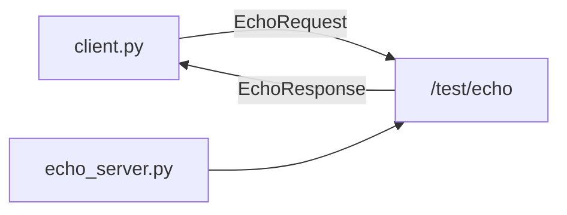

# MW-02 — Services

<div class="ebook-run">

**Track:** `mw` (Middleware) · **Lab:** `mw-02` · **Folder:** `mw-02-services`

Paste the **whole** block for your computer. A new window does not keep PATH or `.venv`. `YOUR_WORKSHOP_DIR` is the folder that contains `SETUP.md`.

**Windows (PowerShell)**

```powershell
cd YOUR_WORKSHOP_DIR
$env:PATH = "$PWD\code\robotos-v0.3.0-windows-x64\bin;$env:PATH"
.\.venv\Scripts\Activate.ps1
scripts\run.cmd mw-02
```

---

**macOS Apple Silicon (zsh or bash)**

```bash
cd YOUR_WORKSHOP_DIR
export PATH="$PWD/code/robotos-v0.3.0-macos-arm64/bin:$PATH"
source .venv/bin/activate
./scripts/run mw-02
```

---

**Linux (bash)** — only if `code/robotos-v0.3.0-linux-x64` is in your drop:

```bash
cd YOUR_WORKSHOP_DIR
export PATH="$PWD/code/robotos-v0.3.0-linux-x64/bin:$PATH"
source .venv/bin/activate
./scripts/run mw-02
```

---

<p class="ebook-source"><strong>Source:</strong> <code>labs/mw/mw-02-services/README.md</code></p>

</div>


## Goal

Call a request/reply **service** (`/test/echo`) while a server is running.

## This window forgets

`robotos` is not installed on the computer. The program is a file in `code/…/bin` inside the workshop folder. Lab `python` is the `.venv` in that same folder. A new Terminal, PowerShell, Cursor, or VS Code window starts blank and does not remember them.

Every command block on this page begins with the lines for your computer. Paste the **whole** block. If you open another window, paste the whole block again.

`YOUR_WORKSHOP_DIR` is the folder that contains `SETUP.md`, `code/`, and `labs/`. If `dir` or `ls` does not show those names, you are in the wrong folder. If activate says `.venv` does not exist, do the Python SDK check in [MW-00](../../mw/mw-00-getting-started/index.md) first, then come back and paste the block again.

## Learning outcomes

- Contrast topic streams vs service RPC  
- Start server + client in two terminals  
- See retry-on-unavailable while the server starts  

## Prerequisites

- MW-01; paste this page's command block in **both** windows  
- Ebook: [`ch06-services.md`](../../../chapters/ch06-services.md)  
- Theory: [`docs/theory/08-services.md`](../../../docs/theory/08-services.md)

## Architecture



## Windows

Use **PowerShell**. Follow this section from the first block to the last.

If `Activate.ps1` is blocked, run this once, then paste the lab block again:

```powershell
Set-ExecutionPolicy -Scope CurrentUser RemoteSigned
```

> **Preferred runner** (workshop root): this lab has multiple starters — `scripts\run.cmd mw-02 <starter>`. Starters: `echo_server / client`. List: `scripts\run.cmd list`. Paste the whole block below, including the first lines. A new window needs the whole block again.

### Terminal A — server

```powershell
cd YOUR_WORKSHOP_DIR
$env:PATH = "$PWD\code\robotos-v0.3.0-windows-x64\bin;$env:PATH"
.\.venv\Scripts\Activate.ps1
python labs\mw\mw-02-services\starter\echo_server.py
```

### Terminal B — client

```powershell
cd YOUR_WORKSHOP_DIR
$env:PATH = "$PWD\code\robotos-v0.3.0-windows-x64\bin;$env:PATH"
.\.venv\Scripts\Activate.ps1
python labs\mw\mw-02-services\starter\client.py
robotos service list
```

Optional: `robotos service call` (CLI help). Client retries while the server starts — expected.

---

## macOS

Use **Terminal** on Apple Silicon (zsh or bash). Follow this section from the first block to the last.

> **Preferred runner** (workshop root): this lab has multiple starters — `./scripts/run mw-02 <starter>`. Starters: `echo_server / client`. List: `./scripts/run list`. Paste the whole block below, including the first lines. A new window needs the whole block again.

### Terminal A — server

```bash
cd YOUR_WORKSHOP_DIR
export PATH="$PWD/code/robotos-v0.3.0-macos-arm64/bin:$PATH"
source .venv/bin/activate
python labs/mw/mw-02-services/starter/echo_server.py
```

### Terminal B — client

```bash
cd YOUR_WORKSHOP_DIR
export PATH="$PWD/code/robotos-v0.3.0-macos-arm64/bin:$PATH"
source .venv/bin/activate
python labs/mw/mw-02-services/starter/client.py
robotos service list
```

Optional: `robotos service call` (CLI help). Client retries while the server starts — expected.

---

## Linux

Use **bash**. Follow this section from the first block to the last. Skip it when `code/robotos-v0.3.0-linux-x64` is not in your drop.

> **Preferred runner** (workshop root): this lab has multiple starters — `./scripts/run mw-02 <starter>`. Starters: `echo_server / client`. List: `./scripts/run list`. Paste the whole block below, including the first lines. A new window needs the whole block again.

### Terminal A — server

```bash
cd YOUR_WORKSHOP_DIR
export PATH="$PWD/code/robotos-v0.3.0-linux-x64/bin:$PATH"
source .venv/bin/activate
python labs/mw/mw-02-services/starter/echo_server.py
```

### Terminal B — client

```bash
cd YOUR_WORKSHOP_DIR
export PATH="$PWD/code/robotos-v0.3.0-linux-x64/bin:$PATH"
source .venv/bin/activate
python labs/mw/mw-02-services/starter/client.py
robotos service list
```

Optional: `robotos service call` (CLI help). Client retries while the server starts — expected.

---

## Expected output

```text
# A
serving /test/echo — Ctrl-C to stop
request: 'hello robotos' (seq 1)

# B
reply: 'hello robotos' (seq 1)
```

## Troubleshooting

| Symptom | Fix |
|---------|-----|
| `no responder` | Start A first; same workshop root / env |
| ImportError `echo_pb2` | Reinstall pack wheel into `.venv` |
| command not found | Paste this page's command block again in this window |

## Done when

Client prints the echoed reply.

See [CHECKLIST.md](CHECKLIST.md).

---

## Checklist

<p class="ebook-source"><strong>Source:</strong> <code>labs/mw/mw-02-services/CHECKLIST.md</code></p>

### MW-02 checklist

- [ ] Server running
- [ ] Client gets EchoResponse
- [ ] Can state topic vs service
