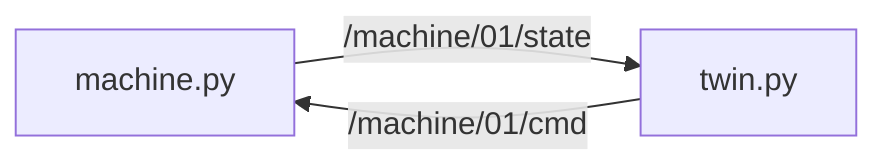

# MW-06 — Mini digital twin

<div class="ebook-run">

**Track:** `mw` (Middleware) · **Lab:** `mw-06` · **Folder:** `mw-06-mini-twin`

```text
# from workshop root
scripts\run.cmd mw-06
# Unix: ./scripts/run mw-06
```

<p class="ebook-source"><strong>Source:</strong> <code>labs/mw/mw-06-mini-twin/README.md</code></p>

</div>


## Goal

Run a plant (`machine.py`) and a twin (`twin.py`) on shared cmd/state topics.

## Learning outcomes

- Twin uses the **same** topic names as the plant  
- START/STOP changes reported “speed”  
- Bridge mentally to warehouse sim as a 3D twin  

## Prerequisites

- MW-01; Ebook: [`ch11-digital-twin.md`](../../../chapters/ch11-digital-twin.md)  
- Theory: [`docs/theory/13-digital-twin.md`](../../../docs/theory/13-digital-twin.md)

## Architecture



## Practice

> **Preferred runner** (workshop root): this lab has multiple starters — `scripts\run.cmd mw-06 <starter>` (Windows) or `./scripts/run mw-06 <starter>` (macOS/Linux). Starters: `machine / twin`. List: `scripts\run.cmd list`. The `python labs/...` lines below still work.


### Terminal A — plant

**Windows (PowerShell)**

```powershell
python labs\mw\mw-06-mini-twin\starter\machine.py
```

**Linux / macOS (bash)**

```bash
python labs/mw/mw-06-mini-twin/starter/machine.py
```

### Terminal B — twin

**Windows (PowerShell)**

```powershell
python labs\mw\mw-06-mini-twin\starter\twin.py
```

**Linux / macOS (bash)**

```bash
python labs/mw/mw-06-mini-twin/starter/twin.py
```

Topics: `/machine/01/state`, `/machine/01/cmd` (Imu used as a simple stand-in payload).

## Expected output

Twin prints rising/falling “speed” after START/STOP.

## Troubleshooting

| Symptom | Fix |
|---------|-----|
| Twin silent | Start machine first; same env |
| No speed change | Cmd not reaching plant |

## Bridge

Next: **warehouse sim** is the same idea with a 3D plant (`robotos_sim`). Future: board↔sim fusion (BACKLOG P3).

## Done when

Twin prints rising/falling “speed” after START/STOP.

See [CHECKLIST.md](CHECKLIST.md).

---

## Checklist

<p class="ebook-source"><strong>Source:</strong> <code>labs/mw/mw-06-mini-twin/CHECKLIST.md</code></p>

### MW-06 checklist

- [ ] Machine publishing state
- [ ] Twin mirrors speed
- [ ] START/STOP changes behavior
