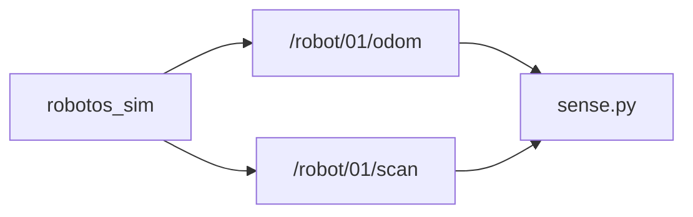

# Lab WH-02 — Sense odom + scan

<div class="ebook-run">

**Track:** `wh` (Warehouse) · **Lab:** `wh-02` · **Folder:** `wh-02-sense-odom-scan`

Paste the **whole** block for your computer. A new window does not keep PATH or `.venv`. `YOUR_WORKSHOP_DIR` is the folder that contains `SETUP.md`.

**Windows (PowerShell)**

```powershell
cd YOUR_WORKSHOP_DIR
$env:PATH = "$PWD\code\robotos-v0.3.0-windows-x64\bin;$env:PATH"
.\.venv\Scripts\Activate.ps1
scripts\run.cmd wh-02
```

---

**macOS Apple Silicon (zsh or bash)**

```bash
cd YOUR_WORKSHOP_DIR
export PATH="$PWD/code/robotos-v0.3.0-macos-arm64/bin:$PATH"
source .venv/bin/activate
./scripts/run wh-02
```

---

**Linux (bash)** — only if `code/robotos-v0.3.0-linux-x64` is in your drop:

```bash
cd YOUR_WORKSHOP_DIR
export PATH="$PWD/code/robotos-v0.3.0-linux-x64/bin:$PATH"
source .venv/bin/activate
./scripts/run wh-02
```

---

Prerequisite: warehouse sim running (`scripts/start-here`).

<p class="ebook-source"><strong>Source:</strong> <code>labs/wh/wh-02-sense-odom-scan/README.md</code></p>

</div>


## Goal

Subscribe to pose and the three rangers while the robot moves.

## This window forgets

`robotos` is not installed on the computer. The program is a file in `code/…/bin` inside the workshop folder. Lab `python` is the `.venv` in that same folder. A new Terminal, PowerShell, Cursor, or VS Code window starts blank and does not remember them.

Every command block on this page begins with the lines for your computer. Paste the **whole** block. If you open another window, paste the whole block again.

`YOUR_WORKSHOP_DIR` is the folder that contains `SETUP.md`, `code/`, and `labs/`. If `dir` or `ls` does not show those names, you are in the wrong folder. If activate says `.venv` does not exist, do the Python SDK check in [MW-00](../../mw/mw-00-getting-started/index.md) first, then come back and paste the block again.

## Learning outcomes

- Print `x`, `y`, yaw from odometry at ~5 Hz  
- Print right / front / left ranges and watch front drop near a wall  
- Relate cmd → motion → sensor updates  

## Prerequisites

- WH-00 / WH-01; sim **Native** + **Connected** (External if driving from a script)  
- Ebook: [`ch03-odometry-scan.md`](../../../chapters/ch03-odometry-scan.md)  
- Theory notes: [`docs/theory/03-odometry-scan.md`](../../../docs/theory/03-odometry-scan.md)

## Topics

| Topic | Schema |
|-------|--------|
| `/robot/01/odom` | `robotos.nav.v1.Odometry` |
| `/robot/01/scan` | `robotos.sensor.v1.LaserScan` |

Laser: `ranges[0]=right`, `[1]=front`, `[2]=left`.

## Architecture



## Windows

Use **PowerShell**. Follow this section from the first block to the last.

If `Activate.ps1` is blocked, run this once, then paste the lab block again:

```powershell
Set-ExecutionPolicy -Scope CurrentUser RemoteSigned
```

### Run

> **Preferred runner** (workshop root): `scripts\run.cmd <lab-id>`. List: `scripts\run.cmd list`. Paste the whole block below, including the first lines. A new window needs the whole block again.

Open a **second** window to drive (WH-01) or use Manual briefly. Paste this page's command block in that window too.

```powershell
cd YOUR_WORKSHOP_DIR
$env:PATH = "$PWD\code\robotos-v0.3.0-windows-x64\bin;$env:PATH"
.\.venv\Scripts\Activate.ps1
python labs\wh\wh-02-sense-odom-scan\starter\sense.py
```

---

## macOS

Use **Terminal** on Apple Silicon (zsh or bash). Follow this section from the first block to the last.

### Run

> **Preferred runner** (workshop root): `./scripts/run <lab-id>`. List: `./scripts/run list`. Paste the whole block below, including the first lines. A new window needs the whole block again.

Open a **second** window to drive (WH-01) or use Manual briefly. Paste this page's command block in that window too.

```bash
cd YOUR_WORKSHOP_DIR
export PATH="$PWD/code/robotos-v0.3.0-macos-arm64/bin:$PATH"
source .venv/bin/activate
python labs/wh/wh-02-sense-odom-scan/starter/sense.py
```

---

## Linux

Use **bash**. Follow this section from the first block to the last. Skip it when `code/robotos-v0.3.0-linux-x64` is not in your drop.

### Run

> **Preferred runner** (workshop root): `./scripts/run <lab-id>`. List: `./scripts/run list`. Paste the whole block below, including the first lines. A new window needs the whole block again.

Open a **second** window to drive (WH-01) or use Manual briefly. Paste this page's command block in that window too.

```bash
cd YOUR_WORKSHOP_DIR
export PATH="$PWD/code/robotos-v0.3.0-linux-x64/bin:$PATH"
source .venv/bin/activate
python labs/wh/wh-02-sense-odom-scan/starter/sense.py
```

---

## Expected output

```text
listening odom+scan — Ctrl-C to stop
x=0.00 y=0.00 yaw=0.00  R=2.50 F=2.50 L=2.50
x=0.35 y=0.00 yaw=0.00  R=2.50 F=1.90 L=2.50
```

## Tasks

1. Confirm pose fields update while moving.  
2. Drive toward a wall; watch `F=` (`ranges[1]`) drop.  
3. Optional: sketch cmd → motion → odom/scan (see chapter sequence diagram).

## Troubleshooting

| Symptom | Fix |
|---------|-----|
| `odom=?` / `scan=?` | Sim Connected; `topic list` shows pubs |
| Numbers never change | Drive with WH-01 or Manual |
| `robotos` / import errors | Paste this page's command block again. If `.venv` is missing, do MW-00 |

## Done when

Your script shows live numbers that match the viewport.

See [CHECKLIST.md](CHECKLIST.md).

---

## Checklist

<p class="ebook-source"><strong>Source:</strong> <code>labs/wh/wh-02-sense-odom-scan/CHECKLIST.md</code></p>

### Lab 02 checklist

- [ ] `sense.py` prints updating `x y yaw`
- [ ] `R F L` ranges appear when sim is Connected
- [ ] Front range drops when approaching a shelf
