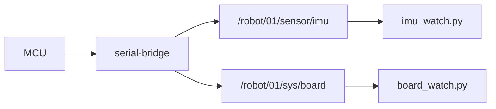

# HW-02 — Read sensors from the board

## Goal

Subscribe to live telemetry the MCU publishes (IMU and/or board status).

## This window forgets

`robotos` is not installed on the computer. The program is a file in `code/…/bin` inside the workshop folder. Lab `python` is the `.venv` in that same folder. A new Terminal, PowerShell, Cursor, or VS Code window starts blank and does not remember them.

Every command block on this page begins with the lines for your computer. Paste the **whole** block. If you open another window, paste the whole block again.

`YOUR_WORKSHOP_DIR` is the folder that contains `SETUP.md`, `code/`, and `labs/`. If `dir` or `ls` does not show those names, you are in the wrong folder. If activate says `.venv` does not exist, do the Python SDK check in [MW-00](../../mw/mw-00-getting-started/README.md) first, then come back and paste the block again.

On Windows, if `Activate.ps1` is blocked, run this once and then paste the lab block again:

```powershell
Set-ExecutionPolicy -Scope CurrentUser RemoteSigned
```

Use the Linux block only when `code/robotos-v0.3.0-linux-x64` is in your drop. This class drop is Windows and macOS.

## Learning outcomes

- Choose IMU vs board_watch based on **HW-01 caps**  
- Print live accel/gyro or battery/board fields  
- Confirm values change when you tilt the board (IMU)  

## Prerequisites

- HW-00 bridge up; HW-01 caps known (`IMU=0x04`, `BATT=0x10`, …)  
- Paste this page's command block (it sets PATH, `.venv`, and `ROBOTOS_CONNECT`)  
- Ebook: [`ch04-board-on-graph.md`](../../../docs/ebook/chapters/ch04-board-on-graph.md)

## Topics

| Topic | Typical use |
|-------|-------------|
| `/robot/01/sensor/imu` | `imu_watch.py` (needs IMU cap) |
| `/robot/01/sensor/battery` | `board_watch.py` |
| `/robot/01/sys/board` | `board_watch.py` |

## Architecture



## Practice

> **Preferred runner** (workshop root): this lab has multiple starters — `scripts\run.cmd hw-02 <starter>` (Windows) or `./scripts/run hw-02 <starter>` (macOS/Linux). Starters: `imu_watch / board_watch`. List: `scripts\run.cmd list`. Paste the whole block below, including the first lines. A new window needs the whole block again.


### IMU (needs IMU cap — often `ws28p`)

**Windows (PowerShell)**

```powershell
cd YOUR_WORKSHOP_DIR
$env:PATH = "$PWD\code\robotos-v0.3.0-windows-x64\bin;$env:PATH"
.\.venv\Scripts\Activate.ps1
python labs\hw\hw-02-read-sensors\starter\imu_watch.py 10
```

**macOS Apple Silicon (zsh or bash)**

```bash
cd YOUR_WORKSHOP_DIR
export PATH="$PWD/code/robotos-v0.3.0-macos-arm64/bin:$PATH"
source .venv/bin/activate
python labs/hw/hw-02-read-sensors/starter/imu_watch.py 10
```

**Linux (bash)**

```bash
cd YOUR_WORKSHOP_DIR
export PATH="$PWD/code/robotos-v0.3.0-linux-x64/bin:$PATH"
source .venv/bin/activate
python labs/hw/hw-02-read-sensors/starter/imu_watch.py 10
```


### Battery / Wi‑Fi / board info

**Windows (PowerShell)**

```powershell
cd YOUR_WORKSHOP_DIR
$env:PATH = "$PWD\code\robotos-v0.3.0-windows-x64\bin;$env:PATH"
.\.venv\Scripts\Activate.ps1
python labs\hw\hw-02-read-sensors\starter\board_watch.py 15
```

**macOS Apple Silicon (zsh or bash)**

```bash
cd YOUR_WORKSHOP_DIR
export PATH="$PWD/code/robotos-v0.3.0-macos-arm64/bin:$PATH"
source .venv/bin/activate
python labs/hw/hw-02-read-sensors/starter/board_watch.py 15
```

**Linux (bash)**

```bash
cd YOUR_WORKSHOP_DIR
export PATH="$PWD/code/robotos-v0.3.0-linux-x64/bin:$PATH"
source .venv/bin/activate
python labs/hw/hw-02-read-sensors/starter/board_watch.py 15
```


## Expected output (IMU)

```text
watching /robot/01/sensor/imu — Ctrl-C to stop (10s)
a=(+0.12,+0.05,+9.81) g=(+0.001,-0.002,+0.000)
```

Tilt the board — acceleration vector should move off “table flat.”

## Code notes (`imu_watch.py`)

- Optional duration argument (seconds); omit to run until Ctrl-C  
- `sub.recv(timeout_ms=2000)` with timeout message if quiet  
- Prints accel + gyro triples each sample  

## Troubleshooting

| Symptom | Fix |
|---------|-----|
| Timeouts forever | Caps lack IMU; bridge down; wrong `ROBOTOS_CONNECT` |
| Flat values never change | Stub board / wrong variant — check HW-01 `hw_model` |
| ImportError | `.venv` + wheel |

## Done when

You print changing sensor values while tilting (IMU) or see battery/board updates.

See [CHECKLIST.md](CHECKLIST.md).
