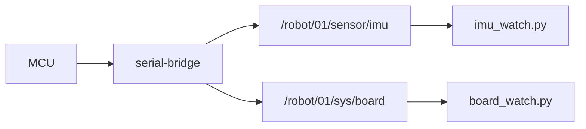

# HW-02 — Read sensors from the board

## Goal

Subscribe to live telemetry the MCU publishes (IMU and/or board status).

## Learning outcomes

- Choose IMU vs board_watch based on **HW-01 caps**  
- Print live accel/gyro or battery/board fields  
- Confirm values change when you tilt the board (IMU)  

## Prerequisites

- HW-00 bridge up; HW-01 caps known (`IMU=0x04`, `BATT=0x10`, …)  
- PATH + `.venv` + `ROBOTOS_CONNECT`  
- Ebook: [`ch04-board-on-graph.md`](../../../docs/ebook/chapters/ch04-board-on-graph.md)

## Topics

| Topic | Typical use |
|-------|-------------|
| `/robot/01/sensor/imu` | `imu_watch.py` (needs IMU cap) |
| `/robot/01/sensor/battery` | `board_watch.py` |
| `/robot/01/sys/board` | `board_watch.py` |

## Architecture



## Practice

### IMU (needs IMU cap — often `ws28p`)

**Windows (PowerShell)**

```powershell
python labs\hw\hw-02-read-sensors\starter\imu_watch.py 10
```

**Linux / macOS (bash)**

```bash
python labs/hw/hw-02-read-sensors/starter/imu_watch.py 10
```

### Battery / Wi‑Fi / board info

**Windows (PowerShell)**

```powershell
python labs\hw\hw-02-read-sensors\starter\board_watch.py 15
```

**Linux / macOS (bash)**

```bash
python labs/hw/hw-02-read-sensors/starter/board_watch.py 15
```

## Expected output (IMU)

```text
watching /robot/01/sensor/imu — Ctrl-C to stop (10s)
a=(+0.12,+0.05,+9.81) g=(+0.001,-0.002,+0.000)
```

Tilt the board — acceleration vector should move off “table flat.”

## Code notes (`imu_watch.py`)

- Optional duration argument (seconds); omit to run until Ctrl-C  
- `sub.recv(timeout_ms=2000)` with timeout message if quiet  
- Prints accel + gyro triples each sample  

## Troubleshooting

| Symptom | Fix |
|---------|-----|
| Timeouts forever | Caps lack IMU; bridge down; wrong `ROBOTOS_CONNECT` |
| Flat values never change | Stub board / wrong variant — check HW-01 `hw_model` |
| ImportError | `.venv` + wheel |

## Done when

You print changing sensor values while tilting (IMU) or see battery/board updates.

See [CHECKLIST.md](CHECKLIST.md).
