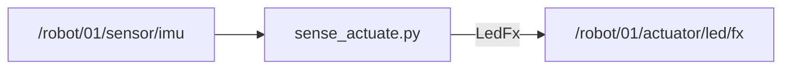

# HW-07 — Sense → actuate (closed loop on silicon)

## Goal

One host node: **read a sensor**, **command an actuator** (WH-03 pattern on hardware).

## This window forgets

`robotos` is not installed on the computer. The program is a file in `code/…/bin` inside the workshop folder. Lab `python` is the `.venv` in that same folder. A new Terminal, PowerShell, Cursor, or VS Code window starts blank and does not remember them.

Every command block on this page begins with the lines for your computer. Paste the **whole** block. If you open another window, paste the whole block again.

`YOUR_WORKSHOP_DIR` is the folder that contains `SETUP.md`, `code/`, and `labs/`. If `dir` or `ls` does not show those names, you are in the wrong folder. If activate says `.venv` does not exist, do the Python SDK check in [MW-00](../../mw/mw-00-getting-started/README.md) first, then come back and paste the block again.

On Windows, if `Activate.ps1` is blocked, run this once and then paste the lab block again:

```powershell
Set-ExecutionPolicy -Scope CurrentUser RemoteSigned
```

Use the Linux block only when `code/robotos-v0.3.0-linux-x64` is in your drop. This class drop is Windows and macOS.

## Learning outcomes

- Branch on HW-01 caps (IMU+LED vs IMU-only vs LED-only)  
- Close a loop: tilt → LED / console state  
- Zero/off on exit when commanding LEDs  

## Prerequisites

- HW-01/02/03 as needed for your caps  
- Ebook: [`ch05-feedback-control.md`](../../../docs/ebook/chapters/ch05-feedback-control.md) + [`ch04-board-on-graph.md`](../../../docs/ebook/chapters/ch04-board-on-graph.md)

## Spec (minimum)

- If board has **IMU + LED**: tilt threshold → LED solid; level → off.  
- If **IMU only**: print `TILT` / `LEVEL` (no LED).  
- If **LED only**: map battery % or a param into color (instructor pick).

## Architecture



## Run

> **Preferred runner** (workshop root): `scripts\run.cmd <lab-id>` (Windows) or `./scripts/run <lab-id>` (macOS/Linux). List: `scripts\run.cmd list`. Paste the whole block below, including the first lines. A new window needs the whole block again.


### Windows (PowerShell)

```powershell
cd YOUR_WORKSHOP_DIR
$env:PATH = "$PWD\code\robotos-v0.3.0-windows-x64\bin;$env:PATH"
.\.venv\Scripts\Activate.ps1
python labs\hw\hw-07-sense-actuate\starter\sense_actuate.py
```

### macOS Apple Silicon (zsh or bash)

```bash
cd YOUR_WORKSHOP_DIR
export PATH="$PWD/code/robotos-v0.3.0-macos-arm64/bin:$PATH"
source .venv/bin/activate
python labs/hw/hw-07-sense-actuate/starter/sense_actuate.py
```

### Linux (bash)

```bash
cd YOUR_WORKSHOP_DIR
export PATH="$PWD/code/robotos-v0.3.0-linux-x64/bin:$PATH"
source .venv/bin/activate
python labs/hw/hw-07-sense-actuate/starter/sense_actuate.py
```


Needs caps matching your branch (probe with HW-01 first). On `ws28p`, expect IMU path + LED publish may be a no-op (no LED cap) — console `TILT`/`LEVEL` still counts.

## Expected output

```text
tilt>25.0° → LED; level → off — Ctrl-C
TILT 138°
LEVEL 12°
```

## Troubleshooting

| Symptom | Fix |
|---------|-----|
| No prints | Bridge / IMU cap / `ROBOTOS_CONNECT` |
| LED dark with TILT | No LED cap — OK; use console branch |
| Forgot `--cmd-topic all` | Restart bridge with flag |

## Done when

Physical motion (or chosen input) changes an actuator or clear console state without Manual board UI.

See [CHECKLIST.md](CHECKLIST.md).
