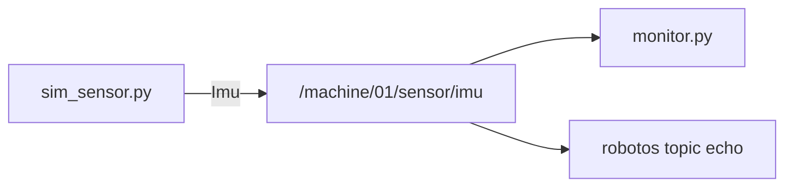
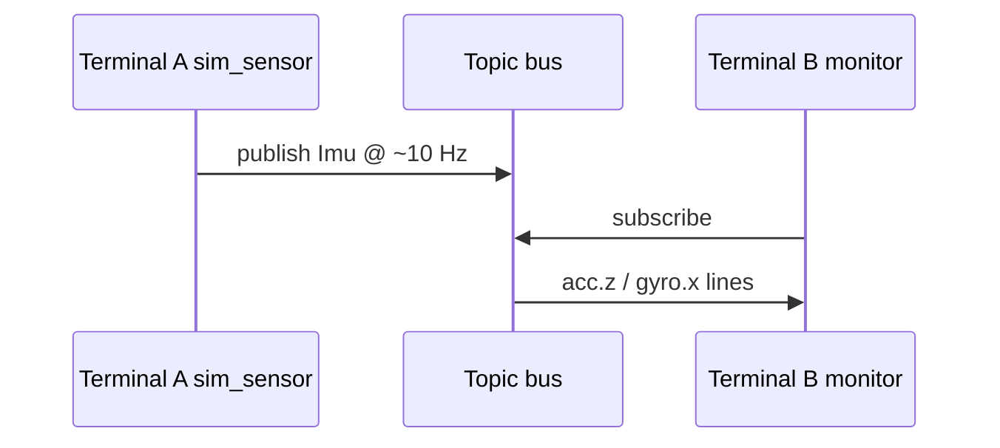

# MW-01 — Publish & subscribe

## Goal

Run a publisher and a subscriber on `/machine/01/sensor/imu` (`robotos.sensor.v1.Imu`) without the warehouse sim.

## Learning outcomes

- Start two processes that share one topic  
- Read live values with `monitor.py` and `robotos topic echo`  
- Confirm discovery with `topic list` (PUBS/SUBS counts)  

## Prerequisites

- MW-00 done  
- Ebook: [`ch01-graph-nodes-topics.md`](../../../docs/ebook/chapters/ch01-graph-nodes-topics.md)  
- Theory: [`docs/theory/07-messages-schema.md`](../../../docs/theory/07-messages-schema.md)

## Theory (short)

A **publisher** sends typed messages on a named **topic**. A **subscriber** receives them. Both must agree on the schema (`robotos.sensor.v1.Imu`). This lab does **not** need the warehouse sim.

## Architecture



## Sequence



## Practice — open two terminals

**Windows:** press `Win`, type `PowerShell`, Enter — that is terminal 1. Do it **again** for terminal 2 (a second window).  
**Linux/macOS:** open a second Terminal tab/window the same way you opened the first.

In **each** window, go to the workshop root (folder with `SETUP.md`), then PATH + venv:

### Both terminals — Windows (PowerShell)

```powershell
cd C:\robotos-workshop
# ↑ your unzip path
$env:PATH = "$PWD\code\robotos-v0.3.0-windows-x64\bin;$env:PATH"
.\.venv\Scripts\Activate.ps1
```

### Both terminals — Linux / macOS (bash)

```bash
cd ~/robotos-workshop
# ↑ your unzip path; use linux-x64 or macos-arm64 below
export PATH="$PWD/code/robotos-v0.3.0-linux-x64/bin:$PATH"
source .venv/bin/activate
```

### Terminal A — publisher (leave running)

**Windows (PowerShell)**

```powershell
python labs\mw\mw-01-pub-sub\starter\sim_sensor.py
```

**Linux / macOS (bash)**

```bash
python labs/mw/mw-01-pub-sub/starter/sim_sensor.py
```

You should see `publishing on /machine/01/sensor/imu`.  
It looks “stuck” — that is normal. Stop later with **Ctrl-C**.

### Terminal B — subscriber / CLI

**Windows (PowerShell)**

```powershell
robotos topic list
robotos topic echo /machine/01/sensor/imu --count 5
python labs\mw\mw-01-pub-sub\starter\monitor.py 5
```

**Linux / macOS (bash)**

```bash
robotos topic list
robotos topic echo /machine/01/sensor/imu --count 5
python labs/mw/mw-01-pub-sub/starter/monitor.py 5
```

(`monitor.py 5` exits after ~5 s. No argument → waits for Enter.)

## Code walkthrough

| File | Role |
|------|------|
| `sim_sensor.py` | Creates a node, publishes `Imu` in a loop (~10 Hz) |
| `monitor.py` | Subscribes with `on_message`, prints `acc.z` / `gyro.x` |

## Expected output

```text
# topic list includes:
/machine/01/sensor/imu    1    …    robotos.sensor.v1.Imu

# monitor:
subscribed — 5s
acc.z=9.81  gyro.x=+0.123
…
```

## Troubleshooting

| Symptom | Fix |
|---------|-----|
| `robotos` / `python` not found | PATH + activate `.venv` in **this** terminal |
| `labs\mw\...` path not found | `cd` to workshop root first (see both-terminals block) |
| Empty topic list | Terminal A not running — wait 1–2 s |
| Monitor empty after Ctrl-C on A | You stopped the publisher; start A again |
| Thought publisher “froze” | Infinite loop is normal — Ctrl-C to stop |
| Leftover HW env | Unset `ROBOTOS_LISTEN` in student terminals |

## Check yourself

1. Who publishes? Who subscribes?  
2. What schema must both sides share?  

## Glossary

| Term | Meaning |
|------|---------|
| Publisher | Node that sends on a topic |
| Subscriber | Node that receives on a topic |
| Imu | Sensor message (accel + gyro fields) |

## Done when

Monitor prints live values; `topic list` shows the pub/sub.

See [CHECKLIST.md](CHECKLIST.md).
