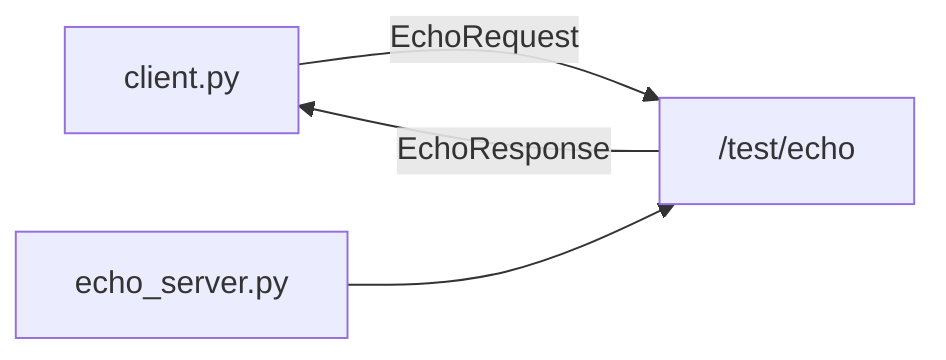

# MW-02 — Services

## Goal

Call a request/reply **service** (`/test/echo`) while a server is running.

## Learning outcomes

- Contrast topic streams vs service RPC  
- Start server + client in two terminals  
- See retry-on-unavailable while the server starts  

## Prerequisites

- MW-01; PATH + `.venv` in **both** terminals  
- Ebook: [`ch06-services.md`](../../../docs/ebook/chapters/ch06-services.md)  
- Theory: [`docs/theory/08-services.md`](../../../docs/theory/08-services.md)

## Architecture



## Practice

> **Preferred runner** (workshop root): this lab has multiple starters — `scripts\run.cmd mw-02 <starter>` (Windows) or `./scripts/run mw-02 <starter>` (macOS/Linux). Starters: `echo_server / client`. List: `scripts\run.cmd list`. The `python labs/...` lines below still work.


### Terminal A — server

**Windows (PowerShell)**

```powershell
python labs\mw\mw-02-services\starter\echo_server.py
```

**Linux / macOS (bash)**

```bash
python labs/mw/mw-02-services/starter/echo_server.py
```

### Terminal B — client

**Windows (PowerShell)**

```powershell
python labs\mw\mw-02-services\starter\client.py
robotos service list
```

**Linux / macOS (bash)**

```bash
python labs/mw/mw-02-services/starter/client.py
robotos service list
```

Optional: `robotos service call` (CLI help). Client retries while the server starts — expected.

## Expected output

```text
# A
serving /test/echo — Ctrl-C to stop
request: 'hello robotos' (seq 1)

# B
reply: 'hello robotos' (seq 1)
```

## Troubleshooting

| Symptom | Fix |
|---------|-----|
| `no responder` | Start A first; same workshop root / env |
| ImportError `echo_pb2` | Reinstall pack wheel into `.venv` |
| command not found | PATH + activate `.venv` |

## Done when

Client prints the echoed reply.

See [CHECKLIST.md](CHECKLIST.md).
