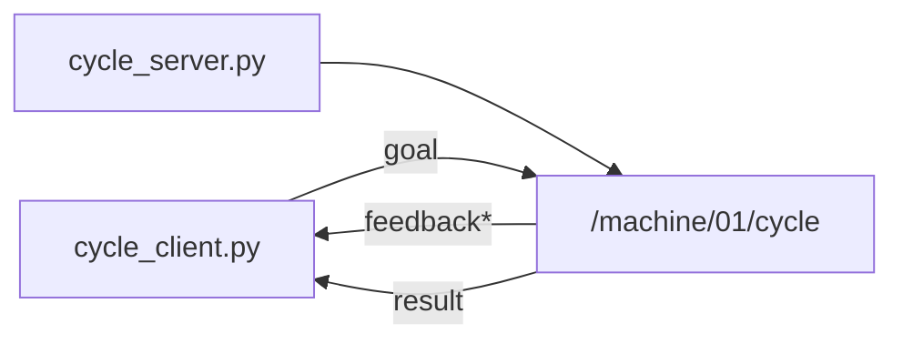

# MW-03 — Actions

## Goal

Run a long-running **action** (`/machine/01/cycle`) with feedback, then a result.

## This window forgets

`robotos` is not installed on the computer. The program is a file in `code/…/bin` inside the workshop folder. Lab `python` is the `.venv` in that same folder. A new Terminal, PowerShell, Cursor, or VS Code window starts blank and does not remember them.

Every command block on this page begins with the lines for your computer. Paste the **whole** block. If you open another window, paste the whole block again.

`YOUR_WORKSHOP_DIR` is the folder that contains `SETUP.md`, `code/`, and `labs/`. If `dir` or `ls` does not show those names, you are in the wrong folder. If activate says `.venv` does not exist, do the Python SDK check in [MW-00](../../mw/mw-00-getting-started/README.md) first, then come back and paste the block again.

On Windows, if `Activate.ps1` is blocked, run this once and then paste the lab block again:

```powershell
Set-ExecutionPolicy -Scope CurrentUser RemoteSigned
```

Use the Linux block only when `code/robotos-v0.3.0-linux-x64` is in your drop. This class drop is Windows and macOS.

## Learning outcomes

- Start action server + client  
- Read multiple feedback lines before the final result  
- Contrast with MW-02 services  

## Prerequisites

- MW-02; paste this page's command block in **both** windows  
- Ebook: [`ch07-actions.md`](../../../docs/ebook/chapters/ch07-actions.md)  
- Theory: [`docs/theory/09-actions.md`](../../../docs/theory/09-actions.md)

## Architecture



## Practice

> **Preferred runner** (workshop root): this lab has multiple starters — `scripts\run.cmd mw-03 <starter>` (Windows) or `./scripts/run mw-03 <starter>` (macOS/Linux). Starters: `cycle_server / cycle_client`. List: `scripts\run.cmd list`. Paste the whole block below, including the first lines. A new window needs the whole block again.


### Terminal A — server

**Windows (PowerShell)**

```powershell
cd YOUR_WORKSHOP_DIR
$env:PATH = "$PWD\code\robotos-v0.3.0-windows-x64\bin;$env:PATH"
.\.venv\Scripts\Activate.ps1
python labs\mw\mw-03-actions\starter\cycle_server.py
```

**macOS Apple Silicon (zsh or bash)**

```bash
cd YOUR_WORKSHOP_DIR
export PATH="$PWD/code/robotos-v0.3.0-macos-arm64/bin:$PATH"
source .venv/bin/activate
python labs/mw/mw-03-actions/starter/cycle_server.py
```

**Linux (bash)**

```bash
cd YOUR_WORKSHOP_DIR
export PATH="$PWD/code/robotos-v0.3.0-linux-x64/bin:$PATH"
source .venv/bin/activate
python labs/mw/mw-03-actions/starter/cycle_server.py
```


### Terminal B — client

**Windows (PowerShell)**

```powershell
cd YOUR_WORKSHOP_DIR
$env:PATH = "$PWD\code\robotos-v0.3.0-windows-x64\bin;$env:PATH"
.\.venv\Scripts\Activate.ps1
python labs\mw\mw-03-actions\starter\cycle_client.py
```

**macOS Apple Silicon (zsh or bash)**

```bash
cd YOUR_WORKSHOP_DIR
export PATH="$PWD/code/robotos-v0.3.0-macos-arm64/bin:$PATH"
source .venv/bin/activate
python labs/mw/mw-03-actions/starter/cycle_client.py
```

**Linux (bash)**

```bash
cd YOUR_WORKSHOP_DIR
export PATH="$PWD/code/robotos-v0.3.0-linux-x64/bin:$PATH"
source .venv/bin/activate
python labs/mw/mw-03-actions/starter/cycle_client.py
```


Stretch: cancel mid-cycle from a second client / CLI if the pack supports it.

## Expected output

Feedback `step i/5`, then a final `cycle complete` (or `aborted` if cancelled).

## Troubleshooting

| Symptom | Fix |
|---------|-----|
| No progress | Server not up; same mesh as client |
| Import errors | Pack wheel / `.venv` |

## Done when

You see multiple feedback lines and a final result.

See [CHECKLIST.md](CHECKLIST.md).
