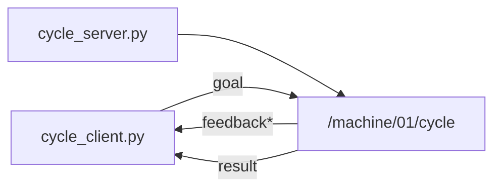

# MW-03 — Actions

## Goal

Run a long-running **action** (`/machine/01/cycle`) with feedback, then a result.

## Learning outcomes

- Start action server + client  
- Read multiple feedback lines before the final result  
- Contrast with MW-02 services  

## Prerequisites

- MW-02; PATH + `.venv` in both terminals  
- Ebook: [`ch07-actions.md`](../../../docs/ebook/chapters/ch07-actions.md)  
- Theory: [`docs/theory/09-actions.md`](../../../docs/theory/09-actions.md)

## Architecture



## Practice

### Terminal A — server

**Windows (PowerShell)**

```powershell
python labs\mw\mw-03-actions\starter\cycle_server.py
```

**Linux / macOS (bash)**

```bash
python labs/mw/mw-03-actions/starter/cycle_server.py
```

### Terminal B — client

**Windows (PowerShell)**

```powershell
python labs\mw\mw-03-actions\starter\cycle_client.py
```

**Linux / macOS (bash)**

```bash
python labs/mw/mw-03-actions/starter/cycle_client.py
```

Stretch: cancel mid-cycle from a second client / CLI if the pack supports it.

## Expected output

Feedback `step i/5`, then a final `cycle complete` (or `aborted` if cancelled).

## Troubleshooting

| Symptom | Fix |
|---------|-----|
| No progress | Server not up; same mesh as client |
| Import errors | Pack wheel / `.venv` |

## Done when

You see multiple feedback lines and a final result.

See [CHECKLIST.md](CHECKLIST.md).
