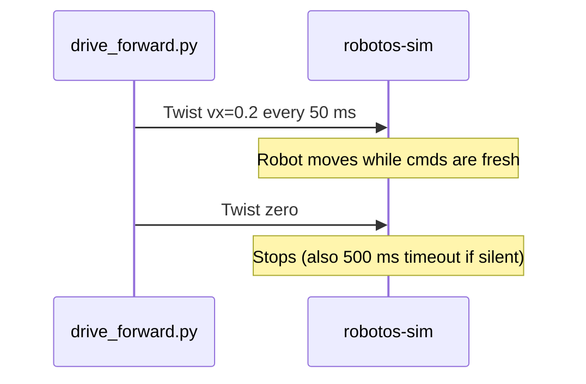

# Lab WH-01 — Drive by Twist

## Goal

Move the warehouse robot by publishing `/robot/01/cmd_vel` (`robotos.geometry.v1.Twist`).

## This window forgets

`robotos` is not installed on the computer. The program is a file in `code/…/bin` inside the workshop folder. Lab `python` is the `.venv` in that same folder. A new Terminal, PowerShell, Cursor, or VS Code window starts blank and does not remember them.

Every command block on this page begins with the lines for your computer. Paste the **whole** block. If you open another window, paste the whole block again.

`YOUR_WORKSHOP_DIR` is the folder that contains `SETUP.md`, `code/`, and `labs/`. If `dir` or `ls` does not show those names, you are in the wrong folder. If activate says `.venv` does not exist, do the Python SDK check in [MW-00](../../mw/mw-00-getting-started/README.md) first, then come back and paste the block again.

On Windows, if `Activate.ps1` is blocked, run this once and then paste the lab block again:

```powershell
Set-ExecutionPolicy -Scope CurrentUser RemoteSigned
```

Use the Linux block only when `code/robotos-v0.3.0-linux-x64` is in your drop. This class drop is Windows and macOS.

## Learning outcomes

- Publish Twist at a steady rate from Python  
- Use CLI flags (`--vx` / `--wz` / `--seconds`) without editing the file  
- Explain why External mode + continuous publish (and a final zero) matter  

## Prerequisites

- [`SETUP.md`](../../../SETUP.md) (paste this page's command block in **this** window (it sets PATH and `.venv`))  
- Lab WH-00; sim **External** + **Native** + **Connect**  
- Ebook: [`ch02-twist-control.md`](../../../docs/ebook/chapters/ch02-twist-control.md)  
- Short notes: [`docs/theory/02-twist-control.md`](../../../docs/theory/02-twist-control.md)

## Architecture


## Sequence



## Run

> **Preferred runner** (workshop root): `scripts\run.cmd <lab-id>` (Windows) or `./scripts/run <lab-id>` (macOS/Linux). List: `scripts\run.cmd list`. Paste the whole block below, including the first lines. A new window needs the whole block again.


Stay in the **workshop root** (the folder that contains `SETUP.md` and `labs\`).  
Do **not** `cd` into `starter\` for these commands.

### Windows (PowerShell)

```powershell
cd YOUR_WORKSHOP_DIR
$env:PATH = "$PWD\code\robotos-v0.3.0-windows-x64\bin;$env:PATH"
.\.venv\Scripts\Activate.ps1
python labs\wh\wh-01-drive-twist\starter\drive_forward.py
python labs\wh\wh-01-drive-twist\starter\drive_forward.py --wz 0.5 --vx 0 --seconds 2
```

### macOS Apple Silicon (zsh or bash)

```bash
cd YOUR_WORKSHOP_DIR
export PATH="$PWD/code/robotos-v0.3.0-macos-arm64/bin:$PATH"
source .venv/bin/activate
python labs/wh/wh-01-drive-twist/starter/drive_forward.py
python labs/wh/wh-01-drive-twist/starter/drive_forward.py --wz 0.5 --vx 0 --seconds 2
```

### Linux (bash)

```bash
cd YOUR_WORKSHOP_DIR
export PATH="$PWD/code/robotos-v0.3.0-linux-x64/bin:$PATH"
source .venv/bin/activate
python labs/wh/wh-01-drive-twist/starter/drive_forward.py
python labs/wh/wh-01-drive-twist/starter/drive_forward.py --wz 0.5 --vx 0 --seconds 2
```


Optional advanced CLI hex (skip if new to terminals): [starter/README.md](starter/README.md).

## Expected output

```text
robotos 0.3.0 — pub Twist vx=0.2 wz=0.0 for ~5.0s @ 20.0 Hz
done — 100 cmds + zero
```

Watch the sim: robot should move ~1 m forward, then stop.

## Code walkthrough (`drive_forward.py`)

**Ignore the short block at the top** that looks for `SETUP.md` — it only helps
Python find this workshop folder. **Do not edit it. Do not open `labs\common\`.**
Your job is the publish loop and the CLI flags below.

| Piece | Why |
|-------|-----|
| Top block (finds `SETUP.md`) | **Ignore / do not edit** — run from workshop root |
| `Twist` schema + `TOPIC` | Typed contract — not free-form JSON |
| `settle` / `make_twist` / `zero_twist` | Shared helpers — brief wait / build Twist; **leave them alone** |
| Loop @ 20 Hz | **Stays in this file** — commands must keep arriving |
| Final `zero_twist()` | Explicit stop (good habit even with timeout) |
| `--vx` / `--wz` / `--seconds` | Change motion without editing source |

## Tasks

1. Default run: `linear.x = 0.2` for ~5 s.  
2. Observe ~1 m forward (odom / viewport).  
3. Confirm stop within ~0.5 s after the script ends.  
4. Yaw: `--wz 0.5 --vx 0 --seconds 2`.

## Troubleshooting

| Symptom | Fix |
|---------|-----|
| `python` / `robotos` not found | Paste this page's command block again in **this** window |
| Script OK, robot still | UI still **Manual** → set **External**; confirm Connected |
| Moves then freezes mid-run | Another window stole focus / you stopped publishing |
| `ImportError` … `geometry_pb2` | Reinstall the pack wheel into `.venv` |
| Paths not found | You must be in workshop root (`dir` should show `labs` and `SETUP.md`) |
| `ModuleNotFoundError: labs` | Workshop tree missing / wrong folder — need `SETUP.md` beside `labs/` |

## Check yourself

1. Why publish many times instead of once?  
2. Why External, not Manual, for this lab?  

## Glossary

| Term | Meaning |
|------|---------|
| Twist | Velocity command (`linear.x`, `angular.z`) |
| External | Sim accepts graph `cmd_vel` |
| Timeout | ~500 ms without a fresh Twist → stop |

## Done when

You can start/stop motion from code without using Manual keyboard.

See [CHECKLIST.md](CHECKLIST.md).
