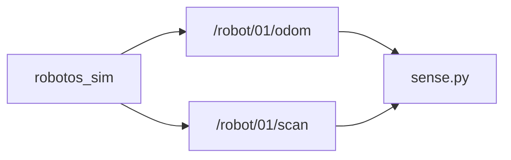

# Lab WH-02 — Sense odom + scan

## Goal

Subscribe to pose and the three rangers while the robot moves.

## Learning outcomes

- Print `x`, `y`, yaw from odometry at ~5 Hz  
- Print right / front / left ranges and watch front drop near a wall  
- Relate cmd → motion → sensor updates  

## Prerequisites

- WH-00 / WH-01; sim **Native** + **Connected** (External if driving from a script)  
- Ebook: [`ch03-odometry-scan.md`](../../../docs/ebook/chapters/ch03-odometry-scan.md)  
- Theory notes: [`docs/theory/03-odometry-scan.md`](../../../docs/theory/03-odometry-scan.md)

## Topics

| Topic | Schema |
|-------|--------|
| `/robot/01/odom` | `robotos.nav.v1.Odometry` |
| `/robot/01/scan` | `robotos.sensor.v1.LaserScan` |

Laser: `ranges[0]=right`, `[1]=front`, `[2]=left`.

## Architecture



## Run

Workshop root; PATH + `.venv` active. Open a **second** terminal to drive (WH-01) or use Manual briefly.

### Windows (PowerShell)

```powershell
python labs\wh\wh-02-sense-odom-scan\starter\sense.py
```

### Linux / macOS (bash)

```bash
python labs/wh/wh-02-sense-odom-scan/starter/sense.py
```

## Expected output

```text
listening odom+scan — Ctrl-C to stop
x=0.00 y=0.00 yaw=0.00  R=2.50 F=2.50 L=2.50
x=0.35 y=0.00 yaw=0.00  R=2.50 F=1.90 L=2.50
```

## Tasks

1. Confirm pose fields update while moving.  
2. Drive toward a wall; watch `F=` (`ranges[1]`) drop.  
3. Optional: sketch cmd → motion → odom/scan (see chapter sequence diagram).

## Troubleshooting

| Symptom | Fix |
|---------|-----|
| `odom=?` / `scan=?` | Sim Connected; `topic list` shows pubs |
| Numbers never change | Drive with WH-01 or Manual |
| `robotos` / import errors | SETUP PATH + wheel |

## Done when

Your script shows live numbers that match the viewport.

See [CHECKLIST.md](CHECKLIST.md).
