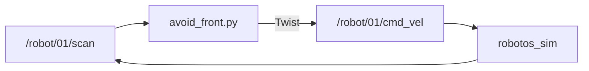

# Lab WH-03 — Avoid front (bang-bang)

## Goal

Closed loop: use front range to stop or turn before hitting a wall.

## This window forgets

`robotos` is not installed on the computer. The program is a file in `code/…/bin` inside the workshop folder. Lab `python` is the `.venv` in that same folder. A new Terminal, PowerShell, Cursor, or VS Code window starts blank and does not remember them.

Every command block on this page begins with the lines for your computer. Paste the **whole** block. If you open another window, paste the whole block again.

`YOUR_WORKSHOP_DIR` is the folder that contains `SETUP.md`, `code/`, and `labs/`. If `dir` or `ls` does not show those names, you are in the wrong folder. If activate says `.venv` does not exist, do the Python SDK check in [MW-00](../../mw/mw-00-getting-started/README.md) first, then come back and paste the block again.

On Windows, if `Activate.ps1` is blocked, run this once and then paste the lab block again:

```powershell
Set-ExecutionPolicy -Scope CurrentUser RemoteSigned
```

Use the Linux block only when `code/robotos-v0.3.0-linux-x64` is in your drop. This class drop is Windows and macOS.

## Learning outcomes

- Publish `cmd_vel` from live `scan` data  
- Implement a threshold (bang-bang) on `ranges[1]`  
- Keep a ≥2 Hz (starter: 20 Hz) loop so the 500 ms timeout never starves  

## Prerequisites

- WH-02; sim External + Native + Connect  
- Ebook: [`ch05-feedback-control.md`](../../../docs/ebook/chapters/ch05-feedback-control.md)  
- Theory: [`docs/theory/04-feedback-control.md`](../../../docs/theory/04-feedback-control.md)

## Architecture



## Run

> **Preferred runner** (workshop root): `scripts\run.cmd <lab-id>` (Windows) or `./scripts/run <lab-id>` (macOS/Linux). List: `scripts\run.cmd list`. Paste the whole block below, including the first lines. A new window needs the whole block again.


Paste this page's command block in this window.

### Windows (PowerShell)

```powershell
cd YOUR_WORKSHOP_DIR
$env:PATH = "$PWD\code\robotos-v0.3.0-windows-x64\bin;$env:PATH"
.\.venv\Scripts\Activate.ps1
python labs\wh\wh-03-avoid-front\starter\avoid_front.py
python labs\wh\wh-03-avoid-front\starter\avoid_front.py --threshold 0.6
```

### macOS Apple Silicon (zsh or bash)

```bash
cd YOUR_WORKSHOP_DIR
export PATH="$PWD/code/robotos-v0.3.0-macos-arm64/bin:$PATH"
source .venv/bin/activate
python labs/wh/wh-03-avoid-front/starter/avoid_front.py
python labs/wh/wh-03-avoid-front/starter/avoid_front.py --threshold 0.6
```

### Linux (bash)

```bash
cd YOUR_WORKSHOP_DIR
export PATH="$PWD/code/robotos-v0.3.0-linux-x64/bin:$PATH"
source .venv/bin/activate
python labs/wh/wh-03-avoid-front/starter/avoid_front.py
python labs/wh/wh-03-avoid-front/starter/avoid_front.py --threshold 0.6
```


Starter turns toward the more open side when blocked.

## Spec (minimum)

- If front range `< 0.6` m → spin in place (`angular.z` only).  
- Else → creep forward (`linear.x` small positive).  
- Loop publish so the **500 ms** timeout never starves the robot.

## Code notes

- `LatestScan` / `make_twist` / `settle` from `labs.common` — bang-bang **control law stays in this starter**  
- Path walk for `SETUP.md` before `labs.common` imports (do not edit)

## Expected behavior

Creeps in open space; near shelves spins instead of tunneling. Leave running ≥30 s.

## Troubleshooting

| Symptom | Fix |
|---------|-----|
| Collides | Lower speed / raise threshold; confirm External |
| Spins in empty space | Wait for real scan (not stale `inf`) |
| Stops every ~0.5 s | Publish rate too low |
| `ModuleNotFoundError: labs` | Need workshop tree with `SETUP.md` + `labs/` |

## Done when

Script runs ≥30 s without tunneling into shelves.

See [CHECKLIST.md](CHECKLIST.md).
