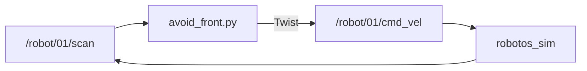

# Lab WH-03 — Avoid front (bang-bang)

## Goal

Closed loop: use front range to stop or turn before hitting a wall.

## Learning outcomes

- Publish `cmd_vel` from live `scan` data  
- Implement a threshold (bang-bang) on `ranges[1]`  
- Keep a ≥2 Hz (starter: 20 Hz) loop so the 500 ms timeout never starves  

## Prerequisites

- WH-02; sim External + Native + Connect  
- Ebook: [`ch05-feedback-control.md`](../../../docs/ebook/chapters/ch05-feedback-control.md)  
- Theory: [`docs/theory/04-feedback-control.md`](../../../docs/theory/04-feedback-control.md)

## Architecture



## Run

Workshop root; PATH + `.venv`.

### Windows (PowerShell)

```powershell
python labs\wh\wh-03-avoid-front\starter\avoid_front.py
python labs\wh\wh-03-avoid-front\starter\avoid_front.py --threshold 0.6
```

### Linux / macOS (bash)

```bash
python labs/wh/wh-03-avoid-front/starter/avoid_front.py
python labs/wh/wh-03-avoid-front/starter/avoid_front.py --threshold 0.6
```

Starter turns toward the more open side when blocked.

## Spec (minimum)

- If front range `< 0.6` m → spin in place (`angular.z` only).  
- Else → creep forward (`linear.x` small positive).  
- Loop publish so the **500 ms** timeout never starves the robot.

## Code notes

- `LatestScan` / `make_twist` / `settle` from `labs.common` — bang-bang **control law stays in this starter**  
- Path walk for `SETUP.md` before `labs.common` imports (do not edit)

## Expected behavior

Creeps in open space; near shelves spins instead of tunneling. Leave running ≥30 s.

## Troubleshooting

| Symptom | Fix |
|---------|-----|
| Collides | Lower speed / raise threshold; confirm External |
| Spins in empty space | Wait for real scan (not stale `inf`) |
| Stops every ~0.5 s | Publish rate too low |
| `ModuleNotFoundError: labs` | Need workshop tree with `SETUP.md` + `labs/` |

## Done when

Script runs ≥30 s without tunneling into shelves.

See [CHECKLIST.md](CHECKLIST.md).
