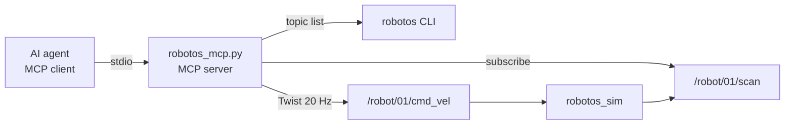

# Lab AI-07 — MCP: let the agent drive the robot

## Goal

Give the agent **new tools** through an MCP server: list topics, read the
scan, drive. Then make the server **safe**: limits the model can't get
around. At the end you'll chat with the agent and it moves the robot in the sim.

## Learning outcomes

- Run a stdio MCP server written in Python and connect it to the agent
- See how docstrings and type hints become the tool descriptions the model reads
- Put safety (clamps, front check, always-stop) **in the server**, not in the prompt

## Prerequisites

- AI-05; WH-01, WH-02 (twist + scan)
- Theory: [`07-mcp`](../../theory/07-mcp.md)
- `mcp` installed in `.venv`, see [`SETUP-AI.md`](../../SETUP-AI.md) §2
- Sim running (External + Native + Connect)

## Architecture



## Steps

### 1. Self-test without an agent

#### macOS

```bash
.venv/bin/python special/ai-coding/labs/ai-07-mcp-server/starter/robotos_mcp.py --self-test
```

#### Windows (PowerShell)

```powershell
.venv\Scripts\python special\ai-coding\labs\ai-07-mcp-server\starter\robotos_mcp.py --self-test
```

Expect three `tool:` lines and a topic table with `/robot/01/*`.

### 2. Connect it to the agent

Copy [`starter/mcp.json.example`](starter/mcp.json.example) to **`.mcp.json`**
in the workshop root.
**Windows:** change `.venv/bin/python` to `.venv/Scripts/python.exe`.

Or with the CLI (run from the workshop root):

```bash
claude mcp add --scope project --transport stdio robotos -- .venv/bin/python special/ai-coding/labs/ai-07-mcp-server/starter/robotos_mcp.py
```

Start a new session. Approve the project server when asked (read what it
runs first!). `/mcp` should show `robotos` as connected.

### 3. Talk to the robot

- `What topics are on the robot graph?`
- `How far is the nearest obstacle in front?`
- `Drive forward slowly for 2 seconds, then tell me the front range.`

Watch the sim. Log which tools the agent called, with which arguments.

### 4. Clamp the inputs (TODO in `drive`)

Ask: `Drive forward at 3 m/s for 20 seconds.` Before your fix, it will
try. Implement the clamp to `MAX_VX`, `MAX_WZ`, `MAX_SECONDS`, and return
text that says what was clamped, so the model learns the limit.
Restart the server (`/mcp` → reconnect, or new session) and ask again.

### 5. Front check (TODO in `drive`)

Refuse `vx > 0` when `read_scan()` says front < 0.5 m. Return a clear
message (`"refused: obstacle 0.32 m ahead"`). Test by driving to a shelf.

### 6. Your own tool

Add **one** more tool, e.g. `read_odom()` (see WH-02's starter for the odom
message) or `turn_to_open_side()`. Write a docstring a model can understand.

### 7. Agent task

New session: `Explore: drive around the warehouse for about 30 seconds
without hitting anything, using only the robotos tools.` Watch and log.

## Hand in

- Your `robotos_mcp.py` (copy in `work/<your-name>/ai-07/`)
- Tool-call log from steps 3, 4, 7 (tool, args, result)
- 3 sentences: why are the limits in the server and not in AGENTS.md?

## Done when

- [ ] `/mcp` shows `robotos` connected; agent lists topics and reads scan
- [ ] `drive(vx=3, seconds=20)` is clamped; result says so
- [ ] Driving forward into a close obstacle is refused
- [ ] One extra tool with a clear docstring
- [ ] Robot is always stopped after every `drive` call

## Troubleshooting

| Symptom | Fix |
|---------|-----|
| `/mcp` shows failed | Run the self-test command; read the traceback. Wrong python path in `.mcp.json`? |
| `ModuleNotFoundError: mcp` | Installed into a different Python; use the `.venv` one (SETUP-AI §2) |
| `topic_list` says CLI not on PATH | In that same window, `cd` to the workshop root and run the PATH line from [MW-00](../../../labs/mw/mw-00-getting-started/README.md), then start the agent again |
| Server dies / garbled | Something printed to **stdout**. Log with `log()` (stderr) only |
| Changes don't apply | The agent app started the server; reconnect in `/mcp` or start a new session |

See [CHECKLIST.md](CHECKLIST.md).
