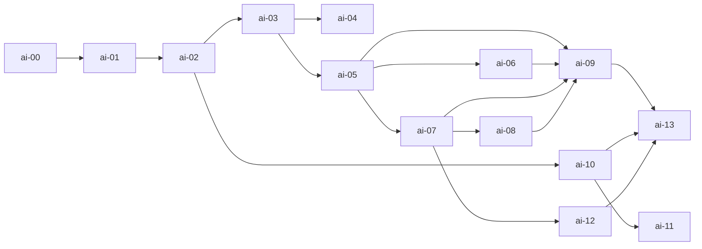

# AI Coding Assistance — content map (theory + practice)

Same rule as the main [`docs/lab-outline.md`](../../docs/lab-outline.md):
every concept has a **theory card** and a **practice lab**. Timing is left
to the instructor. Rough split: **~25% theory, ~75% practice**.

---

## Part A — Foundations

| Concept | Theory | Practice lab |
|---------|--------|--------------|
| Tokens, context window, invented answers, non-determinism | [`theory/00-how-llms-work.md`](theory/00-how-llms-work.md) | [`ai-00`](labs/ai-00-how-llms-work/) |
| Autocomplete vs. chat vs. agent; tools, loop, permissions | [`theory/01-tool-landscape.md`](theory/01-tool-landscape.md) | [`ai-01`](labs/ai-01-tool-landscape/) |
| Prompt as a spec: goal, constraints, done-when, plan first | [`theory/02-prompt-specs.md`](theory/02-prompt-specs.md) | [`ai-02`](labs/ai-02-prompt-specs/) |

## Part B — Context engineering

| Concept | Theory | Practice lab |
|---------|--------|--------------|
| Project memory: `AGENTS.md`, `CLAUDE.md`, `CLAUDE.local.md`, nesting, `@imports` | [`theory/03-agents-md.md`](theory/03-agents-md.md) | [`ai-03`](labs/ai-03-agents-md/) |
| Scoped rules: `.claude/rules/`, `.cursor/rules/*.mdc`, `.github/instructions/` | [`theory/04-scoped-rules.md`](theory/04-scoped-rules.md) | [`ai-04`](labs/ai-04-scoped-rules/) |
| Skills: `SKILL.md`, progressive disclosure, descriptions that trigger | [`theory/05-skills.md`](theory/05-skills.md) | [`ai-05`](labs/ai-05-skills/) |
| Subagents: `.claude/agents/*.md`, own context, fewer tools | [`theory/06-subagents.md`](theory/06-subagents.md) | [`ai-06`](labs/ai-06-subagents/) |

## Part C — Extending the agent

| Concept | Theory | Practice lab |
|---------|--------|--------------|
| MCP: client/server, tools/resources/prompts, stdio vs. HTTP, `.mcp.json` | [`theory/07-mcp.md`](theory/07-mcp.md) | [`ai-07`](labs/ai-07-mcp-server/) |
| Hooks, slash commands, permission allow/deny lists | [`theory/08-hooks-permissions.md`](theory/08-hooks-permissions.md) | [`ai-08`](labs/ai-08-hooks-permissions/) |
| Plugins & sharing: bundle, marketplace, what to commit | [`theory/09-plugins.md`](theory/09-plugins.md) | [`ai-09`](labs/ai-09-plugins/) |

## Part D — Working well & safely

| Concept | Theory | Practice lab |
|---------|--------|--------------|
| Verify: diffs, tests, sim, bags as proof | [`theory/10-verify-evidence.md`](theory/10-verify-evidence.md) | [`ai-10`](labs/ai-10-verify-evidence/) |
| Debugging with logs; refactoring in small, tested steps | [`theory/11-debug-refactor.md`](theory/11-debug-refactor.md) | [`ai-11`](labs/ai-11-debug-refactor/) |
| Prompt injection, secrets, invented packages, untrusted skills/MCP, integrity | [`theory/12-security-ethics.md`](theory/12-security-ethics.md) | [`ai-12`](labs/ai-12-security/) |
| Full workflow: plan → small steps → verify → review | [`theory/13-capstone-workflow.md`](theory/13-capstone-workflow.md) | [`ai-13`](labs/ai-13-capstone/) |

---

## Dependencies

## Main-track labs reused

| AI lab | Reuses |
|--------|--------|
| ai-01 | WH-01 drive twist |
| ai-02 | WH-03 avoid front |
| ai-04 | HW folder (rule scope only; no board needed) |
| ai-07 | WH-02 sensing, WH-01 driving |
| ai-10 | WH-05 wall follow + WH-07 bag |
| ai-11 | WH-03 (planted bugs), `labs/common/` |
